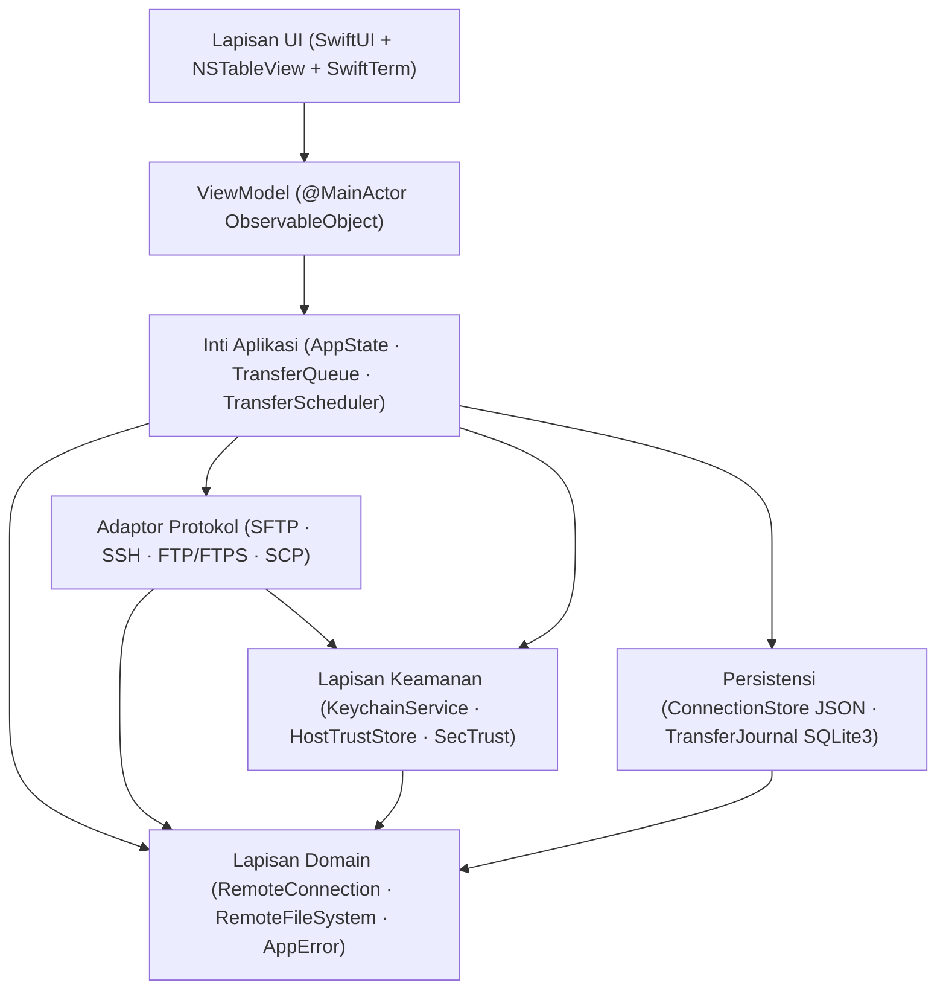

<p align="center">
  
</p>

<h1 align="center">SparkleSFTP</h1>

<p align="center">
  <b>Klien SFTP, FTP/FTPS, SCP &amp; SSH Commander Dual-Pane Native macOS — Dibangun dengan Swift 6 &amp; SwiftUI</b><br>
  <i>Manajemen berkas berkinerja tinggi, keamanan Keychain + Touch ID, terminal PTY SwiftTerm terintegrasi, dan transfer atomik tahan crash tanpa beban Electron</i>
</p>

<p align="center">
  <a href="README.md"><b>English</b></a> &nbsp;|&nbsp; <b>Bahasa Indonesia</b>
</p>

<p align="center">
  <a href="docs/ROADMAP.md"></a>
  <a href="https://apple.com/macos"></a>
  <a href="https://developer.apple.com/swift/"></a>
  <a href="https://developer.apple.com/xcode/swiftui/"></a>
  <a href="LICENSE"></a>
  <a href="https://github.com/alsyundawy/SparkleSFTP/actions"></a>
</p>

> Pengembang Utama & Pemelihara:<br>
> **[`HARRY DERTIN SUTISNA ALSYUNDAWY (@alsyundawy)`](https://github.com/alsyundawy)** — [`ALSYUNDAWY IT SOLUTION`](https://alsyundawy.com)<br>
>
> 📋 **[`Rencana Implementasi`](docs/IMPLEMENTATION_PLAN.md)** &nbsp;|&nbsp;
> 🔍 **[`Review Kode 14 Pilar`](docs/CODE_REVIEW_14_PILLARS.md)** &nbsp;|&nbsp;
> 📐 **[`Arsitektur`](docs/ARCHITECTURE.md)** &nbsp;|&nbsp;
> 🗺️ **[`Roadmap & Release Gate`](docs/ROADMAP.md)** &nbsp;|&nbsp;
> 🔐 **[`Kebijakan Keamanan`](SECURITY.md)** &nbsp;|&nbsp;
> 📜 **[`Changelog`](CHANGELOG.md)** &nbsp;|&nbsp;
> 🤝 **[`Panduan Kontribusi`](CONTRIBUTING.md)** &nbsp;|&nbsp;
> 💖 **[`Dukungan via PayPal`](https://www.paypal.me/alsyundawy)**

---

> [!IMPORTANT]
>
> ### Status Repositori: Full MVP Terealisasi (Swift 6 + macOS 13+)
>
> Seluruh modul SwiftPM (`Package.swift`, `src/App/`, `src/Packages/*`, `src/Features/`, `Tests/*`, `Tools/*`) telah diimplementasikan dan diverifikasi dengan `swift build` serta `swift test`. Lihat [`docs/TECHNICAL_SPECIFICATION.md`](docs/TECHNICAL_SPECIFICATION.md), [`DOCNOTE.md`](DOCNOTE.md), [`TODO.md`](TODO.md), dan [`docs/IMPLEMENTATION_PLAN.md`](docs/IMPLEMENTATION_PLAN.md).
>
> **Asal-Usul Proyek:** Awalnya dirancang dengan nama kerja `MacSFTP` dan distandardisasi menjadi **SparkleSFTP** dengan seluruh 55 temuan dari [`docs/CODE_REVIEW_14_PILLARS.md`](docs/CODE_REVIEW_14_PILLARS.md) terintegrasi sebelum penulisan kode dimulai.

---

## Navigasi

- [Ringkasan & Visi](#ringkasan--visi)
- [Tumpukan Teknologi](#tumpukan-teknologi)
- [Arsitektur Sistem](#arsitektur-sistem)
- [Garis Dasar Keamanan & Hardening](#garis-dasar-keamanan--hardening)
- [Struktur Repositori](#struktur-repositori)
- [Ringkasan Roadmap](#ringkasan-roadmap)
- [Dokumentasi & ADR](#dokumentasi--adr)
- [Kontribusi & Gerbang Kualitas](#kontribusi--gerbang-kualitas)
- [Lisensi](#lisensi)

---

## Ringkasan & Visi

**SparkleSFTP** adalah aplikasi Commander transfer berkas dan SSH native untuk macOS yang dirancang bagi engineer, sysadmin, dan alur kerja DevOps yang menginginkan produktivitas dual-pane bergaya WinSCP dengan ergonomi native macOS:

- **Pengalaman Commander Dual-Pane & Menu Konteks WinSCP**: Panel Lokal ↔ Remote maupun Remote ↔ Remote berbasis AppKit `InteractiveFileTableView` (sorotan hover cursor `NSTrackingArea`, auto-pilih saat klik kanan, `⌘A` Pilih Semua, `F2`–`F9`, Quick Look, seret-lepas Finder), lengkap dengan menu konteks WinSCP (`Sunting` -> Editor Internal / Aplikasi Luar / Preferensi, `Salin... F5`, `Pindah... F6`, `Perintah Kustom Berkas` -> Bandingkan Berkas / Kompres & Unggah `.gz` `-lz` / Verifikasi SHA-256 / Perintah SSH Kustom terutip POSIX, dan `Nama Berkas` -> Sisipkan ke Terminal / Salin Nama / Salin Path Lengkap).
- **Multi-Jendela Independen, Multi-Tab Koneksi FileZilla/WinSCP (`⌘N` / `⌘T`) & 1 Tab = 1 Shell**: `AppEnvironment` membuat `AppState` terisolasi per jendela (`WindowGroup` + `FocusedValues`) sehingga **Jendela Baru (`⌘N`)** selalu membuka sesi bersih bukan kloning sesi aktif, lengkap dengan `WorkspaceTabBar` (`WorkspaceTabStripRepresentable` + tombol AppKit `TabBarActionButton`, state lokal+remote berpasangan per tab, tab duplikat host `#2`, perpindahan & penutupan tab instan, `⌘W` / `⌘⇧[` / `⌘⇧]`, menu konteks tab, serta `Sambungkan di Jendela Baru`). Setiap tab terhubung 1-ke-1 dengan satu `TerminalTabSession` (`workspaceTabID` + `remoteSessionID`, pindah tab menyinkronkan Shell terikat sedangkan tab baru terputus menyembunyikan Shell), sementara `QuickConnectBar`, tombol Sambung Cepat, dan `Connect` di toolbar hanya tampil pada tab/jendela yang belum terhubung.
- **Editor Berkas Internal Minimalis Notepad2 (`⌘E`)**: Editor multi-tab AppKit `NSTextView` (`src/Features/Editor/`) dengan nomor baris (`NSRulerView`), syntax highlighting mengikuti palet tema aktif, simbol spasi/tab (`¶`), word wrap, zoom `+/-/%`, mode hanya-baca, Cari & Ganti berbasis regex, lompat ke baris, transformasi teks (UPPER/lower/Title/Trim/Sort), konversi `UTF-8`/`UTF-8 BOM`/`UTF-16 LE`/`ASCII` + `LF`/`CRLF`, serta simpan & unggah otomatis ke server remote.
- **Sistem Multi-Tema (`76` Palet `SparkNotePad`/`NotepadNext`) & Propagasi Penuh**: `76` tema terkurasi di `26` keluarga palet dengan mode `Auto / Terang / Gelap`, kartu Pratinjau Tema Aktif langsung, kontrol filter pencarian + nada warna terstruktur, grid kartu `LazyVGrid` interaktif (`PreferencesThemeTab`), submenu 26 rumpun tema (`MainWindowView`), validasi kontras WCAG 2.1 AA pada kanvas dan window chrome, impor/ekspor tema JSON kustom, serta pemaksaan tombol Close/Minimize/Zoom native + `NSAppearance` (`SparkleWindowConfigurator`) di jendela Utama, Pengaturan, About, dan Editor.
- **Manajemen Koneksi, Responsivitas Cursor, Pintasan & Keychain**: `ConnectionListTableView` & `InteractiveFileTableView` (`NSTrackingArea` sorotan hover mouse, seleksi instan `rightMouseDown`, validasi modifier ketat untuk `F2`/`F5`/`F6`/`F7`/`F8`/`F9`, `⌘A`, `⌘C`, `⌘⇧C` Salin Nama Berkas, `⌘⌥C` Salin Path Lengkap, `⌘↩` Sisipkan ke Shell, `⌥↩` Properti, `⌘⌫`, `⌘\`, menu `⌘⇧S` Sinkronisasi, perpindahan fokus antar-pane `Tab` tanpa mencuri fokus `NSText`, serta `⇧⌘N` Folder Baru), bilah tombol aksi langsung terlihat (`Hubungkan`, `Baru`, `Sunting`, `Semua`, `Hapus`) + menu klik kanan host WinSCP, modal Sunting Koneksi atomik (`ConnectionEditorMode`), **Ingat Kata Sandi di Apple Keychain**, serta keluar non-deadlock via `applicationShouldTerminate`.
- **Jendela About, Pengaturan AppKit Mandiri & Ukuran Dialog Tetap**: Jendela About 7 tab (`AboutView`, `AboutWindowController`, `720x560`), jendela Pengaturan AppKit mandiri (`PreferencesView`, `PreferencesWindowController`, `760x600`, menggantikan scene `Settings` SwiftUI yang menghilangkan Minimize/Maximize), dan Editor Internal (`900x620`) berbagi `ManagedWindowController` (`sizingOptions = [.minSize]`) agar tombol Tutup/Perkecil/Perbesar aktif dengan ukuran antartab konstan, sementara seluruh modal `.sheet` terkunci pada ukuran `width x height` tetap bersama diagnostik, tautan GitHub/PayPal, pintasan, lisensi, serta logo `AppIcon.png`/`.icns` 1:1.
- **Pustaka Pihak Ketiga & Integrasi Terminal Eksternal (`zlib`, `libcurl`, `libssh2`, `OpenSSL`, `OpenSSH`, `iTerm2`)**: C11 `Clibcurl` menautkan `-lcurl` + `-lz` SDK macOS (buffer `256 KB`, `TCP_NODELAY`, `TCP_KEEPALIVE`, worker GCD di luar pool kooperatif, codec `zlib`/`gzip` berbatas `CWE-409` di `ZlibCompressionCodec`), probing dinamis `dlopen`/`dlsym` untuk `libssh2` opsional, deteksi `OpenSSL`/`OpenSSH` (`ToolchainInspector`), ikon Shell `terminal.fill` v0.1 (tanpa Local Shell), serta peluncur eksternal tersanitasi `CWE-78` untuk `iTerm2`/`Terminal.app` (`ExternalTerminalLauncher`).
- **Transfer Multi-Thread Pipelined, Speedometer Peluruhan Stall, Izin POSIX & Dialog FileZilla**: Pipeline sliding-window `SFTPPipelinedTransfer` dengan enqueue berurutan + pelacakan ACK kontigu (`64 KB` blok, window `min(32, max(2, pipelineDepth * 4))`, default `4` global / `3` per-host di `TransferScheduler`), `TransferSpeedMeter` adaptif (meluruh setelah jeda `>= 0.4s` hingga `0 B/s` di `>= 2.0s`, plus filter `total=0` libcurl), rekonsiliasi reentrancy `TransferQueue.handleProgress` & pemulihan `.part` remote `100%` (`resolveUploadResumeOffset`), pembersihan `.part` + `0` byte saat konflik `.skip`, pemulihan izin POSIX folder bottom-up (`& 0o777` sesudah transfer isi selesai, dengan default direktori `0o755`), refresh pane ter-debounce, dialog `ConflictResolutionSheet` bergaya FileZilla, serta antrean konfirmasi FIFO `pendingConflictQueue`.
- **Arsitektur Runtime Ringan & Responsif**: `TransferMonitor` terpisah mengisolasi pembaruan progres 10Hz dari render ulang seluruh jendela SwiftUI, cache `AppStrings` & `SparkleThemePalette`, pembatasan penulisan checkpoint SQLite WAL 2 detik saat transfer aktif, serta pembacaan metadata POSIX single-`lstat` di `LocalFileService`.
- **i18n JSON Terkelola, Tata Letak Kartu Bahasa & Importer**: Katalog JSON (`en.json` & `id.json`, `365` kunci sinkron) + direktori override lokal (`~/Library/Application Support/SparkleSFTP/Locales/`), grid kartu bahasa interaktif (`PreferencesLocalizationTab`), pengalih bahasa Globe di toolbar/status bar/menu (`MainWindowView`, `SparkleSFTPApp`), serta `ExternalSessionFileReader` & `ImportConnectionsSheet` untuk FileZilla XML (`<Folder>`, `base64`, proteksi `crypt`) dan WinSCP INI (UTF-16LE/BE BOM, dekripsi sandi sederhana `0xA3` dengan tolakan otomatis `UseMasterPassword=1`, `FSProtocol`, proxy, subgrup bersarang).
- **Pengaturan Pembaruan Otomatis & Sinkronisasi Dua Arah**: Konfigurasi `AutoUpdateSettings` lengkap (periksa/unduh otomatis, frekuensi `Jam`/`Harian`/`Mingguan`/`Manual`, kanal `Stable`/`Beta`, validasi feed HTTPS, fallback pengecekan GitHub Releases API untuk build komunitas) dan dukungan penuh `SyncDirection` (`Local -> Remote`, `Remote -> Local`, `Bidirectional`).
- **Dukungan Protokol Lengkap**: SFTP, Terminal SSH (PTY), FTPS Explicit/Implicit, FTP biasa (dengan peringatan keamanan eksplisit), serta fallback SCP terisolasi (`SCPCompatibilityAdapter`).
- **Mesin Transfer Terisolasi Actor**: Konkurensi terbatas per-host dan global, jeda/lanjutkan berbasis checkpoint dengan revalidasi metadata remote, pemulihan crash `TransferJournal`, serta unggahan atomik (tulis sementara → verifikasi SHA-256 → ganti nama atomik).
- **Keamanan Sejak Hari Pertama**: Apple Keychain terkunci perangkat (`kSecAttrAccessibleWhenUnlockedThisDeviceOnly`), pembukaan opsional Touch ID, state machine verifikasi host key TOFU yang ketat, validasi TLS `SecTrust`, dan redaksi log `OSLog` tanpa kebocoran rahasia.

---

## Tumpukan Teknologi

| Lapisan                       | Teknologi                                                     | Tujuan & Standar Keamanan                                                                                                                                           |
| :---------------------------- | :------------------------------------------------------------ | :------------------------------------------------------------------------------------------------------------------------------------------------------------------ |
| **Bahasa**                    | Swift 6                                                       | Strict concurrency, isolasi actor, penegakan `Sendable`                                                                                                             |
| **Antarmuka UI**              | SwiftUI + AppKit (`NSTableView`)                              | HIG macOS native dengan reuse sel tabel (`ObservableObject` untuk macOS 13+)                                                                                        |
| **SSH & SFTP**                | `apple/swift-nio-ssh` (`0.15.1` >= `0.14.1`) + Codec SFTP v3  | SFTP v3 async/await, PTY, port forwarding; mitigasi CVE-2026-43798 & macOS 13+                                                                                      |
| **FTP/FTPS & Bridge Pustaka** | Sistem `libcurl` + `zlib` (`Clibcurl`) + `ToolchainInspector` | Worker GCD `256 KB` TCP keepalive terkunci `ftp,ftps` (anti CVE-2025-15224), zlib/gzip berbatas `CWE-409`, probing dinamis `libssh2`, deteksi OpenSSL/OpenSSH/shell |
| **Terminal SSH**              | `SwiftTerm` (`1.20.0`) + `ExternalTerminalLauncher`           | PTY VT100/xterm remote & peluncur eksternal tersanitasi `iTerm2` / `Terminal.app`                                                                                   |
| **Rahasia & Trust**           | Apple `Security.framework`                                    | Keychain ACL native (`WhenUnlockedThisDeviceOnly`), Touch ID (`LAContext`), `SecTrustEvaluateWithError`                                                             |
| **Persistensi**               | JSON (`Codable`) + `SQLite3` WAL                              | JSON ringan untuk profil (`ConnectionStore`) + `TransferJournal` ACID (macOS 13+)                                                                                   |
| **Pengujian**                 | Swift Testing + Docker Compose                                | Fixture deterministik OpenSSH, vsftpd, dan ProFTPD                                                                                                                  |
| **Distribusi**                | Universal 2 DMG + Sparkle                                     | `arm64` + `x86_64`, notarized Developer ID, pembaruan bertanda Ed25519                                                                                              |

---

## Arsitektur Sistem



### Aturan Lapisan Wajib (Non-Negotiable)

1. `src/App -> SparkleFeatures -> src/Packages/*`; `ProtocolAdapters -> Domain`, `Security -> Domain`, `Persistence -> Domain`.
2. View dan ViewModel **dilarang** memanggil `NIOSSH`, `Clibcurl`, `SQLite3`, atau Keychain secara langsung.
3. Modul di `src/Packages/` **dilarang** mengimpor modul dari `src/Features/`.
4. Siklus hidup transfer berjalan di dalam `TransferQueue` actor — terpisah sepenuhnya dari siklus hidup jendela maupun tab.

---

## Garis Dasar Keamanan & Hardening

Setiap keputusan desain di SparkleSFTP menegakkan hasil audit pada [`docs/CODE_REVIEW_14_PILLARS.md`](docs/CODE_REVIEW_14_PILLARS.md):

| Kontrol                        | Standar / Referensi | Penegakan                                                                          |
| :----------------------------- | :------------------ | :--------------------------------------------------------------------------------- |
| **Keamanan Pre-Auth SSH**      | CVE-2026-43798      | Pin `apple/swift-nio-ssh >= 0.15.1` (`>= 0.14.1`) di `Package.swift`               |
| **Keamanan Auth SSH libcurl**  | CVE-2025-15224      | Kunci `Clibcurl` ke `ftp,ftps` (`CURLOPT_PROTOCOLS_STR`); tanpa permukaan `libssh` |
| **Isolasi Keychain Perangkat** | CWE-312 / CWE-522   | `kSecAttrAccessibleWhenUnlockedThisDeviceOnly` + aturan SwiftLint                  |
| **Validasi Sertifikat TLS**    | CWE-295             | `SecTrustEvaluateWithError` + OCSP + tanpa auto-downgrade FTPS                     |
| **Kepercayaan Host SSH**       | State Machine TOFU  | Siklus 6-state; perubahan host key langsung memblokir koneksi                      |
| **Keamanan Path & Symlink**    | CWE-22 / CWE-59     | Kanonisasi path ketat + validasi target symlink & loop                             |
| **Integritas Pembaruan**       | Ed25519 + TLS       | `UpdateConfigurationValidator` menolak feed non-HTTPS & key placeholder            |
| **Redaksi Log**                | CWE-532             | Label privasi `OSLog` + aturan SwiftLint `no_password_in_logs`                     |

---

## Struktur Repositori

### Struktur Repositori Swift 6 Terealisasi (Full MVP)

```text
SparkleSFTP/
├── Package.swift                  # Manifest Swift 6.0 (.macOS(.v13), dependensi SPM ter-pin)
├── sonar-project.properties       # Konfigurasi SonarQube / SonarScanner & laporan SonarQube SwiftLint
├── src/
│   ├── App/                       # Entry point multi-jendela (WindowGroup), AppDelegate, AppEnvironment, SparkleUpdaterService, Info.plist, Entitlements
│   ├── Features/                  # View SwiftUI + AppKit (WorkspaceTabBar, QuickConnectBar, Commander/Connections bergaya WinSCP, About 7 Tab, Editor Notepad2, Terminal, ConflictResolutionSheet, Settings)
│   └── Packages/
│       ├── Clibcurl/              # Wrapper helper C11 non-variadik untuk libcurl (-lcurl) + zlib (-lz) & probing dlopen libssh2
│       ├── Core/                  # Model domain (ToolchainModels, TransferModels konflik), RemotePath, AppError, Protocols
│       ├── DesignSystem/          # 76 palet tema SparkNotePad/NotepadNext (26 keluarga), SparkleWindowConfigurator, katalog JSON i18n EN/ID (365 kunci)
│       ├── FileManager/           # LocalFileService, LocalDirectoryWatcher, POSIXPermissions, DualPaneState
│       ├── Networking/            # SFTPPacketCodec, SFTPPipelinedTransfer (64KB), SSHClientService, SCP, FTPService (GCD 256KB), ToolchainInspector
│       ├── Persistence/           # ConnectionStore (JSON), TransferJournal (SQLite3 WAL), Importer FileZilla/WinSCP & SSH
│       ├── Security/              # KeychainService, HostTrustStore, SecTrust, PathValidator (`CWE-22/59/78`), KeyParser, UpdateValidator
│       ├── Synchronization/       # DirectoryScanner, SyncPlanner (Satu Arah & Dua Arah, TTL 60 detik), SyncExecutor
│       ├── Terminal/              # SwiftTerm TerminalViewRepresentable, SessionManager 1-Tab=1-Shell, ExternalTerminalLauncher, PortForwardingManager
│       └── TransferEngine/        # TransferQueue actor, TransferScheduler (4/3), ConflictResolver FileZilla, ResumeValidator, SHA256Verifier
├── Tests/                         # 8 target uji / 28 berkas Swift (94 test di 25 suite Swift Testing, termasuk kontrol jendela, ukuran dialog tetap, 1-tab-1-shell & resume)
├── Tools/
│   ├── Release/                   # Skrip Universal 2 build-universal.sh, create-dmg.sh, notarize.sh
│   └── TestServers/               # Fixture Docker Compose (OpenSSH, vsftpd, ProFTPD) & skrip smoke test
├── .github/workflows/             # ci.yml, release.yml, mega-linter.yml, codeql.yml, jekyll-gh-pages.yml
└── docs/                          # Arsitektur, Spesifikasi Teknis, Model Keamanan, Workground, Review 14 Pilar, Review Jangka Panjang, ADR 0001–0008
```

---

## Ringkasan Roadmap

| Fase           | Tonggak                 | Fokus Utama & Status                                                                                                                                                                                                                                                                                                                                                                                                                                 |
| :------------- | :---------------------- | :--------------------------------------------------------------------------------------------------------------------------------------------------------------------------------------------------------------------------------------------------------------------------------------------------------------------------------------------------------------------------------------------------------------------------------------------------- |
| **Fase 00**    | Bootstrap Repositori    | Tata kelola, spesifikasi, perbaikan 14 pilar, ADR, pagar CI & lint _(Selesai)_                                                                                                                                                                                                                                                                                                                                                                       |
| **Fase 01–02** | Riset & Fondasi         | Audit graf SPM ([ADR-004](docs/ADR/0004-direct-swift-nio-ssh-and-sftp-codec.md), [ADR-005](docs/ADR/0005-macos13-sqlite3-journal-and-observable-object.md)), `Package.swift`, `Core`, `DesignSystem` _(Selesai)_                                                                                                                                                                                                                                     |
| **Fase 03**    | Koneksi & Keamanan      | `ConnectionStore`, `KeychainService`, TOFU `HostTrustStore`, `SecTrust`, Touch ID _(Selesai)_                                                                                                                                                                                                                                                                                                                                                        |
| **Fase 04**    | Mesin Protokol          | `SSHClientService` (`swift-nio-ssh 0.15.1`), codec SFTP v3 pipelined, SCP, `Clibcurl` `-lcurl`/`-lz` FTP/FTPS _(Selesai)_                                                                                                                                                                                                                                                                                                                            |
| **Fase 05**    | Antarmuka Commander     | `NSTableView` dual-pane, pintasan F5–F8, Quick Look, seret-lepas Finder _(Selesai)_                                                                                                                                                                                                                                                                                                                                                                  |
| **Fase 06**    | Mesin Transfer          | `TransferQueue` actor, transfer multi-thread pipelined, `SQLite3` `TransferJournal`, dialog konflik FileZilla _(Selesai)_                                                                                                                                                                                                                                                                                                                            |
| **Fase 07**    | Terminal & Sinkronisasi | PTY `SwiftTerm` 1-Tab = 1-Shell (`terminal.fill`), peluncur eksternal iTerm2/Terminal, port forwarding `-L`/`-R`, dry-run sync, `76` tema, EN/ID (`365` kunci) _(Selesai)_                                                                                                                                                                                                                                                                           |
| **Fase 08**    | QA & Rilis              | `94 test di 25 suite` (`160` berkas Swift), Struktur `src/`, Multi-Jendela & Multi-Tab (`1 Tab = 1 Shell`, Quick Connect hanya saat terputus), Tutup/Perkecil/Perbesar Pengaturan/About/Editor & Ukuran Dialog Tetap, Grid Tema Preferences, Pintasan AppKit, Transfer `64 KB`/Resume/Izin Folder Bottom-Up, Dekripsi INI `0xA3`, Trunk/SonarQube/MegaLinter hijau, DMG Universal 2 (`release.yml`), notarization menunggu Developer ID _(Berjalan)_ |

---

## Dokumentasi & ADR

- **[Rencana Implementasi (`docs/IMPLEMENTATION_PLAN.md`)](docs/IMPLEMENTATION_PLAN.md)** — Cetak biru lengkap, kontrak protokol, workground, 125 tugas, dan matriks pengujian Docker.
- **[Spesifikasi Teknis (`docs/TECHNICAL_SPECIFICATION.md`)](docs/TECHNICAL_SPECIFICATION.md)** — Graf target, kontrak toolchain, dan gerbang penerimaan milestone.
- **[Model Keamanan (`docs/SECURITY_MODEL.md`)](docs/SECURITY_MODEL.md)** — Kontrol ancaman, state machine TOFU, ACL Keychain, dan aturan TLS.
- **[Workground Breakdown (`docs/WORKGROUND.md`)](docs/WORKGROUND.md)** — Alur kerja domain (`WG-1`–`WG-9`) dan graf dependensi modul.
- **[Daftar Tugas (`docs/TASK_LIST.md`)](docs/TASK_LIST.md)** — Daftar tugas eksekusi di seluruh Milestone M1–M8.
- **[Catatan Teknis (`DOCNOTE.md`)](DOCNOTE.md)** — Temuan dependensi terverifikasi dan solusi kompatibilitas SDK.
- **[Review Kode 14 Pilar (`docs/CODE_REVIEW_14_PILLARS.md`)](docs/CODE_REVIEW_14_PILLARS.md)** — 55 temuan berbasis bukti di 14 pilar (bug, concurrency, memori, CVE keamanan, skalabilitas, dan linter).
- **[Review Jangka Panjang Pasca-Rilis (`docs/LONG_TERM_REVIEW_2026_11.md`)](docs/LONG_TERM_REVIEW_2026_11.md)** — Laporan kesehatan arsitektur 14 pilar, daftar utang teknis, pemetaan CVE/CWE, audit SwiftUI/Swift 6, dan peta jalan 90 hari / 12 bulan.
- **[Arsitektur Sistem (`docs/ARCHITECTURE.md`)](docs/ARCHITECTURE.md)** — Batasan dependensi modul dan aturan concurrency.
- **[Roadmap & Gerbang Rilis (`docs/ROADMAP.md`)](docs/ROADMAP.md)** — Jadwal fase dan syarat mutlak gerbang rilis MVP.
- **[ADR-001: Tech Stack & Protokol](docs/ADR/0001-tech-stack-and-protocols.md)**
- **[ADR-002: Isolasi Keychain & Host Trust](docs/ADR/0002-security-keychain-and-host-trust.md)**
- **[ADR-003: Strategi Persistensi (JSON vs SwiftData)](docs/ADR/0003-metadata-persistence-swiftdata-vs-json.md)**
- **[ADR-004: Direct `swift-nio-ssh` & Engine SFTP v3 Native](docs/ADR/0004-direct-swift-nio-ssh-and-sftp-codec.md)**
- **[ADR-005: Jurnal SQLite3 & `ObservableObject` macOS 13+](docs/ADR/0005-macos13-sqlite3-journal-and-observable-object.md)**
- **[ADR-006: Multi-Tema, i18n JSON, Editor Notepad2 & Fallback Auto-Update](docs/ADR/0006-post-mvp-theming-i18n-notepad2-and-updater.md)**
- **[ADR-007: Pustaka Pihak Ketiga, Transfer Pipelined Multi-Thread & Konflik FileZilla](docs/ADR/0007-third-party-toolchain-pipelined-transfers-and-filezilla-conflicts.md)**
- **[ADR-008: Isolasi Multi-Jendela, Tab AppKit, Katalog 76 Tema & Transfer Berpelestarian Izin POSIX](docs/ADR/0008-multi-window-isolation-appkit-tab-chrome-76-themes-and-transfer-pipeline.md)**

---

## Kontribusi & Gerbang Kualitas

Kontribusi sangat terbuka! Harap baca [`CONTRIBUTING.md`](CONTRIBUTING.md) dan [`CODE_OF_CONDUCT.md`](CODE_OF_CONDUCT.md) sebelum mengirim pull request.

Pemeriksaan build, pengujian, dan linter lokal repositori dapat dijalankan dengan:

```bash
swiftlint lint --strict
swiftformat --lint .
swift build -j 2
swift test -j 2
markdownlint-cli2 "**/*.md" "#.build" "#DerivedData" "#.trunk"
yamllint -c .yamllint.yml .
shellcheck -s bash Tools/**/*.sh
actionlint
```

---

## Lisensi

Didistribusikan di bawah **Lisensi MIT**. Lihat berkas [`LICENSE`](LICENSE) untuk teks lengkapnya.

---

<p align="center">
  Dibuat untuk engineer macOS oleh <a href="https://github.com/alsyundawy"><b>@alsyundawy</b></a>
</p>
