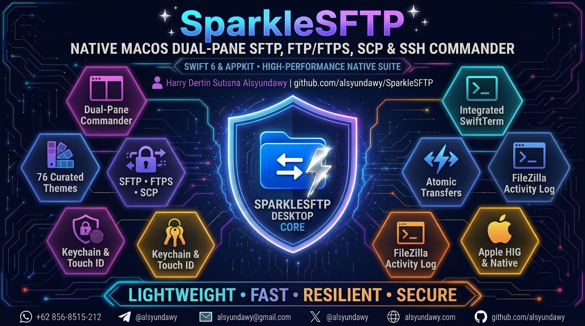
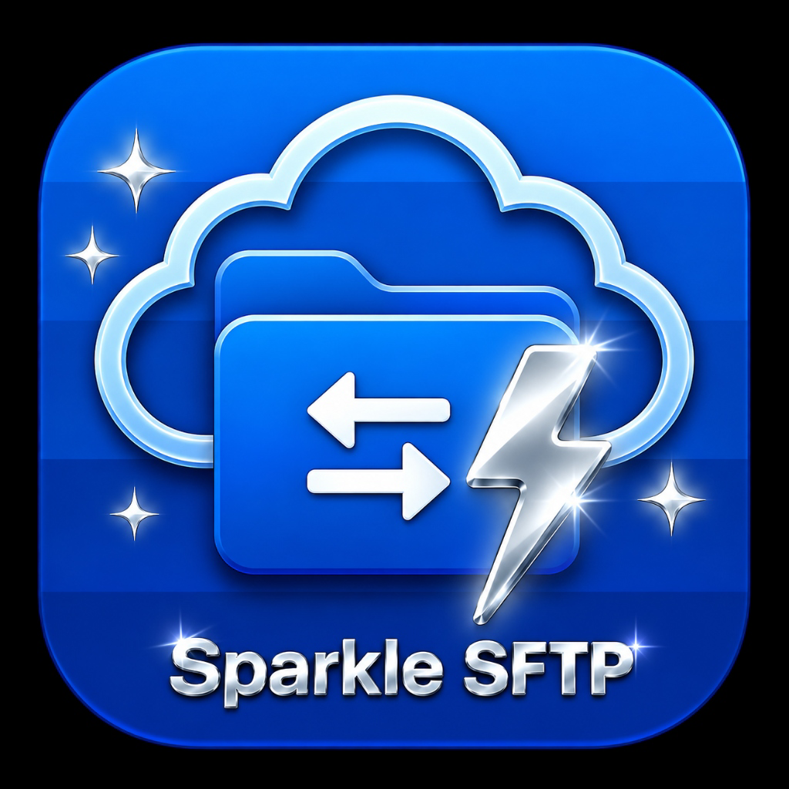

<!-- markdownlint-disable-file MD013 MD022 MD026 MD032 MD033 MD041 MD060 -->

<p align="center">
  <a href="https://github.com/alsyundawy/SparkleSFTP">
    
  </a>
</p>

<p align="center">
  <a href="https://github.com/alsyundawy/SparkleSFTP">
    
  </a>
</p>

<h1 align="center">SparkleSFTP</h1>

<p align="center">
  <b>SparkleSFTP — Commander Transfer Berkas Dual-Pane Native macOS yang Ringan dan Secepat Kilat.</b><br>
  <i>Dirancang dengan Swift 6 dan arsitektur native SwiftUI + AppKit untuk performa transfer maksimal, keamanan zero-cloud, dan efisiensi memori tingkat tinggi</i>
</p>

<p align="center">
  <a href="README.md"><b>English</b></a> &nbsp;|&nbsp; <b>Bahasa Indonesia</b>
</p>

<p align="center">
  <a href="https://github.com/alsyundawy/SparkleSFTP/releases/latest"></a>
  <a href="https://apple.com/macos"></a>
  <a href="https://github.com/alsyundawy/SparkleSFTP"></a>
  <a href="https://developer.apple.com/swift/"></a>
  <a href="https://developer.apple.com/xcode/swiftui/"></a>
  <a href="LICENSE"></a>
  <a href="https://github.com/alsyundawy/SparkleSFTP/actions"></a>
</p>

<p align="center">
  <b>SparkleSFTP</b> adalah aplikasi transfer dan pengelola berkas native dual-pane yang elegan dan super cepat untuk macOS. Dibuat murni sebagai alternatif modern pengganti perkakas transfer berkas tradisional, SparkleSFTP mengutamakan efisiensi daya baterai, hemat RAM, keamanan kriptografi Apple Keychain, dan kenyamanan pengguna tanpa beban browser webview atau Electron.
</p>

<p align="center">
  <a href="#-panduan-unduh--instalasi-cepat">
    
  </a>
  <a href="https://github.com/alsyundawy/SparkleSFTP/releases/latest">
    
  </a>
  <a href="docs/ARCHITECTURE.md">
    
  </a>
  <a href="https://github.com/alsyundawy/SparkleSFTP/issues">
    
  </a>
</p>

---

> Pengembang Utama & Pemelihara:<br>
> **[`HARRY DERTIN SUTISNA ALSYUNDAWY (@alsyundawy)`](https://github.com/alsyundawy)** — [`ALSYUNDAWY IT SOLUTION`](https://alsyundawy.com)<br>
>
> 📋 **[`Rencana Implementasi`](docs/IMPLEMENTATION_PLAN.md)** &nbsp;|&nbsp;
> 🔍 **[`Tinjauan Kode 14 Pilar`](docs/CODE_REVIEW_14_PILLARS.md)** &nbsp;|&nbsp;
> 📐 **[`Arsitektur Sistem`](docs/ARCHITECTURE.md)** &nbsp;|&nbsp;
> 🗺️ **[`Peta Jalan & Syarat Rilis`](docs/ROADMAP.md)** &nbsp;|&nbsp;
> 🔐 **[`Kebijakan Keamanan`](SECURITY.md)** &nbsp;|&nbsp;
> 📜 **[`Catatan Perubahan`](CHANGELOG.md)** &nbsp;|&nbsp;
> 🤝 **[`Panduan Kontribusi`](CONTRIBUTING.md)** &nbsp;|&nbsp;
> 💖 **[`Dukungan via PayPal`](https://www.paypal.me/alsyundawy)**

---

## 🌟 Sorotan Utama & Keunggulan bagi Pengguna di v0.7.0

- ✍️ **Editor Teks & Kode Internal (TextKit 2 & 52+ Bahasa)**: Editor native berkinerja tinggi berbasis Apple TextKit 2 dengan zero-allocation UTF-8 line traversal, pewarna sintaks untuk 52+ bahasa pemrograman dan berkas konfigurasi, toolbar gelap permanen (`#21252b`), dan bilah tab multi-dokumen ergonomis dengan titik dirty (`●` kuning `#e5c07b`) serta lencana read-only.
- ⚛️ **Kriptografi Pasca-Kuantum & Standar OpenSSH 10.x**: Pertukaran kunci hibrida Post-Quantum (PQ-KEX) ML-KEM-768 (`mlkem768x25519-sha256`, NIST FIPS 203) dan Streamlined NTRU Prime (`sntrup761x25519-sha512@openssh.com`) dengan lencana telemetri koneksi langsung di antarmuka.
- 🖥️ **Administrasi Server Linux Jarak Jauh**: Pengontrol layanan systemd native (`systemctl status/restart/reload` untuk Nginx, Apache, PHP-FPM, MariaDB, Docker, dll.), penjelajah proses (`ps aux` / `kill`), manajer Docker, penampil log live (`tail -f`), dan telemetri sumber daya server langsung (`/proc/loadavg`, `free -m`, `df -h`).
- 🚀 **Mesin Kompatibilitas SCP Streaming Modern**: Pengaliran data per bongkahan 64 KB langsung ke/dari disk (`FileHandle`) mencegah ledakan memori RAM (`CWE-400`), batas dekrompresi aman (`CWE-409`), dan elevasi hak akses root opsional `sudo -n` dengan sanitasi tanda petik tunggal ketat (`CWE-78`).
- 📡 **Diagnostik Jaringan & Pemeriksa Keterjangkauan Port TCP**: Pengujian port TCP asinkron langsung untuk port umum server (22, 21, 990, 80, 443, 3306, 5432, 6379) via `NWConnection` dengan métrik latensi bolak-balik dan perintah inspeksi rute jaringan.
- 📝 **Ekosistem Editor Desktop Eksternal (`ExternalEditorDetector`)**: Penemuan otomatis editor teks terpasang di macOS (VS Code, Sublime Text, BBEdit, TextMate, CotEditor, MacVim, NotepadMac, SparkNotePad, Cursor) dengan integrasi flag CLI tunggu (`--wait`).
- 🔄 **Coba Ulang Backoff Eksponensial dengan Jitter Acak**: Penjadwal retry transfer dengan variasi jitter acak penuh bilateral ($0.7 \dots 1.3 \times \text{delay}$) menghindarkan fenomena _thundering herd_.
- 🔢 **Kalkulator Subnet & CIDR IPv4 Bawaan (`⌘⌥S`)**: Mesin kalkulasi subnet offline yang di-porting dari SubnetCalc for macOS dengan salin sekali klik, rentang host terpakai, dan analisis cakupan RFC 1918.
- 🛡️ **Perlindungan Protokol & Mitigasi CVE 2025–2026**: Audit versi proaktif untuk CVE-2024-6387 (regreSSHion), mitigasi serangan Terrapin (CVE-2023-48795), penguncian versi swift-nio-ssh (CVE-2026-43798), dan kekebalan Zip-Slip (CVE-2026-52886/57233).
- 🔒 **Bundel Konfigurasi & Vault Kriptografis Native (`.sparkleconfig` / `.sparklevault`)**: Cadangkan dan pulihkan profil dengan enkripsi autentikasi AES-256-GCM, PBKDF2-HMAC-SHA256 (600.000 iterasi), pengikatan header AAD, dan pembersihan memori kunci zero-knowledge. Impor berkas FileZilla XML, WinSCP INI, dan OpenSSH config dengan 4 kebijakan konflik.
- ⚙️ **Registri Pengaturan 10 Tab & Pencarian Universal (`⌘,`)**: Registri preferensi terpusat dengan pencarian dinamis, atur ulang bawaan per tab, dan ekspor/impor kamus pengaturan JSON di seluruh 10 tab.
- 🔍 **Perbandingan Direktori Berkecepatan Tinggi**: Perbandingan instan $O(N+M)$ mendeteksi berkas identik, perbedaan ukuran, selisih waktu modifikasi, dan berkas hilang di antara 10.000+ berkas dalam hitungan milidetik.
- 📝 **Pengawas & Pengunggah Editor Eksternal**: Sunting berkas remote langsung di editor favorit Anda (VS Code, Sublime, BBEdit) dengan deteksi perubahan otomatis dan sinkronisasi kembali yang aman.
- ⚡ **Pembatas Kecepatan Bandwidth & Pipelining Adaptif**: Pengatur batas kecepatan transfer token-bucket serta pengontrol kedalaman transfer cerdas (1–16 jendela) dengan coba-ulang eksponensial.
- 🏷️ **Ganti Nama Massal & Verifikasi Hash Multi-Algoritma**: Perencana aturan ganti nama berkas massal dengan penghitung digit `[C]` serta verifikasi checksum streaming SHA-256, SHA-512, SHA-1, dan MD5.
- 📦 **Perlengkapan Arsip Aman**: Kompresi dan ekstraksi multi-format (ZIP, TAR, GZ) yang kebal terhadap serangan Zip-Slip path traversal.
- ⌘ **Palet Perintah (_Command Palette_, `⌘⇧P`)**: Peluncur aksi cepat bergaya Spotlight untuk mencari perintah, markah, koneksi, dan navigasi pengaturan.
- 📌 **Manajer Markah & Riwayat Jalur**: Menyimpan markah direktori lokal dan remote dengan ikon kustom, isolasi sesi host, serta Penelusuran Tersinkronisasi.
- 🌲 **Bilah Sisi Pohon Direktori**: Penjelajah pohon folder berhierarki untuk panel lokal dan remote dengan pencegahan siklus rekursif symlink.
- ⚡ **Super Adem & Hemat Daya (Zero Runaway CPU)**: Dirancang dengan notifikasi jendela AppKit presisi, menghentikan perulangan render sehingga konsumsi daya 0.0% saat santai (idle).
- 🎨 **Seluruh 76 Tema Dipulihkan & Dimuat Lengkap**: Koleksi lengkap 76 tema bawaan dalam 26 rumpun yang memenuhi standar kontras WCAG 2.1 AA/AAA.
- 📂 **Arsitektur Dual-Pane Commander**: Menjelajah berkas lokal dan server secara berdampingan dengan daur ulang baris AppKit native, pembaruan baris beranimasi halus via `CollectionDifference` tanpa kedipan, dan dukungan seret-lepas (_drag-and-drop_) langsung ke/dari macOS Finder.
- 🚀 **Penjadwal Transfer Dinamis Multi-Pekerja**: Pengelolaan antrean transfer cerdas dengan prioritas berkas berukuran kecil lebih dulu untuk mencegah hambatan antrean saat menyinkronkan direktori besar.
- ⚡ **Integrasi macOS Finder QuickActions & Protokol URL**: Layanan sistem "Open in SparkleSFTP" serta penanganan skema URL `sftp://`, `ftps://`, dan `ssh://`.
- 💻 **Terminal Mandiri Bergaya iTerm2 (`⌘⌥T`)**: Ruang kerja terminal multi-tab dengan pembagian jendela vertikal dan horizontal, koneksi SSH, serta sinkronisasi direktori OSC 7.
- 🔐 **Keamanan Apple Keychain & Touch ID**: Tanpa server pihak ketiga (_Zero-cloud_), seluruh kredensial dan kunci privat SSH tersimpan aman di dalam Apple Keychain fisik Mac Anda.

---

## 📥 Panduan Unduh & Instalasi Cepat

### Langkah 1: Unduh Berkas DMG

Unduh berkas instalasi resmi **`SparkleSFTP-0.7.0-universal.dmg`** dari GitHub Releases.

### Langkah 2: Pasang ke Folder Applications

1. Klik dua kali berkas `SparkleSFTP-0.7.0-universal.dmg` untuk membukanya.
2. Seret ikon **SparkleSFTP** ke dalam folder **Applications**.
3. Buka SparkleSFTP melalui Launchpad, Finder, atau Spotlight (`⌘Spasi`).

### Langkah 3: Tips Keamanan Gatekeeper Pertama Kali

Karena rilis komunitas ini menggunakan sertifikat mandiri, Anda dapat membukanya dengan mudah:

- **Cara Termudah**: Klik kanan (atau `Control` + Klik) **SparkleSFTP** di `/Applications`, pilih **Open (Buka)**, lalu klik **Open** pada jendela konfirmasi.
- **Alternatif Terminal**:

  ```bash
  xattr -dr com.apple.quarantine /Applications/SparkleSFTP.app
  ```

### Langkah 4: Menjalankan Mode Galeri Showcase

Untuk mengeksplorasi seluruh 8 layar pratinjau antarmuka Sparkle Commander:

```bash
/Applications/SparkleSFTP.app/Contents/MacOS/SparkleSFTP --showcase-gallery
```

---

## ⌨️ Daftar Tombol Pintas Penting

| Tombol Pintas        | Tindakan                   | Keterangan                                                    |
| :------------------- | :------------------------- | :------------------------------------------------------------ |
| `⌘⇧P`                | Palet Perintah             | Peluncur cepat tindakan, koneksi, markah, dan navigasi        |
| `⌘A`                 | Pilih Semua                | Memilih semua berkas dan folder di panel aktif                |
| `Esc` / `⇧⌘A` / `⌘D` | Batalkan Semua Pilihan     | Membatalkan / melepas sorotan pilihan semua berkas dan folder |
| `F3`                 | Pratinjau Berkas (View)    | Pratinjau cepat berkas menggunakan QuickLook                  |
| `F4`                 | Sunting Berkas (Edit)      | Membuka editor kode internal TextKit 2 (`⌘H` Cari/Tandai)     |
| `F5`                 | Transfer Cepat Antar-Panel | Mengirimkan berkas terpilih langsung ke panel di seberangnya  |
| `⇧F5`                | Salin Ke...                | Meminta lokasi folder tujuan kustom untuk menyalin berkas     |
| `F6`                 | Pindah / Ganti Nama        | Memindahkan berkas atau mengganti nama antar-panel            |
| `F7`                 | Folder Baru                | Membuat folder baru di panel yang sedang aktif                |
| `F8`                 | Hapus Berkas               | Menghapus berkas terpilih dengan dialog konfirmasi aman       |
| `⌘C` / `⌘V`          | Salin / Tempel Clipboard   | Operasi salin-tempel standar clipboard macOS                  |
| `⌥⌘L`                | Tampilkan/Sembunyikan Log  | Membuka atau menutup konsol riwayat perintah aktivitas server |
| `⌘⌥T`                | Terminal Mandiri           | Membuka jendela kerja terminal multi-tab bergaya iTerm2       |
| `⌘\`                 | Bilah Sambungan Cepat      | Menampilkan atau menyembunyikan bilah Quick Connect           |
| `⌘1` / `⌘2`          | Fokus Panel Berkas         | Berpindah fokus keyboard antara panel Lokal dan Remote        |
| `⌘,`                 | Pengaturan / Preferensi    | Membuka jendela 10 tab setelan dengan fitur cari & atur ulang |
| `⌘⌥S`                | Kalkulator Subnet IPv4     | Membuka jendela kalkulator subnetting & CIDR bawaan           |
| `⇧⌘I`                | Impor Koneksi              | Impor profil koneksi dari WinSCP, FileZilla, atau Vault       |
| `⇧⌘E`                | Ekspor Koneksi             | Ekspor profil koneksi dengan pelestarian protokol presisi     |
| `⌘W`                 | Tutup Tab                  | Menutup tab koneksi server yang sedang aktif                  |

---

## 🛡️ Jaminan Keamanan & Privasi

- **100% Lokal & Tanpa Telemetri**: SparkleSFTP tidak pernah memantau, mengumpulkan, atau mengirimkan analitik, alamat server, maupun data berkas Anda.
- **Penyimpanan Lokal Terenkripsi**: Frasa sandi SSH dan kunci privat tersimpan langsung di Apple Keychain yang dilindungi Touch ID.
- **Verifikasi Integritas SHA-256**:

```bash
shasum -a 256 SparkleSFTP-0.7.0-universal.dmg
# SHA-256 Valid: 2a5575eb6359ba28f1dee4f4584562aadc4c5d8db37c3593ef06bdb14634cf52
```

---

## 🛠️ Kompilasi Mandiri Secara Lokal

Kompilasi dan bangun paket menggunakan Swift 6 di macOS 13+:

```bash
swift build -j 2
Tools/Release/build-universal.sh
Tools/Release/create-dmg.sh dist/SparkleSFTP.app 0.7.0
Tools/Release/generate-appcast.sh
```

---

<p align="center">
  Didistribusikan di bawah <b>Lisensi MIT</b>. Dibuat dengan ❤️ untuk pengguna setia Mac oleh <a href="https://github.com/alsyundawy"><b>@alsyundawy</b></a>
</p>
