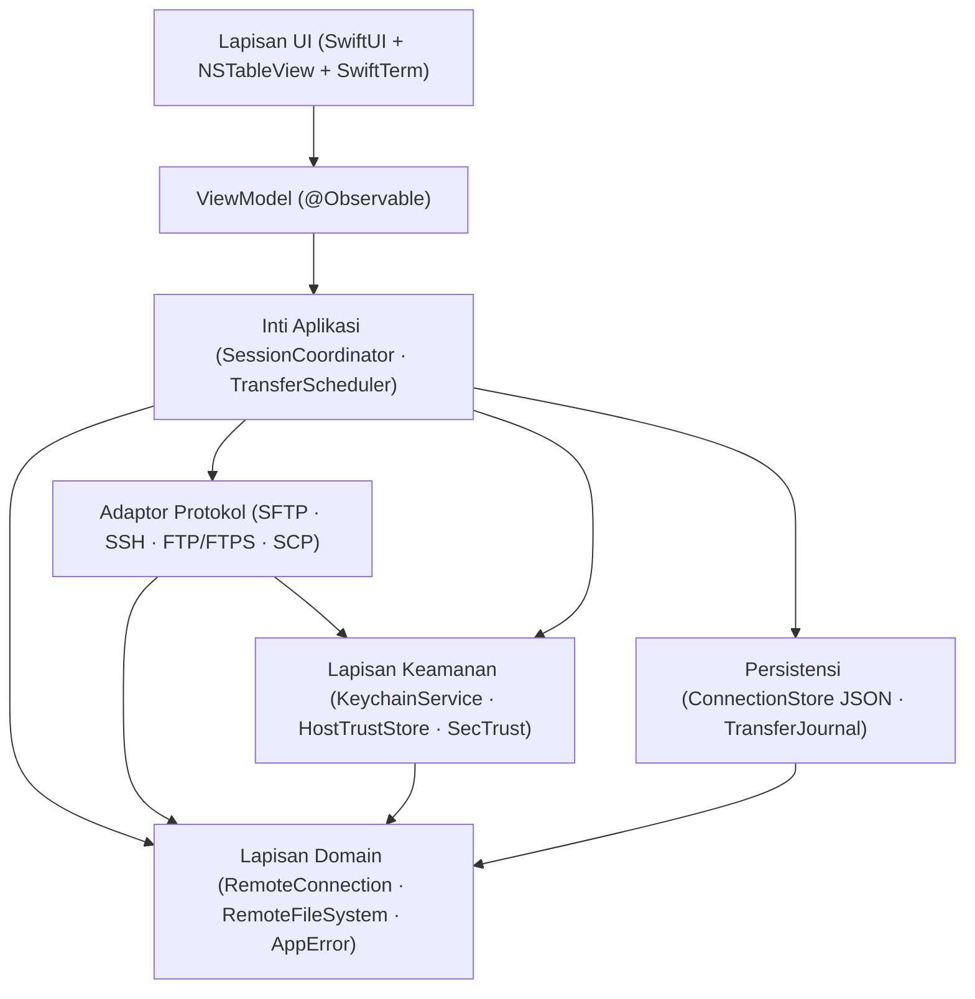

<h1 align="center">✨ SparkleSFTP</h1>

<p align="center">
  <b>Klien SFTP, FTP/FTPS, SCP &amp; SSH Commander Dual-Pane Native macOS — Dibangun dengan Swift 6 &amp; SwiftUI</b><br>
  <i>Manajemen berkas berkinerja tinggi, keamanan Keychain + Touch ID, terminal PTY SwiftTerm terintegrasi, dan transfer atomik tahan crash tanpa beban Electron</i>
</p>

<p align="center">
  <a href="README.md"><b>English</b></a> &nbsp;|&nbsp; <b>Bahasa Indonesia</b>
</p>

<p align="center">
  <a href="docs/ROADMAP.md"></a>
  <a href="https://apple.com/macos"></a>
  <a href="https://developer.apple.com/swift/"></a>
  <a href="https://developer.apple.com/xcode/swiftui/"></a>
  <a href="LICENSE"></a>
  <a href="https://github.com/alsyundawy/SparkleSFTP/actions"></a>
</p>

> Pengembang Utama & Pemelihara:<br>
> **[`HARRY DERTIN SUTISNA ALSYUNDAWY (@alsyundawy)`](https://github.com/alsyundawy)** — [`ALSYUNDAWY IT SOLUTION`](https://alsyundawy.com)<br>
>
> 📋 **[`Rencana Implementasi`](docs/IMPLEMENTATION_PLAN.md)** &nbsp;|&nbsp;
> 🔍 **[`Review Kode 14 Pilar`](docs/CODE_REVIEW_14_PILLARS.md)** &nbsp;|&nbsp;
> 📐 **[`Arsitektur`](docs/ARCHITECTURE.md)** &nbsp;|&nbsp;
> 🗺️ **[`Roadmap & Release Gate`](docs/ROADMAP.md)** &nbsp;|&nbsp;
> 🔐 **[`Kebijakan Keamanan`](SECURITY.md)** &nbsp;|&nbsp;
> 📜 **[`Changelog`](CHANGELOG.md)** &nbsp;|&nbsp;
> 🤝 **[`Panduan Kontribusi`](CONTRIBUTING.md)** &nbsp;|&nbsp;
> 💖 **[`Dukungan via PayPal`](https://www.paypal.me/alsyundawy)**

---

> [!IMPORTANT]
>
> ### Status Repositori: Full MVP Terealisasi (Swift 6 + macOS 13+)
>
> Seluruh modul SwiftPM (`Package.swift`, `App/`, `Packages/*`, `Features/`, `Tests/*`, `Tools/*`) telah diimplementasikan dan diverifikasi dengan `swift build` serta `swift test`. Lihat [`docs/TECHNICAL_SPECIFICATION.md`](docs/TECHNICAL_SPECIFICATION.md), [`DOCNOTE.md`](DOCNOTE.md), [`TODO.md`](TODO.md), dan [`docs/IMPLEMENTATION_PLAN.md`](docs/IMPLEMENTATION_PLAN.md).
>
> **Asal-Usul Proyek:** Awalnya dirancang dengan nama kerja `MacSFTP` dan distandardisasi menjadi **SparkleSFTP** dengan seluruh 55 temuan dari [`docs/CODE_REVIEW_14_PILLARS.md`](docs/CODE_REVIEW_14_PILLARS.md) terintegrasi sebelum penulisan kode dimulai.

---

## Navigasi

- [Ringkasan & Visi](#ringkasan--visi)
- [Tumpukan Teknologi Rencana](#tumpukan-teknologi-rencana)
- [Arsitektur Sistem](#arsitektur-sistem)
- [Garis Dasar Keamanan & Hardening](#garis-dasar-keamanan--hardening)
- [Struktur Repositori](#struktur-repositori)
- [Ringkasan Roadmap](#ringkasan-roadmap)
- [Dokumentasi & ADR](#dokumentasi--adr)
- [Kontribusi & Gerbang Kualitas](#kontribusi--gerbang-kualitas)
- [Lisensi](#lisensi)

---

## Ringkasan & Visi

**SparkleSFTP** adalah aplikasi Commander transfer berkas dan SSH native untuk macOS yang dirancang bagi engineer, sysadmin, dan alur kerja DevOps yang menginginkan produktivitas dual-pane bergaya WinSCP dengan ergonomi native macOS:

- **Pengalaman Commander Dual-Pane**: Panel Lokal ↔ Remote maupun Remote ↔ Remote berbasis AppKit `NSTableView` untuk daftar 100.000+ berkas yang mulus, pintasan papan ketik (`Tab`, `F5`–`F8`), Quick Look (`QLPreviewPanel`), dan seret-lepas Finder.
- **Dukungan Protokol Lengkap**: SFTP, Terminal SSH (PTY), FTPS Explicit/Implicit, FTP biasa (dengan peringatan keamanan eksplisit), serta fallback SCP terisolasi (`SCPCompatibilityAdapter`).
- **Mesin Transfer Terisolasi Actor**: Konkurensi terbatas per-host dan global, jeda/lanjutkan berbasis checkpoint dengan revalidasi metadata remote, pemulihan crash `TransferJournal`, serta unggahan atomik (tulis sementara → verifikasi SHA-256 → ganti nama atomik).
- **Keamanan Sejak Hari Pertama**: Apple Keychain terkunci perangkat (`kSecAttrAccessibleWhenUnlockedThisDeviceOnly`), pembukaan opsional Touch ID, state machine verifikasi host key TOFU yang ketat, validasi TLS `SecTrust`, dan redaksi log `OSLog` tanpa kebocoran rahasia.

---

## Tumpukan Teknologi Rencana

| Lapisan | Teknologi Rencana | Tujuan & Standar Keamanan |
| :--- | :--- | :--- |
| **Bahasa** | Swift 6 | Strict concurrency, isolasi actor, penegakan `Sendable` |
| **Antarmuka UI** | SwiftUI + AppKit (`NSTableView`) | HIG macOS native dengan reuse sel tabel (`ObservableObject` untuk macOS 13+) |
| **SSH & SFTP** | `apple/swift-nio-ssh` (`0.15.1` >= `0.14.1`) + Codec SFTP v3 | SFTP v3 async/await, PTY, port forwarding; mitigasi CVE-2026-43798 & macOS 13+ |
| **FTP & FTPS** | Sistem `libcurl` (`Clibcurl` + `SecTrust`) | FTP TLS explicit/implicit terkunci `ftp,ftps` (tanpa `libssh` / CVE-2025-15224) |
| **Terminal SSH** | `SwiftTerm` (`1.20.0`) | Emulasi VT100/xterm via `NSViewRepresentable` + pembersihan PTY eksplisit |
| **Rahasia & Trust** | Apple `Security.framework` | Keychain ACL native (`WhenUnlockedThisDeviceOnly`), Touch ID (`LAContext`), `SecTrustEvaluateWithError` |
| **Persistensi** | JSON (`Codable`) + `SQLite3` WAL | JSON ringan untuk profil (`ConnectionStore`) + `TransferJournal` ACID (macOS 13+) |
| **Pengujian** | Swift Testing + Docker Compose | Fixture deterministik OpenSSH, vsftpd, dan ProFTPD |
| **Distribusi** | Universal 2 DMG + Sparkle | `arm64` + `x86_64`, notarized Developer ID, pembaruan bertanda Ed25519 |

---

## Arsitektur Sistem



### Aturan Lapisan Wajib (Non-Negotiable)

1. `App -> ApplicationCore -> Domain`, `ProtocolAdapters -> Domain`, `Security -> Domain`, `Persistence -> Domain`.
2. View dan ViewModel **dilarang** memanggil Citadel, libcurl, atau Keychain secara langsung.
3. Modul di `Packages/` **dilarang** mengimpor modul dari `Features/`.
4. Siklus hidup transfer berjalan di dalam `TransferQueue` actor — terpisah sepenuhnya dari siklus hidup jendela maupun tab.

---

## Garis Dasar Keamanan & Hardening

Setiap keputusan desain di SparkleSFTP menegakkan hasil audit pada [`docs/CODE_REVIEW_14_PILLARS.md`](docs/CODE_REVIEW_14_PILLARS.md):

| Kontrol | Standar / Referensi | Penegakan |
| :--- | :--- | :--- |
| **Keamanan Pre-Auth SSH** | CVE-2026-43798 | Pin `swift-nio-ssh >= 0.14.1` di `Package.swift` |
| **Keamanan Auth SSH libcurl** | CVE-2025-15224 | Gunakan backend `libssh2` saja (bukan `libssh`) |
| **Isolasi Keychain Perangkat** | CWE-312 / CWE-522 | `kSecAttrAccessibleWhenUnlockedThisDeviceOnly` + aturan SwiftLint |
| **Validasi Sertifikat TLS** | CWE-295 | `SecTrustEvaluateWithError` + OCSP + tanpa auto-downgrade FTPS |
| **Kepercayaan Host SSH** | State Machine TOFU | Siklus 6-state; perubahan host key langsung memblokir koneksi |
| **Keamanan Path & Symlink** | CWE-22 / CWE-59 | Kanonisasi path ketat + validasi target symlink & loop inode |
| **Redaksi Log** | CWE-532 | Label privasi `OSLog` + aturan SwiftLint `no_password_in_logs` |

---

## Struktur Repositori

### Berkas Saat Ini (Fondasi Repositori Fase 0)

```text
SparkleSFTP/
├── .github/
│   ├── ISSUE_TEMPLATE/        # Templat laporan bug & permintaan fitur
│   ├── workflows/ci.yml       # Lint Markdown/YAML/Shell + CI Swift kondisional
│   ├── FUNDING.yml
│   ├── dependabot.yml
│   └── pull_request_template.md
├── docs/
│   ├── ADR/                   # Architecture Decision Records (0001–0003)
│   ├── ARCHITECTURE.md        # Batasan modul & jaminan concurrency
│   ├── CODE_REVIEW_14_PILLARS.md
│   ├── IMPLEMENTATION_PLAN.md
│   └── ROADMAP.md
├── .editorconfig
├── .gitattributes
├── .gitignore
├── .markdownlint.json
├── .swiftformat
├── .swiftlint.yml
├── .yamllint.yml
├── CHANGELOG.md
├── CODE_OF_CONDUCT.md
├── CONTRIBUTING.md
├── LICENSE                    # Lisensi MIT
├── README.md                  # Dokumentasi Bahasa Inggris
├── README-id.md               # Dokumentasi Bahasa Indonesia
└── SECURITY.md                # Kebijakan keamanan & pelaporan kerentanan
```

### Struktur Aplikasi Rencana (Fase 01–08)

Rincian modul lengkap (`App/`, `Packages/Core`, `Packages/Networking`, `Packages/TransferEngine`, `Packages/FileManager`, `Packages/Security`, `Packages/Terminal`, `Packages/Synchronization`, `Packages/Persistence`, `Packages/DesignSystem`, `Features/`, `Tests/`, `Tools/`) dijabarkan di [`docs/ARCHITECTURE.md`](docs/ARCHITECTURE.md) dan [`docs/IMPLEMENTATION_PLAN.md`](docs/IMPLEMENTATION_PLAN.md).

---

## Ringkasan Roadmap

| Fase | Tonggak | Fokus Utama |
| :--- | :--- | :--- |
| **Fase 00** | Bootstrap Repositori | Tata kelola, spesifikasi, perbaikan 14 pilar, ADR, pagar CI & lint *(Selesai)* |
| **Fase 01–02** | Riset & Fondasi | PoC Citadel/libcurl, proyek Xcode Swift 6, SPM ter-pin, DesignSystem |
| **Fase 03** | Koneksi & Keamanan | Store profil, `KeychainService` native, state machine TOFU, `SecTrust` |
| **Fase 04** | Mesin Protokol | `SFTPService`, `SSHService`, `FTPService` (FTPS), fixture Docker |
| **Fase 05** | Antarmuka Commander | `NSTableView` dual-pane, pintasan F5–F8, Quick Look, seret-lepas Finder |
| **Fase 06** | Mesin Transfer | `TransferQueue` actor, limit per-host, pemulihan `TransferJournal`, unggah atomik |
| **Fase 07** | Terminal & Sinkronisasi | PTY multi-tab/split `SwiftTerm`, port forwarding, dry-run sync, i18n EN/ID |
| **Fase 08** | QA & Rilis | Uji transfer 10GB, audit kebocoran PTY, notarized Developer ID, DMG Sparkle |

---

## Dokumentasi & ADR

- **[Rencana Implementasi (`docs/IMPLEMENTATION_PLAN.md`)](docs/IMPLEMENTATION_PLAN.md)** — Cetak biru lengkap, kontrak protokol, workground, 125 tugas, dan matriks pengujian Docker.
- **[Review Kode 14 Pilar (`docs/CODE_REVIEW_14_PILLARS.md`)](docs/CODE_REVIEW_14_PILLARS.md)** — 55 temuan berbasis bukti di 14 pilar (bug, concurrency, memori, CVE keamanan, skalabilitas, dan linter).
- **[Arsitektur Sistem (`docs/ARCHITECTURE.md`)](docs/ARCHITECTURE.md)** — Batasan dependensi modul dan aturan concurrency.
- **[Roadmap & Gerbang Rilis (`docs/ROADMAP.md`)](docs/ROADMAP.md)** — Jadwal fase dan syarat mutlak gerbang rilis MVP.
- **[ADR-001: Tech Stack & Protokol](docs/ADR/0001-tech-stack-and-protocols.md)**
- **[ADR-002: Isolasi Keychain & Host Trust](docs/ADR/0002-security-keychain-and-host-trust.md)**
- **[ADR-003: Strategi Persistensi (JSON vs SwiftData)](docs/ADR/0003-metadata-persistence-swiftdata-vs-json.md)**

---

## Kontribusi & Gerbang Kualitas

Kontribusi sangat terbuka setelah fase implementasi dibuka. Harap baca [`CONTRIBUTING.md`](CONTRIBUTING.md) dan [`CODE_OF_CONDUCT.md`](CODE_OF_CONDUCT.md) sebelum mengirim pull request.

Pemeriksaan lokal repositori dapat dijalankan dengan:

```bash
markdownlint-cli2 "**/*.md" "#.build" "#DerivedData"
actionlint
```

---

## Lisensi

Didistribusikan di bawah **Lisensi MIT**. Lihat berkas [`LICENSE`](LICENSE) untuk teks lengkapnya.

---

<p align="center">
  Dibuat untuk engineer macOS oleh <a href="https://github.com/alsyundawy"><b>@alsyundawy</b></a>
</p>
