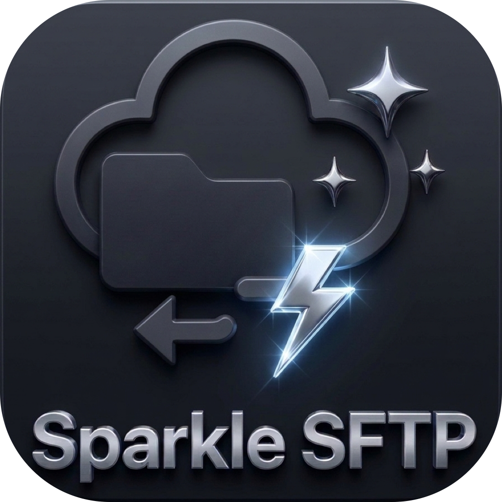
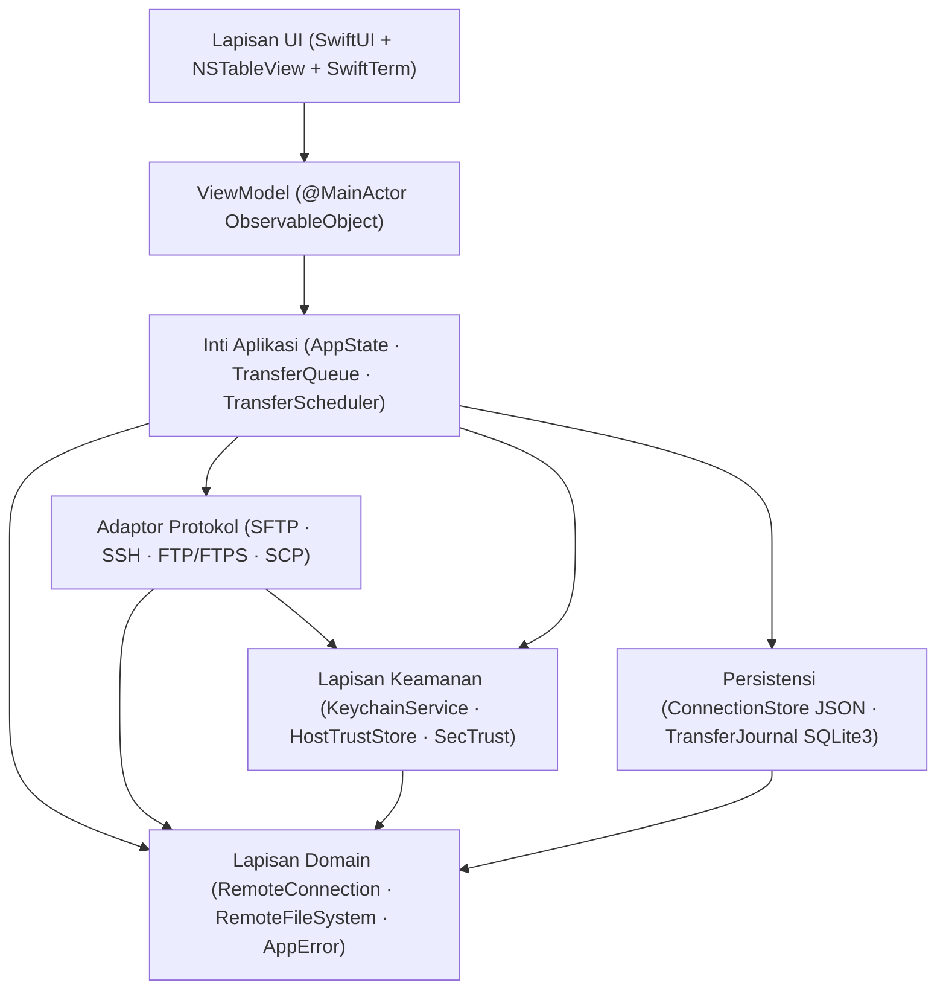

<p align="center">
  
</p>

<h1 align="center">SparkleSFTP</h1>

<p align="center">
  <b>Klien SFTP, FTP/FTPS, SCP &amp; SSH Commander Dual-Pane Native macOS — Dibangun dengan Swift 6 &amp; SwiftUI</b><br>
  <i>Manajemen berkas berkinerja tinggi, keamanan Keychain + Touch ID, terminal PTY SwiftTerm terintegrasi, dan transfer atomik tahan crash tanpa beban Electron</i>
</p>

<p align="center">
  <a href="README.md"><b>English</b></a> &nbsp;|&nbsp; <b>Bahasa Indonesia</b>
</p>

<p align="center">
  <a href="docs/ROADMAP.md"></a>
  <a href="https://apple.com/macos"></a>
  <a href="https://developer.apple.com/swift/"></a>
  <a href="https://developer.apple.com/xcode/swiftui/"></a>
  <a href="LICENSE"></a>
  <a href="https://github.com/alsyundawy/SparkleSFTP/actions"></a>
</p>

> Pengembang Utama & Pemelihara:<br>
> **[`HARRY DERTIN SUTISNA ALSYUNDAWY (@alsyundawy)`](https://github.com/alsyundawy)** — [`ALSYUNDAWY IT SOLUTION`](https://alsyundawy.com)<br>
>
> 📋 **[`Rencana Implementasi`](docs/IMPLEMENTATION_PLAN.md)** &nbsp;|&nbsp;
> 🔍 **[`Review Kode 14 Pilar`](docs/CODE_REVIEW_14_PILLARS.md)** &nbsp;|&nbsp;
> 📐 **[`Arsitektur`](docs/ARCHITECTURE.md)** &nbsp;|&nbsp;
> 🗺️ **[`Roadmap & Release Gate`](docs/ROADMAP.md)** &nbsp;|&nbsp;
> 🔐 **[`Kebijakan Keamanan`](SECURITY.md)** &nbsp;|&nbsp;
> 📜 **[`Changelog`](CHANGELOG.md)** &nbsp;|&nbsp;
> 🤝 **[`Panduan Kontribusi`](CONTRIBUTING.md)** &nbsp;|&nbsp;
> 💖 **[`Dukungan via PayPal`](https://www.paypal.me/alsyundawy)**

---

> [!IMPORTANT]
>
> ### Status Repositori: Full MVP Terealisasi (Swift 6 + macOS 13+)
>
> Seluruh modul SwiftPM (`Package.swift`, `App/`, `Packages/*`, `Features/`, `Tests/*`, `Tools/*`) telah diimplementasikan dan diverifikasi dengan `swift build` serta `swift test`. Lihat [`docs/TECHNICAL_SPECIFICATION.md`](docs/TECHNICAL_SPECIFICATION.md), [`DOCNOTE.md`](DOCNOTE.md), [`TODO.md`](TODO.md), dan [`docs/IMPLEMENTATION_PLAN.md`](docs/IMPLEMENTATION_PLAN.md).
>
> **Asal-Usul Proyek:** Awalnya dirancang dengan nama kerja `MacSFTP` dan distandardisasi menjadi **SparkleSFTP** dengan seluruh 55 temuan dari [`docs/CODE_REVIEW_14_PILLARS.md`](docs/CODE_REVIEW_14_PILLARS.md) terintegrasi sebelum penulisan kode dimulai.

---

## Navigasi

- [Ringkasan & Visi](#ringkasan--visi)
- [Tumpukan Teknologi](#tumpukan-teknologi)
- [Arsitektur Sistem](#arsitektur-sistem)
- [Garis Dasar Keamanan & Hardening](#garis-dasar-keamanan--hardening)
- [Struktur Repositori](#struktur-repositori)
- [Ringkasan Roadmap](#ringkasan-roadmap)
- [Dokumentasi & ADR](#dokumentasi--adr)
- [Kontribusi & Gerbang Kualitas](#kontribusi--gerbang-kualitas)
- [Lisensi](#lisensi)

---

## Ringkasan & Visi

**SparkleSFTP** adalah aplikasi Commander transfer berkas dan SSH native untuk macOS yang dirancang bagi engineer, sysadmin, dan alur kerja DevOps yang menginginkan produktivitas dual-pane bergaya WinSCP dengan ergonomi native macOS:

- **Pengalaman Commander Dual-Pane**: Panel Lokal ↔ Remote maupun Remote ↔ Remote berbasis AppKit `NSTableView` untuk daftar 100.000+ berkas yang mulus, pintasan papan ketik (`Tab`, `F5`–`F8`), Quick Look (`QLPreviewPanel`), seret-lepas Finder, dan editor internal.
- **Editor Berkas Internal Minimalis Notepad2 (`⌘E`)**: Editor multi-tab AppKit `NSTextView` (`Features/Editor/`) dengan nomor baris (`NSRulerView`), syntax highlighting mengikuti palet tema aktif, simbol spasi/tab (`¶`), word wrap, zoom `+/-/%`, mode hanya-baca, Cari & Ganti berbasis regex, lompat ke baris, transformasi teks (UPPER/lower/Title/Trim/Sort), konversi `UTF-8`/`UTF-8 BOM`/`UTF-16 LE`/`ASCII` + `LF`/`CRLF`, serta simpan & unggah otomatis ke server remote.
- **Sistem Multi-Tema (`SparkNotePad` Palettes) & Propagasi Workspace Penuh**: `28` tema bawaan pada `15` keluarga palet (`NotepadNext`, `Catppuccin`, `Dracula`, `Tokyo Night`, `Nord`, `One Dark`, `Gruvbox`, `Solarized`, `GitHub`, `Monokai`, `Rosé Pine`, `Night Owl`, `SynthWave '84`, `Cobalt2`, `Tomorrow`) dengan mode `Auto / Terang / Gelap`, validasi kontras WCAG 2.1, impor/ekspor tema JSON kustom, serta pembaruan tema menyeluruh (`sparkleWorkspaceSurface`, `TerminalThemeColors`, tabel AppKit, `NSApp.windows`) hingga Terminal, Transfers, Snippets, Sync, Settings, dan About.
- **Manajemen Koneksi, Fokus Mouse/Keyboard AppKit & Ingat Kata Sandi**: `ConnectionListTableView` (`NSTableView` native dengan key baris unik) + `InteractiveFileTableView` untuk fokus klik/panah atas-bawah instan tanpa bentrok gesture SwiftUI, klik dua kali untuk koneksi, modal Sunting Koneksi atomik (`ConnectionEditorMode`), **Duplikat Koneksi**, `⌘A` Pilih Semua & hapus massal, kontrol **Ingat Kata Sandi di Apple Keychain** + hapus rahasia eksplisit (`ConnectionEditorView`, `CredentialPromptSheet`, `FTPService`), serta mekanisme keluar non-deadlock via `applicationShouldTerminate`.
- **Jendela About Bergaya SparkNotePad & Ikon Squircle 1:1**: Dialog About 7 tab (`AboutView`, `AboutView+Tabs`, `AboutWindowController`, termasuk tab `Libraries` status pustaka) lengkap dengan diagnostik sistem/tema/toolchain yang dapat disalin, tautan GitHub/maintainer/PayPal, pintasan, lisensi, serta logo `AppIcon.png`/`.icns` 1:1 berwarna biru, putih, dan kuning pastel pensil khas SparkNotePad.
- **Pustaka Pihak Ketiga & Integrasi Shell / iTerm2 (`zlib`, `libcurl`, `libssh2`, `OpenSSL`, `OpenSSH`)**: C11 `Clibcurl` menautkan `-lcurl` + `-lz` SDK macOS (buffer `256 KB`, `TCP_NODELAY`, `TCP_KEEPALIVE`, worker GCD di luar pool kooperatif, codec `zlib`/`gzip` berbatas `CWE-409` di `ZlibCompressionCodec`), probing dinamis `dlopen`/`dlsym` untuk `libssh2` opsional, deteksi async `OpenSSL`/`OpenSSH`/shell POSIX (`ToolchainInspector`), tab shell lokal interaktif (`LocalShellTerminalRepresentable` via `LocalProcessTerminalView`), serta peluncur eksternal tersanitasi `CWE-78` untuk `iTerm2`/`Terminal.app` (`ExternalTerminalLauncher`).
- **Transfer Multi-Thread Pipelined & Dialog Timpa FileZilla**: Pipeline sliding-window `SFTPPipelinedTransfer` bebas-actor (`pipelineDepth` `8x` per blok `32 KB`, default konkurensi `4` global / `3` per-host di `TransferScheduler`), dialog `ConflictResolutionSheet` bergaya FileZilla (kartu perbandingan Sumber vs Target, 7 opsi timpa/lanjutkan/ganti-nama/lewati, aturan antrean/arah otomatis), serta antrean konfirmasi FIFO `pendingConflictQueue`.
- **Arsitektur Runtime Ringan & Responsif**: `TransferMonitor` terpisah mengisolasi pembaruan progres 10Hz dari render ulang seluruh jendela SwiftUI, cache `AppStrings` & `SparkleThemePalette`, pembatasan penulisan checkpoint SQLite WAL 2 detik saat transfer aktif, serta pembacaan metadata POSIX single-`lstat` di `LocalFileService`.
- **i18n JSON Terkelola, Tata Letak Kartu Bahasa & Importer**: Katalog JSON (`en.json` & `id.json`, `309` kunci sinkron) + direktori override lokal (`~/Library/Application Support/SparkleSFTP/Locales/`), grid kartu bahasa interaktif (`PreferencesLocalizationTab`), pengalih bahasa Globe di toolbar/status bar/menu (`MainWindowView`, `SparkleSFTPApp`), serta `ImportConnectionsSheet` untuk FileZilla XML (`<Folder>`, `base64`, proteksi `crypt`) dan WinSCP INI (UTF-16LE/BE BOM, `FSProtocol`, proxy, subgrup bersarang).
- **Pengaturan Pembaruan Otomatis & Sinkronisasi Dua Arah**: Konfigurasi `AutoUpdateSettings` lengkap (periksa/unduh otomatis, frekuensi `Jam`/`Harian`/`Mingguan`/`Manual`, kanal `Stable`/`Beta`, validasi feed HTTPS, fallback pengecekan GitHub Releases API untuk build komunitas) dan dukungan penuh `SyncDirection` (`Local -> Remote`, `Remote -> Local`, `Bidirectional`).
- **Dukungan Protokol Lengkap**: SFTP, Terminal SSH (PTY), FTPS Explicit/Implicit, FTP biasa (dengan peringatan keamanan eksplisit), serta fallback SCP terisolasi (`SCPCompatibilityAdapter`).
- **Mesin Transfer Terisolasi Actor**: Konkurensi terbatas per-host dan global, jeda/lanjutkan berbasis checkpoint dengan revalidasi metadata remote, pemulihan crash `TransferJournal`, serta unggahan atomik (tulis sementara → verifikasi SHA-256 → ganti nama atomik).
- **Keamanan Sejak Hari Pertama**: Apple Keychain terkunci perangkat (`kSecAttrAccessibleWhenUnlockedThisDeviceOnly`), pembukaan opsional Touch ID, state machine verifikasi host key TOFU yang ketat, validasi TLS `SecTrust`, dan redaksi log `OSLog` tanpa kebocoran rahasia.

---

## Tumpukan Teknologi

| Lapisan | Teknologi | Tujuan & Standar Keamanan |
| :--- | :--- | :--- |
| **Bahasa** | Swift 6 | Strict concurrency, isolasi actor, penegakan `Sendable` |
| **Antarmuka UI** | SwiftUI + AppKit (`NSTableView`) | HIG macOS native dengan reuse sel tabel (`ObservableObject` untuk macOS 13+) |
| **SSH & SFTP** | `apple/swift-nio-ssh` (`0.15.1` >= `0.14.1`) + Codec SFTP v3 | SFTP v3 async/await, PTY, port forwarding; mitigasi CVE-2026-43798 & macOS 13+ |
| **FTP/FTPS & Bridge Pustaka** | Sistem `libcurl` + `zlib` (`Clibcurl`) + `ToolchainInspector` | Worker GCD `256 KB` TCP keepalive terkunci `ftp,ftps` (anti CVE-2025-15224), zlib/gzip berbatas `CWE-409`, probing dinamis `libssh2`, deteksi OpenSSL/OpenSSH/shell |
| **Terminal SSH & Shell Lokal** | `SwiftTerm` (`1.20.0`) + `ExternalTerminalLauncher` | PTY VT100/xterm remote, tab `$SHELL` lokal (`LocalProcessTerminalView`), & peluncur eksternal tersanitasi `iTerm2` / `Terminal.app` |
| **Rahasia & Trust** | Apple `Security.framework` | Keychain ACL native (`WhenUnlockedThisDeviceOnly`), Touch ID (`LAContext`), `SecTrustEvaluateWithError` |
| **Persistensi** | JSON (`Codable`) + `SQLite3` WAL | JSON ringan untuk profil (`ConnectionStore`) + `TransferJournal` ACID (macOS 13+) |
| **Pengujian** | Swift Testing + Docker Compose | Fixture deterministik OpenSSH, vsftpd, dan ProFTPD |
| **Distribusi** | Universal 2 DMG + Sparkle | `arm64` + `x86_64`, notarized Developer ID, pembaruan bertanda Ed25519 |

---

## Arsitektur Sistem



### Aturan Lapisan Wajib (Non-Negotiable)

1. `App -> SparkleFeatures -> Packages/*`; `ProtocolAdapters -> Domain`, `Security -> Domain`, `Persistence -> Domain`.
2. View dan ViewModel **dilarang** memanggil `NIOSSH`, `Clibcurl`, `SQLite3`, atau Keychain secara langsung.
3. Modul di `Packages/` **dilarang** mengimpor modul dari `Features/`.
4. Siklus hidup transfer berjalan di dalam `TransferQueue` actor — terpisah sepenuhnya dari siklus hidup jendela maupun tab.

---

## Garis Dasar Keamanan & Hardening

Setiap keputusan desain di SparkleSFTP menegakkan hasil audit pada [`docs/CODE_REVIEW_14_PILLARS.md`](docs/CODE_REVIEW_14_PILLARS.md):

| Kontrol | Standar / Referensi | Penegakan |
| :--- | :--- | :--- |
| **Keamanan Pre-Auth SSH** | CVE-2026-43798 | Pin `apple/swift-nio-ssh >= 0.15.1` (`>= 0.14.1`) di `Package.swift` |
| **Keamanan Auth SSH libcurl** | CVE-2025-15224 | Kunci `Clibcurl` ke `ftp,ftps` (`CURLOPT_PROTOCOLS_STR`); tanpa permukaan `libssh` |
| **Isolasi Keychain Perangkat** | CWE-312 / CWE-522 | `kSecAttrAccessibleWhenUnlockedThisDeviceOnly` + aturan SwiftLint |
| **Validasi Sertifikat TLS** | CWE-295 | `SecTrustEvaluateWithError` + OCSP + tanpa auto-downgrade FTPS |
| **Kepercayaan Host SSH** | State Machine TOFU | Siklus 6-state; perubahan host key langsung memblokir koneksi |
| **Keamanan Path & Symlink** | CWE-22 / CWE-59 | Kanonisasi path ketat + validasi target symlink & loop |
| **Integritas Pembaruan** | Ed25519 + TLS | `UpdateConfigurationValidator` menolak feed non-HTTPS & key placeholder |
| **Redaksi Log** | CWE-532 | Label privasi `OSLog` + aturan SwiftLint `no_password_in_logs` |

---

## Struktur Repositori

### Struktur Repositori Swift 6 Terealisasi (Full MVP)

```text
SparkleSFTP/
├── Package.swift              # Manifest Swift 6.0 (.macOS(.v13), dependensi SPM ter-pin)
├── App/                       # Entry point executable, AppDelegate, SparkleUpdaterService, Info.plist, Entitlements
├── Packages/
│   ├── Clibcurl/              # Wrapper helper C11 non-variadik untuk libcurl (-lcurl) + zlib (-lz) & probing dlopen libssh2
│   ├── Core/                  # Model domain (ToolchainModels, TransferModels konflik), RemotePath, AppError, Protocols
│   ├── DesignSystem/          # 28 palet tema SparkNotePad (15 keluarga), komponen UI, katalog JSON i18n EN/ID (309 kunci)
│   ├── FileManager/           # LocalFileService, LocalDirectoryWatcher, POSIXPermissions, DualPaneState
│   ├── Networking/            # SFTPPacketCodec, SFTPPipelinedTransfer, SSHClientService, SCP, FTPService (GCD 256KB), ToolchainInspector
│   ├── Persistence/           # ConnectionStore (JSON), TransferJournal (SQLite3 WAL), Importer FileZilla/WinSCP & SSH
│   ├── Security/              # KeychainService, HostTrustStore, SecTrust, PathValidator, KeyParser, UpdateValidator
│   ├── Synchronization/       # DirectoryScanner, SyncPlanner (Satu Arah & Dua Arah, TTL 60 detik), SyncExecutor
│   ├── Terminal/              # SwiftTerm TerminalViewRepresentable, LocalShellTerminalRepresentable, ExternalTerminalLauncher, PortForwardingManager
│   └── TransferEngine/        # TransferQueue actor, TransferScheduler (4/3), ConflictResolver FileZilla, ResumeValidator, SHA256Verifier
├── Features/                  # View SwiftUI + AppKit (Commander, ConnectionListTableView, About 7 Tab, Editor Notepad2, Terminal, ConflictResolutionSheet, Settings)
├── Tests/                     # 8 target uji (71 test di 18 suite Swift Testing, termasuk SFTP pipelined & konflik FIFO)
├── Tools/
│   ├── Release/               # Skrip Universal 2 build-universal.sh, create-dmg.sh, notarize.sh
│   └── TestServers/           # Fixture Docker Compose (OpenSSH, vsftpd, ProFTPD) & skrip smoke test
├── .github/workflows/         # ci.yml, release.yml, mega-linter.yml, codeql.yml, jekyll-gh-pages.yml
└── docs/                      # Arsitektur, Spesifikasi Teknis, Model Keamanan, Workground, Review 14 Pilar, ADR 0001–0007
```

---

## Ringkasan Roadmap

| Fase | Tonggak | Fokus Utama & Status |
| :--- | :--- | :--- |
| **Fase 00** | Bootstrap Repositori | Tata kelola, spesifikasi, perbaikan 14 pilar, ADR, pagar CI & lint *(Selesai)* |
| **Fase 01–02** | Riset & Fondasi | Audit graf SPM ([ADR-004](docs/ADR/0004-direct-swift-nio-ssh-and-sftp-codec.md), [ADR-005](docs/ADR/0005-macos13-sqlite3-journal-and-observable-object.md)), `Package.swift`, `Core`, `DesignSystem` *(Selesai)* |
| **Fase 03** | Koneksi & Keamanan | `ConnectionStore`, `KeychainService`, TOFU `HostTrustStore`, `SecTrust`, Touch ID *(Selesai)* |
| **Fase 04** | Mesin Protokol | `SSHClientService` (`swift-nio-ssh 0.15.1`), codec SFTP v3 pipelined, SCP, `Clibcurl` `-lcurl`/`-lz` FTP/FTPS *(Selesai)* |
| **Fase 05** | Antarmuka Commander | `NSTableView` dual-pane, pintasan F5–F8, Quick Look, seret-lepas Finder *(Selesai)* |
| **Fase 06** | Mesin Transfer | `TransferQueue` actor, transfer multi-thread pipelined, `SQLite3` `TransferJournal`, dialog konflik FileZilla *(Selesai)* |
| **Fase 07** | Terminal & Sinkronisasi | PTY & shell lokal `SwiftTerm`, peluncur eksternal iTerm2/Terminal, port forwarding `-L`/`-R`, dry-run sync, EN/ID (`309` kunci) *(Selesai)* |
| **Fase 08** | QA & Rilis | `71 test di 18 suite` (`135` berkas Swift), Integrasi Pustaka Pihak Ketiga + Transfer Multi-Thread + Dialog Konflik FileZilla + Kartu Bahasa + About 7 Tab, DMG Universal 2 (`release.yml`), CI/lint hijau; notarization produksi menunggu Developer ID *(Berjalan)* |

---

## Dokumentasi & ADR

- **[Rencana Implementasi (`docs/IMPLEMENTATION_PLAN.md`)](docs/IMPLEMENTATION_PLAN.md)** — Cetak biru lengkap, kontrak protokol, workground, 125 tugas, dan matriks pengujian Docker.
- **[Spesifikasi Teknis (`docs/TECHNICAL_SPECIFICATION.md`)](docs/TECHNICAL_SPECIFICATION.md)** — Graf target, kontrak toolchain, dan gerbang penerimaan milestone.
- **[Model Keamanan (`docs/SECURITY_MODEL.md`)](docs/SECURITY_MODEL.md)** — Kontrol ancaman, state machine TOFU, ACL Keychain, dan aturan TLS.
- **[Workground Breakdown (`docs/WORKGROUND.md`)](docs/WORKGROUND.md)** — Alur kerja domain (`WG-1`–`WG-9`) dan graf dependensi modul.
- **[Daftar Tugas (`docs/TASK_LIST.md`)](docs/TASK_LIST.md)** — Daftar tugas eksekusi di seluruh Milestone M1–M8.
- **[Catatan Teknis (`DOCNOTE.md`)](DOCNOTE.md)** — Temuan dependensi terverifikasi dan solusi kompatibilitas SDK.
- **[Review Kode 14 Pilar (`docs/CODE_REVIEW_14_PILLARS.md`)](docs/CODE_REVIEW_14_PILLARS.md)** — 55 temuan berbasis bukti di 14 pilar (bug, concurrency, memori, CVE keamanan, skalabilitas, dan linter).
- **[Review Jangka Panjang Pasca-Rilis (`docs/LONG_TERM_REVIEW_2026_11.md`)](docs/LONG_TERM_REVIEW_2026_11.md)** — Laporan kesehatan arsitektur 14 pilar, daftar utang teknis, pemetaan CVE/CWE, audit SwiftUI/Swift 6, dan peta jalan 90 hari / 12 bulan.
- **[Arsitektur Sistem (`docs/ARCHITECTURE.md`)](docs/ARCHITECTURE.md)** — Batasan dependensi modul dan aturan concurrency.
- **[Roadmap & Gerbang Rilis (`docs/ROADMAP.md`)](docs/ROADMAP.md)** — Jadwal fase dan syarat mutlak gerbang rilis MVP.
- **[ADR-001: Tech Stack & Protokol](docs/ADR/0001-tech-stack-and-protocols.md)**
- **[ADR-002: Isolasi Keychain & Host Trust](docs/ADR/0002-security-keychain-and-host-trust.md)**
- **[ADR-003: Strategi Persistensi (JSON vs SwiftData)](docs/ADR/0003-metadata-persistence-swiftdata-vs-json.md)**
- **[ADR-004: Direct `swift-nio-ssh` & Engine SFTP v3 Native](docs/ADR/0004-direct-swift-nio-ssh-and-sftp-codec.md)**
- **[ADR-005: Jurnal SQLite3 & `ObservableObject` macOS 13+](docs/ADR/0005-macos13-sqlite3-journal-and-observable-object.md)**
- **[ADR-006: Multi-Tema, i18n JSON, Editor Notepad2 & Fallback Auto-Update](docs/ADR/0006-post-mvp-theming-i18n-notepad2-and-updater.md)**
- **[ADR-007: Pustaka Pihak Ketiga, Transfer Pipelined Multi-Thread & Konflik FileZilla](docs/ADR/0007-third-party-toolchain-pipelined-transfers-and-filezilla-conflicts.md)**

---

## Kontribusi & Gerbang Kualitas

Kontribusi sangat terbuka! Harap baca [`CONTRIBUTING.md`](CONTRIBUTING.md) dan [`CODE_OF_CONDUCT.md`](CODE_OF_CONDUCT.md) sebelum mengirim pull request.

Pemeriksaan build, pengujian, dan linter lokal repositori dapat dijalankan dengan:

```bash
swiftlint lint --strict
swiftformat --lint .
swift build -j 2
swift test -j 2
markdownlint-cli2 "**/*.md" "#.build" "#DerivedData" "#.trunk"
yamllint -c .yamllint.yml .
shellcheck -s bash Tools/**/*.sh
actionlint
```

---

## Lisensi

Didistribusikan di bawah **Lisensi MIT**. Lihat berkas [`LICENSE`](LICENSE) untuk teks lengkapnya.

---

<p align="center">
  Dibuat untuk engineer macOS oleh <a href="https://github.com/alsyundawy"><b>@alsyundawy</b></a>
</p>
