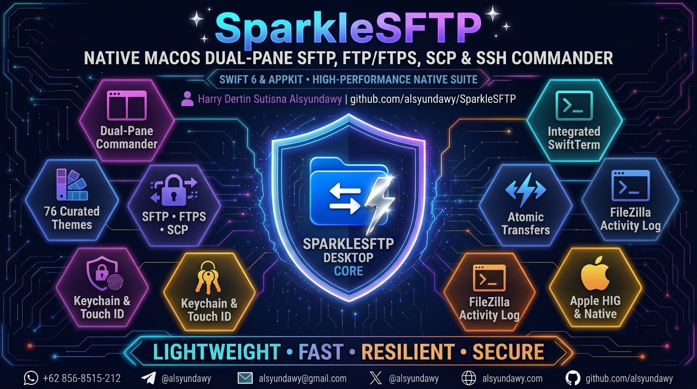
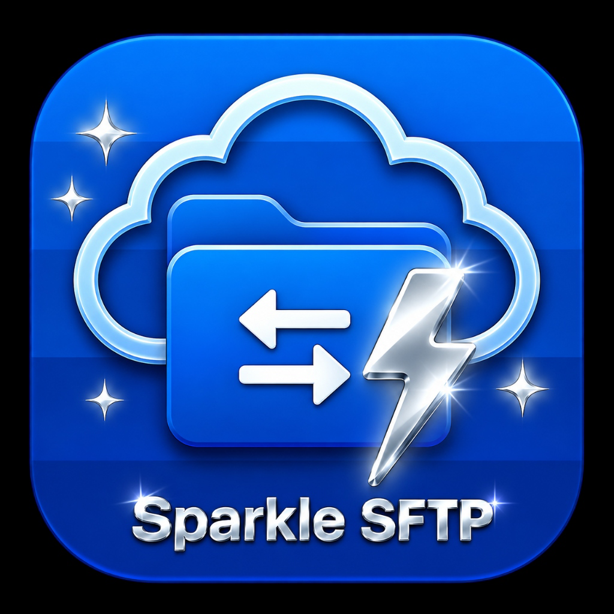

<!-- markdownlint-disable-file MD013 MD022 MD026 MD032 MD033 MD041 MD060 -->

<p align="center">
  <a href="https://github.com/alsyundawy/SparkleSFTP">
    
  </a>
</p>

<p align="center">
  <a href="https://github.com/alsyundawy/SparkleSFTP">
    
  </a>
</p>

<h1 align="center">SparkleSFTP</h1>

<p align="center">
  <b>SparkleSFTP — Lightweight, blazing-fast native macOS Dual-Pane SFTP, FTP/FTPS, SCP &amp; SSH Commander.</b><br>
  <i>Engineered with Swift 6 and native SwiftUI + AppKit architecture for maximum transfer performance, zero-cloud security, and minimal memory footprint</i>
</p>

<p align="center">
  <b>English</b> &nbsp;|&nbsp; <a href="README-id.md"><b>Bahasa Indonesia</b></a>
</p>

<p align="center">
  <a href="https://github.com/alsyundawy/SparkleSFTP/releases/latest"></a>
  <a href="https://apple.com/macos"></a>
  <a href="https://github.com/alsyundawy/SparkleSFTP"></a>
  <a href="https://developer.apple.com/swift/"></a>
  <a href="https://developer.apple.com/xcode/swiftui/"></a>
  <a href="LICENSE"></a>
  <a href="https://github.com/alsyundawy/SparkleSFTP/actions"></a>
</p>

<p align="center">
  <b>SparkleSFTP</b> is a premier native file transfer suite and dual-pane commander crafted exclusively for macOS. Built from the ground up to replace outdated transfer utilities, SparkleSFTP prioritizes energy efficiency, memory minimalism, cryptographic security, and power-user ergonomics without any Electron or webview bloat.
</p>

<p align="center">
  <a href="#-quick-download--installation-guide">
    
  </a>
  <a href="https://github.com/alsyundawy/SparkleSFTP/releases/latest">
    
  </a>
  <a href="docs/ARCHITECTURE.md">
    
  </a>
  <a href="https://github.com/alsyundawy/SparkleSFTP/issues">
    
  </a>
</p>

---

> Lead Developer & Maintainer:<br>
> **[`HARRY DERTIN SUTISNA ALSYUNDAWY (@alsyundawy)`](https://github.com/alsyundawy)** — [`ALSYUNDAWY IT SOLUTION`](https://alsyundawy.com)<br>
>
> 📋 **[`Implementation Plan`](docs/IMPLEMENTATION_PLAN.md)** &nbsp;|&nbsp;
> 🔍 **[`14-Pillar Code Review`](docs/CODE_REVIEW_14_PILLARS.md)** &nbsp;|&nbsp;
> 📐 **[`Architecture`](docs/ARCHITECTURE.md)** &nbsp;|&nbsp;
> 🗺️ **[`Roadmap & Release Gate`](docs/ROADMAP.md)** &nbsp;|&nbsp;
> 🔐 **[`Security Policy`](SECURITY.md)** &nbsp;|&nbsp;
> 📜 **[`Changelog`](CHANGELOG.md)** &nbsp;|&nbsp;
> 🤝 **[`Contributing`](CONTRIBUTING.md)** &nbsp;|&nbsp;
> 💖 **[`Support via PayPal`](https://www.paypal.me/alsyundawy)**

---

## 🌟 Key Highlights & What Makes SparkleSFTP Special

- ✍️ **Internal Code & Text Editor (TextKit 2, 52+ Languages & Lua Macro Engine)**: Ultra-fast native editor built on Apple TextKit 2 with zero-allocation UTF-8 line traversal, syntax highlighting for 52+ programming languages and system configs, embedded sandboxed Lua macro automation engine (`EditorMacroEngine`, `⌘K`), developer tools hub (Base64, JSON, Hash, Timestamps), permanent dark toolbar (`#21252b`), find/replace with regex, and ergonomic multi-tab bar with dirty indicators (`●` yellow `#e5c07b`) and read-only badges.
- 📂 **Dual-Pane Commander Architecture & Diffable Animations**: High-speed side-by-side local and remote directory browsers with native AppKit cell reuse, fine-grained `CollectionDifference` diffable animations eliminating table reload flicker, native drag-and-drop to/from macOS Finder, clickable breadcrumbs bar, F3–F8 function key bar, category filter bar, and synchronized folder browsing.
- ⚛️ **Post-Quantum Cryptography & OpenSSH 10.x Standards**: Hybrid ML-KEM-768 (`mlkem768x25519-sha256`, NIST FIPS 203) and Streamlined NTRU Prime (`sntrup761x25519-sha512@openssh.com`) key exchange with real-time post-quantum connection telemetry badges, OpenSSH `known_hosts` bidirectional synchronization, multi-hop ProxyJump parser, dynamic SOCKS5 port forwarding, SSH Agent Unix socket forwarding (`SSH_AUTH_SOCK`), FIDO2/U2F hardware token detection, and modern SFTP protocol extensions (`limits`, `statvfs`, `fsync`, `copy-data`, `md5/sha256`).
- 🔒 **Enterprise FTPS Parity & Certificate Shielding**: Explicit FTPS dynamic STARTTLS framer with preflight `SecTrust` and OCSP/CRL revocation verification, interactive X.509 visual certificate inspector (`CertificateInspectorSheet`) with TOFU pinning, Active Mode FTP (`PORT`/`EPRT`), Windows IIS listing parser, and fallback charset negotiation (UTF-8 -> Latin1 -> Windows-1252 -> ASCII).
- 🚀 **High-Performance Transfer Engine & Block-Level Resume**: Pipelined SFTP upload resume with 64 KB block-level prefix SHA-256 verification against corruption, remote-to-remote direct streaming transfer engine (`TransferQueue+RemoteToRemote`), streaming `READDIR` AsyncSequence generator for 100,000+ files, shortest-job-first priority admission, bilateral randomized jitter backoff, and macOS Dock transfer progress bar.
- 🖥️ **Remote Linux Server Administration**: Native Systemd service controller (`systemctl status/restart/reload` for Nginx, Apache, PHP-FPM, MariaDB, Docker, etc.), process explorer (`ps aux` / `kill`), Docker manager, remote log viewer (`tail -f`), and real-time server telemetry (`/proc/loadavg`, `free -m`, `df -h`).
- 🚀 **Modernized Streaming SCP Compatibility Engine**: 64 KB chunked streaming directly to/from disk (`FileHandle`) eliminating RAM exhaustion (`CWE-400`), decompression bomb ceiling (`CWE-409`), and opt-in `sudo -n` root elevation with strict single-quote escaping (`CWE-78`).
- 📡 **Network Diagnostics & Built-in Subnet Calculator**: Real-time asynchronous TCP probe for common server ports (22, 21, 990, 80, 443, 3306, 5432, 6379) via `NWConnection`, multi-sample host latency probe (`HostLatencyProbe`), and offline IPv4 Subnet & CIDR calculation hub (`⌘⌥S`) ported from SubnetCalc for macOS.
- 💻 **Persistent Terminal Drawer & Standalone Split Terminal**: AppKit `TerminalView` retaining 10,000 lines of scrollback history across drawer toggles, 16ms frame coalescing for silky-smooth stdout, inline find bar (`magnifyingglass`), and standalone terminal (`⌘⌥T`) with iTerm2-style vertical (`⌘D`) and horizontal (`⌘⇧D`) split panes.
- 🛡️ **2025–2026 Security Vulnerability Shielding**: Proactive version audit for CVE-2024-6387 (regreSSHion), strict Terrapin attack mitigation (CVE-2023-48795), swift-nio-ssh pin gate (CVE-2026-43798), swift-nio CRLF injection defense (CVE-2026-28970), Zip-Slip traversal defense (CVE-2026-52886/57233), XML entity limit (CVE-2026-105925), and SQLite corruption auto-quarantine with orphan `.filepart` GC.
- 🔒 **Native Configuration Bundles & Vault (`.sparkleconfig` / `.sparklevault`)**: Securely backup and restore profiles with AES-256-GCM encryption, PBKDF2-HMAC-SHA256 (600,000 iterations), AAD header binding, and zero-knowledge memory zeroization. Import FileZilla XML, WinSCP INI, and OpenSSH configs with 4 conflict policies.
- ⚙️ **Comprehensive 10-Tab Settings Registry & Universal Search (`⌘,`)**: Centralized preferences registry featuring dynamic search, per-tab reset, and settings dictionary import/export across all 10 tabs.
- 🔍 **High-Performance Directory Comparison**: Instant $O(N+M)$ comparison detecting identical files, size mismatches, modification time differences, and missing items across 10,000+ files in milliseconds.
- 📝 **External Editor Watcher & Sync-Back**: Edit remote files seamlessly in your favorite editor (VS Code, Sublime, BBEdit) with automatic change detection and sandboxed sync-back.
- ⚡ **Bandwidth Limiter & Adaptive Pipeline Depth**: Token-bucket transfer speed limiter and dynamic latency-sensing pipeline controller (1–16 window) with exponential backoff retries.
- 🏷️ **Batch Rename & Multi-Hash Checksums**: Pure rule planner for batch file renaming with `[C]` counters and streaming SHA-256, SHA-512, SHA-1, and MD5 hash verification.
- 📦 **Safe Archive Toolkit**: Multi-format archive compression and extraction (ZIP, TAR, GZ) with Zip-Slip path traversal immunity.
- ⌘ **Command Palette (`⌘⇧P`)**: Spotlight-style quick launcher for commands, bookmarks, connections, and settings navigation.
- 📌 **Bookmarks & Path History Manager**: Save local and remote directory bookmarks with custom icons and host scoping, plus Synchronized Browsing.
- 🌲 **Directory Tree Navigation Sidebar**: Collapsible tree navigation for both local and remote panes with cycle-safe symlink detection.
- ⚡ **Zero Runaway CPU & Battery Coolness**: Engineered with precision AppKit window notifications, eliminating redraw loops so your Mac stays cool and battery usage drops to 0.0% at idle.
- 🎨 **All 76 Themes Restored & Instant Eager Access**: Complete catalog of 76 curated themes meeting WCAG 2.1 AA/AAA contrast guidelines.
- ⚡ **macOS Finder QuickActions & URL Schemes**: Native system service "Open in SparkleSFTP" and registered `sftp://`, `ftps://`, and `ssh://` protocol scheme handlers.
- 🔐 **Apple Keychain & Touch ID Security**: Zero-cloud local security storing credentials, passwords, and private SSH keys strictly inside macOS Keychain.
- 🌐 **100% Localization Parity**: Complete synchronization across English (`en.json`) and Indonesian (`id.json`) spanning 742 localized strings.

---

## 📥 Quick Download & Installation Guide

### Step 1: Download the Universal 2 DMG

Grab the latest official release image **`SparkleSFTP-0.7.0-universal.dmg`** from GitHub Releases.

### Step 2: Drag to Applications

1. Double-click `SparkleSFTP-0.7.0-universal.dmg` to mount the disk image.
2. Drag the **SparkleSFTP** icon into your **Applications** folder.
3. Launch SparkleSFTP from Launchpad, Finder, or Spotlight (`⌘Space`).

### Step 3: Gatekeeper First-Launch Tip

Because community builds are ad-hoc signed, macOS may ask for initial confirmation on first launch:

- **Easiest Method**: Right-click (or `Control` + Click) **SparkleSFTP** in `/Applications`, choose **Open**, and click **Open** in the dialog.
- **Terminal Alternative**:

  ```bash
  xattr -dr com.apple.quarantine /Applications/SparkleSFTP.app
  ```

### Step 4: Previewing the Showcase Gallery

To explore all 8 showcase screens of the Sparkle Commander visual refresh:

```bash
/Applications/SparkleSFTP.app/Contents/MacOS/SparkleSFTP --showcase-gallery
```

---

## ⌨️ Essential Keyboard Shortcuts

| Shortcut             | Action                 | Description                                                 |
| :------------------- | :--------------------- | :---------------------------------------------------------- |
| `⌘⇧P`                | Command Palette        | Spotlight-style instant action and navigation launcher      |
| `⌘A`                 | Select All             | Select all files and folders in the active file pane        |
| `Esc` / `⇧⌘A` / `⌘D` | Deselect All           | Deselect / cancel selection of all files and folders        |
| `F3`                 | View File              | Instant QuickLook file preview                              |
| `F4`                 | Edit File              | Open file in TextKit 2 Internal Code Editor (`⌘H` Find/Mark)|
| `F5`                 | Cross-Pane Transfer    | Transfer selected items directly to the opposing file pane  |
| `⇧F5`                | Copy To...             | Prompt for a custom destination directory to copy files     |
| `F6`                 | Move / Rename          | Move or rename selected files across panes                  |
| `F7`                 | New Folder             | Create new directory in active pane                         |
| `F8`                 | Delete Items           | Safe deletion with prompt dialog                            |
| `⌘C` / `⌘V`          | Clipboard Copy / Paste | Standard macOS clipboard file operations                    |
| `⌥⌘L`                | Toggle Activity Log    | Show or hide the real-time command log in sidebar           |
| `⌘⌥T`                | Standalone Terminal    | Open the multi-tab iTerm2 terminal workspace                |
| `⌘\`                 | Toggle Quick Connect   | Show or hide the quick connect connection bar               |
| `⌘1` / `⌘2`          | Pane Focus             | Switch keyboard focus between Local and Remote file tables  |
| `⌘K`                 | Lua Macro Console      | Open sandboxed Lua scripting and automation console         |
| `⌘,`                 | Preferences            | Open the 10-tab Settings window with Search & Reset         |
| `⌘⌥S`                | Subnet Calculator      | Open native IPv4 Subnet / CIDR calculation hub              |
| `⇧⌘I`                | Import Connections     | Import connection profiles from WinSCP, FileZilla, or Vault |
| `⇧⌘E`                | Export Connections     | Export connection profiles with protocol preservation       |
| `⌘W`                 | Close Tab              | Close the active workspace connection tab                   |

---

## 🛡️ Security & Privacy Assurance

- **100% Local & Zero Telemetry**: SparkleSFTP does not track, collect, or transmit any analytics, server addresses, or transfer data.
- **Encrypted Local Storage**: SSH passphrases, passwords, and private keys reside directly in macOS Keychain with hardware Touch ID gating.
- **SHA-256 Checksum Verification**:

```bash
shasum -a 256 SparkleSFTP-0.7.0-universal.dmg
# Expected SHA-256: 58f39b5a09d53471722264a5d3f5db68c5e0067221b492a01742cfd12b78ab69
```

---

## 🛠️ Building & Contributing Locally

Build and test using Swift 6 on macOS 13+:

```bash
swift build -j 2
Tools/Release/build-universal.sh
Tools/Release/create-dmg.sh dist/SparkleSFTP.app 0.7.0
Tools/Release/generate-appcast.sh
```

---

<p align="center">
  Distributed under the <b>MIT License</b>. Crafted with ❤️ for macOS power users by <a href="https://github.com/alsyundawy"><b>@alsyundawy</b></a>
</p>
