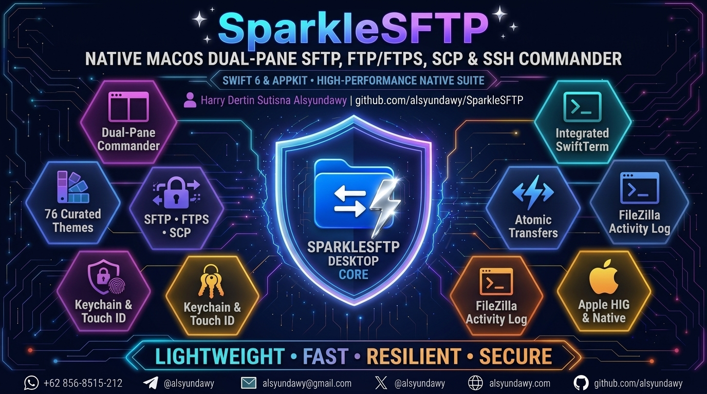

<!-- markdownlint-disable-file MD013 MD022 MD026 MD032 MD033 MD041 MD060 -->

<p align="center">
  <a href="https://github.com/alsyundawy/SparkleSFTP">
    
  </a>
</p>

<p align="center">
  <a href="https://github.com/alsyundawy/SparkleSFTP">
    
  </a>
</p>

<h1 align="center">SparkleSFTP</h1>

<p align="center">
  <b>SparkleSFTP — Lightweight, blazing-fast native macOS Dual-Pane SFTP, FTP/FTPS, SCP &amp; SSH Commander.</b><br>
  <i>Engineered with Swift 6 and native SwiftUI + AppKit architecture for maximum transfer performance and minimal memory footprint</i>
</p>

<p align="center">
  <b>English</b> &nbsp;|&nbsp; <a href="README-id.md"><b>Bahasa Indonesia</b></a>
</p>

<p align="center">
  <a href="https://github.com/alsyundawy/SparkleSFTP/releases/tag/v0.4.0"></a>
  <a href="https://apple.com/macos"></a>
  <a href="https://github.com/alsyundawy/SparkleSFTP"></a>
  <a href="https://developer.apple.com/swift/"></a>
  <a href="https://developer.apple.com/xcode/swiftui/"></a>
  <a href="LICENSE"></a>
  <a href="https://github.com/alsyundawy/SparkleSFTP/actions"></a>
</p>

<p align="center">
  <b>SparkleSFTP</b> is an elegant, lightning-fast native dual-pane file management and transfer commander built exclusively for macOS. Designed from the ground up as a modern alternative to legacy tools, SparkleSFTP prioritizes energy efficiency, memory minimalism, cryptographic security, and power-user ergonomics without any Electron or webview bloat.
</p>

<p align="center">
  <a href="#-quick-download--installation-guide">
    
  </a>
  <a href="https://github.com/alsyundawy/SparkleSFTP/releases/tag/v0.4.0">
    
  </a>
  <a href="docs/ARCHITECTURE.md">
    
  </a>
  <a href="https://github.com/alsyundawy/SparkleSFTP/issues">
    
  </a>
</p>

---

> Lead Developer & Maintainer:<br>
> **[`HARRY DERTIN SUTISNA ALSYUNDAWY (@alsyundawy)`](https://github.com/alsyundawy)** — [`ALSYUNDAWY IT SOLUTION`](https://alsyundawy.com)<br>
>
> 📋 **[`Implementation Plan`](docs/IMPLEMENTATION_PLAN.md)** &nbsp;|&nbsp;
> 🔍 **[`14-Pillar Code Review`](docs/CODE_REVIEW_14_PILLARS.md)** &nbsp;|&nbsp;
> 📐 **[`Architecture`](docs/ARCHITECTURE.md)** &nbsp;|&nbsp;
> 🗺️ **[`Roadmap & Release Gate`](docs/ROADMAP.md)** &nbsp;|&nbsp;
> 🔐 **[`Security Policy`](SECURITY.md)** &nbsp;|&nbsp;
> 📜 **[`Changelog`](CHANGELOG.md)** &nbsp;|&nbsp;
> 🤝 **[`Contributing`](CONTRIBUTING.md)** &nbsp;|&nbsp;
> 💖 **[`Support via PayPal`](https://www.paypal.me/alsyundawy)**

---

## 🌟 Key Highlights & User Benefits in v0.4.0

- 🚀 **Engineered for High-Frequency Transfers**: Features an 80ms (~12.5 Hz) progress coalescing and throttling window (`TransferMonitor`), decoupling SwiftUI view invalidation and preventing table scrolling jitter during large-scale file batches.
- 🛡️ **Cross-Platform Transfer Resilience**:
  - Catches and gracefully tolerates Linux/FreeBSD/OpenBSD `SSH_FXP_SETSTAT` permission issues without failing entire transfer jobs.
  - Automatically filters macOS metadata clutter (`.DS_Store` and AppleDouble `._*` resource forks).
  - Employs temporary `.filepart` naming with atomic rename on full completion to prevent corrupted partial files.
- ⚡ **Zero Runaway CPU & Battery Coolness**: Engineered with precision AppKit window notifications (`NSWindow.didResizeNotification`), eliminating redraw loops so your Mac stays cool and battery usage drops to 0.0% at idle.
- 📜 **Real-Time FileZilla Activity Log Console (`⌥⌘L`)**: Live color-coded server activity log showing connection negotiations, raw commands, server replies, and transfer statuses. Features dedicated **Minimize / Restore arrow controls** (`chevron.up` to hide, `chevron.down` to restore).
- 🚀 **Resilient Background Transfer Queue**: Non-blocking batch transfers with 8 conflict resolution policies, pause/resume capabilities, and dedicated **Minimize / Restore arrow controls** (`chevron.down` to collapse, `chevron.up` to restore).
- 💻 **Standalone iTerm2-Style Terminal (`⌘⌥T`)**: Dedicated terminal workspace featuring split vertical (`⌘D`) and horizontal (`⌘⇧D`) panes, remote SSH sessions, local shell tabs, and live palette synchronization.
- 🎨 **76 Curated Built-in Themes across 26 Families**: Full WCAG 2.1 AA/AAA contrast adherence across light and dark aesthetics, with dynamic live preview, JSON theme import/export, and instant switching.
- 🔐 **Apple Keychain & Touch ID Security**: Zero-cloud local security storing credentials, passwords, and private SSH keys strictly inside macOS Keychain.

---

## 📥 Quick Download & Installation Guide

### Step 1: Download the Universal 2 DMG

Grab the latest official release image **`SparkleSFTP-0.4.0-universal.dmg`** from GitHub Releases.

### Step 2: Drag to Applications

1. Double-click `SparkleSFTP-0.4.0-universal.dmg` to mount the disk image.
2. Drag the **SparkleSFTP** icon into your **Applications** folder.
3. Launch SparkleSFTP from Launchpad, Finder, or Spotlight (`⌘Space`).

### Step 3: Gatekeeper First-Launch Tip

Because community builds are ad-hoc signed, macOS may ask for initial confirmation on first launch:

- **Easiest Method**: Right-click (or `Control` + Click) **SparkleSFTP** in `/Applications`, choose **Open**, and click **Open** in the dialog.
- **Terminal Alternative**:

  ```bash
  xattr -dr com.apple.quarantine /Applications/SparkleSFTP.app
  ```

---

## ⌨️ Essential Keyboard Shortcuts

| Shortcut | Action | Description |
| :--- | :--- | :--- |
| `F5` | Cross-Pane Transfer | Transfer selected items directly to the opposing file pane |
| `⇧F5` | Copy To... | Prompt for a custom destination directory to copy files |
| `⌘C` / `⌘V` | Clipboard Copy / Paste | Standard macOS clipboard file operations |
| `⌥⌘L` | Toggle Activity Log | Show or hide the FileZilla-style real-time command log |
| `⌘⌥T` | Standalone Terminal | Open the multi-tab iTerm2 terminal workspace |
| `⌘\` | Toggle Quick Connect | Show or hide the quick connect connection bar |
| `⌘1` / `⌘2` | Pane Focus | Switch keyboard focus between Local and Remote file tables |
| `⌘,` | Preferences | Open the Settings window with Theme, Locale, and Update tabs |
| `⌘W` | Close Tab | Close the active workspace connection tab |

---

## 🛡️ Security & Privacy Assurance

- **100% Local & Zero Telemetry**: SparkleSFTP does not track, collect, or transmit any analytics, server addresses, or transfer data.
- **Encrypted Local Storage**: SSH passphrases, passwords, and private keys reside directly in macOS Keychain with hardware Touch ID gating.
- **SHA-256 Checksum Verification**:

```text
888f6f7bf744e221396e507ac30934eccbbf57a2b638d6848b0bfe3c99bff25e  SparkleSFTP-0.4.0-universal.dmg
```

Verify in Terminal:

```bash
shasum -a 256 SparkleSFTP-0.4.0-universal.dmg
```

---

## 🛠️ Building & Contributing Locally

Build and test using Swift 6 on macOS 13+:

```bash
swift build -j 2
Tools/Release/build-universal.sh
Tools/Release/create-dmg.sh dist/SparkleSFTP.app 0.4.0
```

---

<p align="center">
  Distributed under the <b>MIT License</b>. Crafted with ❤️ for macOS power users by <a href="https://github.com/alsyundawy"><b>@alsyundawy</b></a>
</p>
