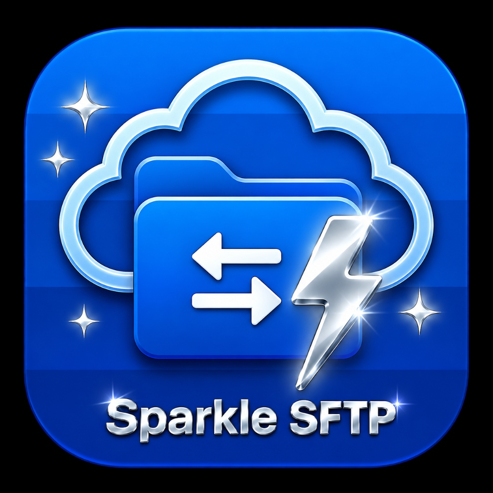
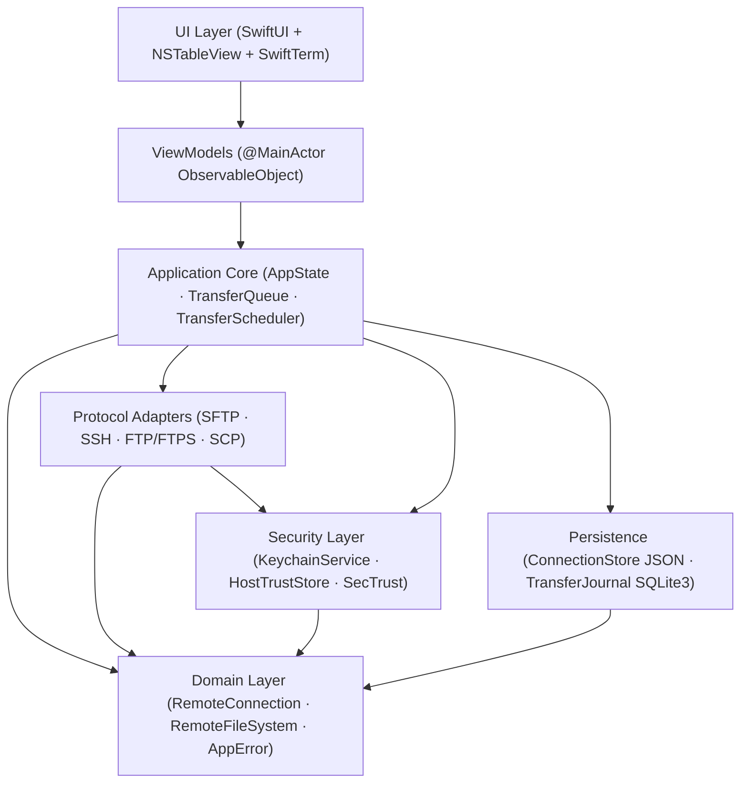

<p align="center">
  
</p>

<h1 align="center">SparkleSFTP</h1>

<p align="center">
  <b>Native macOS Dual-Pane SFTP, FTP/FTPS, SCP &amp; SSH Commander — Built with Swift 6 &amp; SwiftUI</b><br>
  <i>High-performance file management, Keychain + Touch ID security, integrated SwiftTerm PTY terminal, and crash-resilient atomic transfers without Electron bloat</i>
</p>

<p align="center">
  <b>English</b> &nbsp;|&nbsp; <a href="README-id.md"><b>Bahasa Indonesia</b></a>
</p>

<p align="center">
  <a href="docs/ROADMAP.md"></a>
  <a href="https://apple.com/macos"></a>
  <a href="https://developer.apple.com/swift/"></a>
  <a href="https://developer.apple.com/xcode/swiftui/"></a>
  <a href="LICENSE"></a>
  <a href="https://github.com/alsyundawy/SparkleSFTP/actions"></a>
</p>

> Lead Developer & Maintainer:<br>
> **[`HARRY DERTIN SUTISNA ALSYUNDAWY (@alsyundawy)`](https://github.com/alsyundawy)** — [`ALSYUNDAWY IT SOLUTION`](https://alsyundawy.com)<br>
>
> 📋 **[`Implementation Plan`](docs/IMPLEMENTATION_PLAN.md)** &nbsp;|&nbsp;
> 🔍 **[`14-Pillar Code Review`](docs/CODE_REVIEW_14_PILLARS.md)** &nbsp;|&nbsp;
> 📐 **[`Architecture`](docs/ARCHITECTURE.md)** &nbsp;|&nbsp;
> 🗺️ **[`Roadmap & Release Gate`](docs/ROADMAP.md)** &nbsp;|&nbsp;
> 🔐 **[`Security Policy`](SECURITY.md)** &nbsp;|&nbsp;
> 📜 **[`Changelog`](CHANGELOG.md)** &nbsp;|&nbsp;
> 🤝 **[`Contributing`](CONTRIBUTING.md)** &nbsp;|&nbsp;
> 💖 **[`Support via PayPal`](https://www.paypal.me/alsyundawy)**

---

> [!IMPORTANT]
>
> ### Repository Status: Full MVP Implemented (Swift 6 + macOS 13+)
>
> All core SwiftPM modules (`Package.swift`, `src/App/`, `src/Packages/*`, `src/Features/`, `Tests/*`, `Tools/*`) are implemented and verified with `swift build` and `swift test`. See [`docs/TECHNICAL_SPECIFICATION.md`](docs/TECHNICAL_SPECIFICATION.md), [`DOCNOTE.md`](DOCNOTE.md), [`TODO.md`](TODO.md), and [`docs/IMPLEMENTATION_PLAN.md`](docs/IMPLEMENTATION_PLAN.md).
>
> **Project Lineage:** Originally drafted under the working title `MacSFTP` and standardized as **SparkleSFTP** with all 55 findings from [`docs/CODE_REVIEW_14_PILLARS.md`](docs/CODE_REVIEW_14_PILLARS.md) integrated prior to coding.

---

## Navigation

- [Overview & Vision](#overview--vision)
- [Technology Stack](#technology-stack)
- [System Architecture](#system-architecture)
- [Security & Hardening Baseline](#security--hardening-baseline)
- [Repository Layout](#repository-layout)
- [Roadmap Summary](#roadmap-summary)
- [Documentation & ADRs](#documentation--adrs)
- [Contributing & Quality Gates](#contributing--quality-gates)
- [License](#license)

---

## Overview & Vision

**SparkleSFTP** is a native macOS file transfer and SSH Commander application designed for engineers, sysadmins, and DevOps workflows who want WinSCP-style dual-pane productivity with first-class macOS ergonomics:

- **Dual-Pane Commander & WinSCP Context Menus**: Local ↔ Remote and Remote ↔ Remote panes backed by AppKit `InteractiveFileTableView` (`NSTrackingArea` row hover feedback, right-click auto-selection, `⌘A` Select All, `F2`–`F9` shortcuts, Quick Look, Finder drag-and-drop), plus WinSCP-inspired context menus (`Edit` submenu -> Internal Notepad / External App / Preferences, `Copy... F5`, `Move... F6`, `File Custom Commands` -> Compare Files / Compress & Upload `.gz` via `-lz` / Verify SHA-256 / POSIX-quoted Custom SSH Command, and `File Names` -> Insert to Command Line / Copy Name / Copy Full Path).
- **Independent Multi-Window, FileZilla/WinSCP Multi-Tab Connections (`⌘N` / `⌘T`) & 1-Tab = 1-Shell**: `AppEnvironment` mints an isolated `AppState` per window (`WindowGroup` + `FocusedValues`) so `New Window` always opens a clean sessionless window rather than cloning an active session, paired with `WorkspaceTabBar` (`WorkspaceTabStripRepresentable` + AppKit `TabBarActionButton`, paired local+remote state per tab, duplicate `#2` host tabs, instant tab switching/closing, `⌘W` / `⌘⇧[` / `⌘⇧]`, tab context menu, and `Connect in New Window`). Each workspace tab binds 1-to-1 with its own single remote `TerminalTabSession` (`workspaceTabID` + `remoteSessionID`, switching tabs syncs the bound SSH Shell while unconnected tabs keep Quick Connect visible and hide the Shell drawer), while `QuickConnectBar`, the Quickconnect toggle, and toolbar `Connect` remain strictly visible only on unconnected New Tabs / New Windows.
- **Minimalist Notepad2 Internal File Editor (`⌘E`)**: Embedded multi-tab AppKit `NSTextView` editor (`src/Features/Editor/`) with `NSRulerView` line numbers, active palette syntax highlighting, whitespace glyph overlay (`¶`), word wrap, zoom `+/-/%`, read-only lock, regex Find & Replace, Go-to-Line, text transforms (UPPER/lower/Title/Trim/Sort), `UTF-8`/`UTF-8 BOM`/`UTF-16 LE`/`ASCII` + `LF`/`CRLF` converters, and remote save + auto-upload.
- **Multi-Theme Engine (`76` SparkNotePad/NotepadNext Palettes) & Full Workspace Sync**: `76` curated themes across `26` developer families (`NotepadNext`, `Catppuccin`, `Dracula`, `Tokyo Night`, `Nord`, `One Dark`, `Gruvbox`, `Solarized`, `GitHub`, `Monokai`, `Rosé Pine`, `Night Owl`, `SynthWave '84`, `Cobalt2`, `Tomorrow`, and 11 studio palettes) with `Auto / Light / Dark` mode, Live Active Theme Preview card, structured search + tone filters, responsive clickable `LazyVGrid` cards (`PreferencesThemeTab`), grouped 26-family menus (`MainWindowView`), WCAG 2.1 AA contrast validation on both canvas and chrome, custom JSON theme import/export, and persistent `SparkleWindowConfigurator` (`Close`/`Minimize`/`Zoom` traffic lights + `NSAppearance` + `NSWindow.backgroundColor`) propagation across Main, Preferences, About, and Editor windows.
- **Connection Manager, AppKit Cursor Focus, Shortcuts & Keychain Password Memory**: Native AppKit `ConnectionListTableView` & `InteractiveFileTableView` (`NSTrackingArea` row hover highlight, `rightMouseDown` immediate row selection, exact modifier-scoped responder validation for `F2`/`F5`/`F6`/`F7`/`F8`/`F9`, `⌘A`, `⌘C`, `⌘⇧C` Copy Filenames, `⌘⌥C` Copy Full Paths, `⌘↩` Insert to Shell, `⌥↩` Properties, `⌘⌫`, `⌘\`, `⌘⇧S` Synchronize menu shortcut, scoped `Tab` pane focus switching, `NSText`-safe focus guards, `⇧⌘N` New Folder), always-visible sidebar toolbar (`Connect`, `New`, `Edit`, `All`, `Delete`) + WinSCP host right-click options (`Connect`, `Connect in New Tab`, `Connect in New Window`, `Open in External Terminal`, `Edit`, `Clone`, `Copy Host Address`, `Select All`, `Delete`), atomic Edit Connection (`ConnectionEditorMode`), Keychain **Remember Password** / clear secret controls (`ConnectionEditorView`, `CredentialPromptSheet`, `FTPService`), and instant non-deadlocking quit via `applicationShouldTerminate`.
- **SparkNotePad-Style About Dialog & 1:1 Branded AppIcon**: 7-tab About window (`AboutView`, `AboutView+Tabs`, `AboutWindowController`, including `Libraries` runtime status) with native Close/Minimize/Zoom & resize controls, system/theme/session/toolchain copyable diagnostics, GitHub/maintainer/PayPal info, verified shortcuts reference, license, and a 1:1 squircle `AppIcon.png`/`.icns` styled in SparkNotePad's blue, white, and pastel yellow pencil palette.
- **Third-Party Libraries & External Terminal Integration (`zlib`, `libcurl`, `libssh2`, `OpenSSL`, `OpenSSH`, `iTerm2`)**: C11 `Clibcurl` bridges macOS SDK `-lcurl` + `-lz` (`256 KB` buffers, `TCP_NODELAY`, `TCP_KEEPALIVE`, off-cooperative GCD worker dispatch, `CWE-409`-bounded `zlib`/`gzip` codec via `ZlibCompressionCodec`), dynamic `dlopen`/`dlsym` probing for optional Homebrew `libssh2`, async `OpenSSL`/`OpenSSH` detection (`ToolchainInspector`), v0.1 `terminal.fill` Shell icon (no Local Shell), and `CWE-78`-sanitized external terminal launching (`ExternalTerminalLauncher` for `iTerm2` / `Terminal.app` / `ssh://`).
- **Multi-Thread Pipelined Transfers, EWMA Speedometer, Permissions & FileZilla Conflicts**: Actor-free ordered-submission sliding-window `SFTPPipelinedTransfer` (`64 KB` blocks, sliding window `min(32, max(2, pipelineDepth * 4))`, sequential packet enqueue + contiguous ACK prefix tracker, default `4` global / `3` per-host concurrency in `TransferScheduler`), stall-decaying `TransferSpeedMeter` (decays after `>= 0.4s` stall and resets to `0 B/s` at `>= 2.0s`, with `0.01s` start clamp and `CurlClientHelper` `total=0` filtering), reentrancy-hardened `TransferQueue` progress/pause checkpoint reconciliation + `100%` remote `.part` upload resume (`resolveUploadResumeOffset`), conflict `.skip` zero-byte cleanup, bottom-up (`deepest first`) POSIX permission (`& 0o777`) & hidden-dotfile folder preservation (`0o700` temporary upload/download write guard, `0o755` dir defaults in `RemoteFile`/`SFTPService`/`FTPListingParser`), debounced pane auto-refresh, FileZilla-inspired `ConflictResolutionSheet` (Source vs Target comparison cards, 7 overwrite/resume/rename/skip actions, per-queue/direction sticky rules), and FIFO serialized `pendingConflictQueue`.
- **Responsive Runtime Architecture**: Dedicated `TransferMonitor` isolating 10Hz transfer updates from whole-window SwiftUI re-renders, cached `AppStrings` & `SparkleThemePalette`, 2-second throttled SQLite WAL checkpoints during active transfers, and single-`lstat` POSIX local directory enumeration.
- **Maintainable JSON i18n, Language Cards & Importers**: JSON locale catalogs (`en.json` & `id.json`, `365` synchronized keys) + runtime override directory (`~/Library/Application Support/SparkleSFTP/Locales/`), redesigned clickable language card grid (`PreferencesLocalizationTab`), toolbar/status-bar/menu Globe switchers (`MainWindowView`, `SparkleSFTPApp`), and preview-based FileZilla XML (`<Folder>`, `base64`, `crypt` protection) & WinSCP INI (UTF-16LE/BE BOM, `0xA3` simple password decryption with fail-closed `UseMasterPassword=1` guard, `FSProtocol`, proxies, nested folders) importer (`ExternalSessionFileReader`, `ImportConnectionsSheet`).
- **Auto-Update Controls & Bidirectional Sync**: Configurable `AutoUpdateSettings` (auto-check/download, `Hourly`/`Daily`/`Weekly`/`Manual` frequency, `Stable`/`Beta` channel, HTTPS feed validation, community GitHub Releases API fallback check) and full `SyncDirection` (`Local -> Remote`, `Remote -> Local`, `Bidirectional Newest Wins`).
- **Complete Protocol Coverage**: SFTP, SSH Terminal (PTY), Explicit/Implicit FTPS, Plain FTP (with explicit security warnings), and isolated SCP fallback (`SCPCompatibilityAdapter`).
- **Actor-Isolated Transfer Engine**: Bounded global and per-host concurrency, checkpointed pause/resume with remote metadata revalidation, durable `TransferJournal` crash recovery, and atomic temporary-write + SHA-256 verification.
- **Security from Day One**: Device-locked Apple Keychain (`kSecAttrAccessibleWhenUnlockedThisDeviceOnly`), optional Touch ID unlock, strict TOFU host key state machine, `SecTrust` TLS validation, and zero-secret `OSLog` privacy redaction.

---

## Technology Stack

| Layer                             | Technology                                                    | Purpose & Security Baseline                                                                                                                                        |
| :-------------------------------- | :------------------------------------------------------------ | :----------------------------------------------------------------------------------------------------------------------------------------------------------------- |
| **Language**                      | Swift 6                                                       | Strict concurrency, actor isolation, `Sendable` safety                                                                                                             |
| **UI Framework**                  | SwiftUI + AppKit (`NSTableView`)                              | Native macOS HIG with cell-reused high-volume tables (`ObservableObject` for macOS 13+)                                                                            |
| **SSH & SFTP**                    | `apple/swift-nio-ssh` (`0.15.1` >= `0.14.1`) + SFTP v3 Codec  | Async/await SFTP v3, PTY, port forwarding; mitigates CVE-2026-43798 & supports macOS 13+                                                                           |
| **FTP / FTPS & Toolchain Bridge** | System `libcurl` + `zlib` (`Clibcurl`) + `ToolchainInspector` | `256 KB` TCP keepalive GCD workers locked to `ftp,ftps` (no CVE-2025-15224), bounded `CWE-409` zlib/gzip, dynamic `libssh2` probe, OpenSSL/OpenSSH/shell detection |
| **SSH Terminal**                  | `SwiftTerm` (`1.20.0`) + `ExternalTerminalLauncher`           | VT100/xterm remote PTY & sanitized `iTerm2` / `Terminal.app` launch                                                                                                |
| **Secrets & Trust**               | Apple `Security.framework`                                    | Native Keychain ACLs (`WhenUnlockedThisDeviceOnly`), Touch ID (`LAContext`), `SecTrustEvaluateWithError`                                                           |
| **Persistence**                   | JSON (`Codable`) + `SQLite3` WAL                              | Atomic profile JSON (`ConnectionStore`) + ACID `TransferJournal` (macOS 13+)                                                                                       |
| **Testing**                       | Swift Testing + Docker Compose                                | Deterministic OpenSSH, vsftpd, and ProFTPD test fixtures                                                                                                           |
| **Distribution**                  | Universal 2 DMG + Sparkle                                     | `arm64` + `x86_64`, Developer ID notarized, Ed25519 signed updates                                                                                                 |

---

## System Architecture



### Non-Negotiable Layering Invariants

1. `src/App -> SparkleFeatures -> src/Packages/*`; `ProtocolAdapters -> Domain`, `Security -> Domain`, `Persistence -> Domain`.
2. Views and ViewModels must **never** invoke `NIOSSH`, `Clibcurl`, `SQLite3`, or Keychain directly.
3. `src/Packages/` modules must **never** import from `src/Features/`.
4. Transfer lifecycles live inside the actor-isolated `TransferQueue` — completely independent of window/tab lifecycles.

---

## Security & Hardening Baseline

Every design decision in SparkleSFTP enforces the remediation outcomes documented in [`docs/CODE_REVIEW_14_PILLARS.md`](docs/CODE_REVIEW_14_PILLARS.md):

| Control                     | Standard / Reference | Enforcement                                                                    |
| :-------------------------- | :------------------- | :----------------------------------------------------------------------------- |
| **SSH Pre-Auth Safety**     | CVE-2026-43798       | Pin `apple/swift-nio-ssh >= 0.15.1` (`>= 0.14.1`) in `Package.swift`           |
| **libcurl SSH Auth Safety** | CVE-2025-15224       | Lock `Clibcurl` to `ftp,ftps` (`CURLOPT_PROTOCOLS_STR`); zero `libssh` surface |
| **Keychain Device Lock**    | CWE-312 / CWE-522    | `kSecAttrAccessibleWhenUnlockedThisDeviceOnly` + SwiftLint rule                |
| **TLS Verification**        | CWE-295              | `SecTrustEvaluateWithError` + OCSP + zero silent FTPS downgrade                |
| **Host Key Trust**          | TOFU State Machine   | 6-state lifecycle; changed keys hard-block connection                          |
| **Path & Symlink Safety**   | CWE-22 / CWE-59      | Canonical path containment + symlink destination & loop guards                 |
| **Update Integrity**        | Ed25519 + TLS        | `UpdateConfigurationValidator` blocks non-HTTPS feeds & placeholder keys       |
| **Log Redaction**           | CWE-532              | `OSLog` privacy labels + SwiftLint `no_password_in_logs`                       |

---

## Repository Layout

### Implemented Swift 6 Repository Structure (Full MVP)

```text
SparkleSFTP/
├── Package.swift                  # Swift 6.0 manifest (.macOS(.v13), pinned SPM dependencies)
├── sonar-project.properties       # SonarQube / SonarScanner & SwiftLint SonarQube report bindings
├── src/
│   ├── App/                       # Executable entry (multi-window WindowGroup), AppDelegate, AppEnvironment, SparkleUpdaterService, Info.plist, Entitlements
│   ├── Features/                  # SwiftUI + AppKit Views (WorkspaceTabBar, QuickConnectBar, WinSCP Commander/Connections, 7-Tab About, Notepad2 Editor, Terminal, ConflictResolutionSheet, Preferences)
│   └── Packages/
│       ├── Clibcurl/              # Non-variadic C11 bridge over macOS SDK libcurl (-lcurl) + zlib (-lz) & libssh2 dlopen probe
│       ├── Core/                  # Domain models (ToolchainModels, Conflict/TransferModels), RemotePath, AppError, Protocols
│       ├── DesignSystem/          # SparkNotePad/NotepadNext palettes (76 themes / 26 families), Window configurator, EN/ID JSON Locales (365 keys)
│       ├── FileManager/           # LocalFileService, LocalDirectoryWatcher, POSIXPermissions, DualPaneState
│       ├── Networking/            # SFTPPacketCodec, SFTPPipelinedTransfer (64KB), SSHClientService, SCP, FTPService (GCD 256KB), ToolchainInspector
│       ├── Persistence/           # ConnectionStore (JSON), TransferJournal (SQLite3 WAL), FileZilla/WinSCP & SSH Importers
│       ├── Security/              # KeychainService, HostTrustStore, SecTrust, PathValidator (`CWE-22/59/78`), KeyParser, UpdateValidator
│       ├── Synchronization/       # DirectoryScanner, SyncPlanner (One-Way & Bidirectional, 60s TTL), SyncExecutor
│       ├── Terminal/              # SwiftTerm TerminalViewRepresentable, 1-Tab=1-Shell SessionManager, ExternalTerminalLauncher, PortForwardingManager
│       └── TransferEngine/        # TransferQueue actor, TransferScheduler (4/3), FileZilla ConflictResolver, ResumeValidator, SHA256Verifier
├── Tests/                         # 8 test targets / 27 test files (91 tests across 24 Swift Testing suites, incl. 1-tab-1-shell, loopback resume, window controls & folder perms)
├── Tools/
│   ├── Release/                   # Universal 2 build-universal.sh, create-dmg.sh, notarize.sh
│   └── TestServers/               # Docker Compose fixtures (OpenSSH, vsftpd, ProFTPD) & smoke runner
├── .github/workflows/             # ci.yml, release.yml, mega-linter.yml, codeql.yml, jekyll-gh-pages.yml
└── docs/                          # Architecture, Technical Spec, Security Model, Workground, 14-Pillar Review, Long-Term Review, ADRs 0001–0008
```

---

## Roadmap Summary

| Phase           | Milestone             | Focus & Status                                                                                                                                                                                                                                                                                                                                                                                                                            |
| :-------------- | :-------------------- | :---------------------------------------------------------------------------------------------------------------------------------------------------------------------------------------------------------------------------------------------------------------------------------------------------------------------------------------------------------------------------------------------------------------------------------------- |
| **Phase 00**    | Repository Bootstrap  | Governance, specs, 14-pillar fixes, ADRs, CI & lint guardrails _(Done)_                                                                                                                                                                                                                                                                                                                                                                   |
| **Phase 01–02** | Research & Foundation | Audited SPM graph ([ADR-004](docs/ADR/0004-direct-swift-nio-ssh-and-sftp-codec.md), [ADR-005](docs/ADR/0005-macos13-sqlite3-journal-and-observable-object.md)), `Package.swift`, `Core`, `DesignSystem` _(Done)_                                                                                                                                                                                                                          |
| **Phase 03**    | Connection & Security | `ConnectionStore`, `KeychainService`, TOFU `HostTrustStore`, `SecTrust`, Touch ID _(Done)_                                                                                                                                                                                                                                                                                                                                                |
| **Phase 04**    | Protocol Engines      | `SSHClientService` (`swift-nio-ssh 0.15.1`), SFTP v3 pipelined codec, SCP, `Clibcurl` `-lcurl`/`-lz` FTP/FTPS _(Done)_                                                                                                                                                                                                                                                                                                                    |
| **Phase 05**    | Commander UI          | Dual-pane `NSTableView`, F5–F8 shortcuts, Quick Look, Finder drag-drop _(Done)_                                                                                                                                                                                                                                                                                                                                                           |
| **Phase 06**    | Transfer Engine       | Actor `TransferQueue`, pipelined multi-thread transfers, `SQLite3` `TransferJournal`, FileZilla conflict dialog _(Done)_                                                                                                                                                                                                                                                                                                                  |
| **Phase 07**    | Terminal & Sync       | 1-Tab = 1-Shell `SwiftTerm` PTY (`terminal.fill`), External iTerm2/Terminal launcher, `-L`/`-R` port forwarding, dry-run sync, `76` themes, EN/ID (`365` keys) _(Done)_                                                                                                                                                                                                                                                                   |
| **Phase 08**    | QA & Release          | `91 tests in 24 suites` (`157` Swift files), `src/` Architecture, Multi-Window & FileZilla/WinSCP Multi-Tab (`1 Tab = 1 Shell`, Quick Connect on unconnected tabs only), AppKit Traffic Lights & Shortcuts, Preferences Themes Card Grid, `64 KB` Pipelined/Resume/Bottom-Up Folder Perms, WinSCP `0xA3` INI Password Decryption, Trunk/SonarQube/MegaLinter green, Universal 2 DMG (`release.yml`), notarization pending _(In Progress)_ |

---

## Documentation & ADRs

- **[Implementation Plan (`docs/IMPLEMENTATION_PLAN.md`)](docs/IMPLEMENTATION_PLAN.md)** — Full blueprint, interfaces, workgrounds, 125 tasks, and Docker test matrix.
- **[Technical Specification (`docs/TECHNICAL_SPECIFICATION.md`)](docs/TECHNICAL_SPECIFICATION.md)** — Target graph, toolchain contracts, and milestone acceptance gates.
- **[Security Model (`docs/SECURITY_MODEL.md`)](docs/SECURITY_MODEL.md)** — Threat controls, TOFU state machine, Keychain ACLs, and TLS rules.
- **[Workground Breakdown (`docs/WORKGROUND.md`)](docs/WORKGROUND.md)** — Domain workstreams (`WG-1`–`WG-9`) and module dependency graph.
- **[Task List (`docs/TASK_LIST.md`)](docs/TASK_LIST.md)** — Executable checklist across Milestones M1–M8.
- **[Engineering Notes (`DOCNOTE.md`)](DOCNOTE.md)** — Verified dependency findings and SDK compatibility resolutions.
- **[14-Pillar Code Review (`docs/CODE_REVIEW_14_PILLARS.md`)](docs/CODE_REVIEW_14_PILLARS.md)** — 55 findings across bugs, concurrency, memory, security CVEs, scalability, and linting.
- **[Post-Completion Long-Term Review (`docs/LONG_TERM_REVIEW_2026_11.md`)](docs/LONG_TERM_REVIEW_2026_11.md)** — 14-pillar architectural health report, technical debt register, CVE/CWE posture, SwiftUI/Swift 6 audit, and 90-day / 12-month roadmap.
- **[System Architecture (`docs/ARCHITECTURE.md`)](docs/ARCHITECTURE.md)** — Module boundaries and concurrency invariants.
- **[Roadmap & Release Gate (`docs/ROADMAP.md`)](docs/ROADMAP.md)** — Delivery milestones and MVP gate criteria.
- **[ADR-001: Tech Stack & Protocols](docs/ADR/0001-tech-stack-and-protocols.md)**
- **[ADR-002: Keychain Isolation & Host Trust](docs/ADR/0002-security-keychain-and-host-trust.md)**
- **[ADR-003: Metadata Persistence (JSON vs SwiftData)](docs/ADR/0003-metadata-persistence-swiftdata-vs-json.md)**
- **[ADR-004: Direct `swift-nio-ssh` & Native SFTP v3](docs/ADR/0004-direct-swift-nio-ssh-and-sftp-codec.md)**
- **[ADR-005: macOS 13+ SQLite3 Journal & `ObservableObject`](docs/ADR/0005-macos13-sqlite3-journal-and-observable-object.md)**
- **[ADR-006: Multi-Themes, JSON i18n, Notepad2 Editor & Auto-Update Fallback](docs/ADR/0006-post-mvp-theming-i18n-notepad2-and-updater.md)**
- **[ADR-007: Third-Party Toolchain Bridge, Pipelined Transfers & FileZilla Conflict Flow](docs/ADR/0007-third-party-toolchain-pipelined-transfers-and-filezilla-conflicts.md)**
- **[ADR-008: Multi-Window State Isolation, AppKit Tab Chrome, 76-Theme Catalog & Permission-Preserving Transfers](docs/ADR/0008-multi-window-isolation-appkit-tab-chrome-76-themes-and-transfer-pipeline.md)**

---

## Contributing & Quality Gates

Contributions are welcome! Please review [`CONTRIBUTING.md`](CONTRIBUTING.md) and [`CODE_OF_CONDUCT.md`](CODE_OF_CONDUCT.md) before opening a pull request.

Repository build, test, and linter gates can be run locally:

```bash
swiftlint lint --strict
swiftformat --lint .
swift build -j 2
swift test -j 2
markdownlint-cli2 "**/*.md" "#.build" "#DerivedData" "#.trunk"
yamllint -c .yamllint.yml .
shellcheck -s bash Tools/**/*.sh
actionlint
```

---

## License

Distributed under the **MIT License**. See [`LICENSE`](LICENSE) for the full text.

---

<p align="center">
  Made for macOS engineers by <a href="https://github.com/alsyundawy"><b>@alsyundawy</b></a>
</p>
