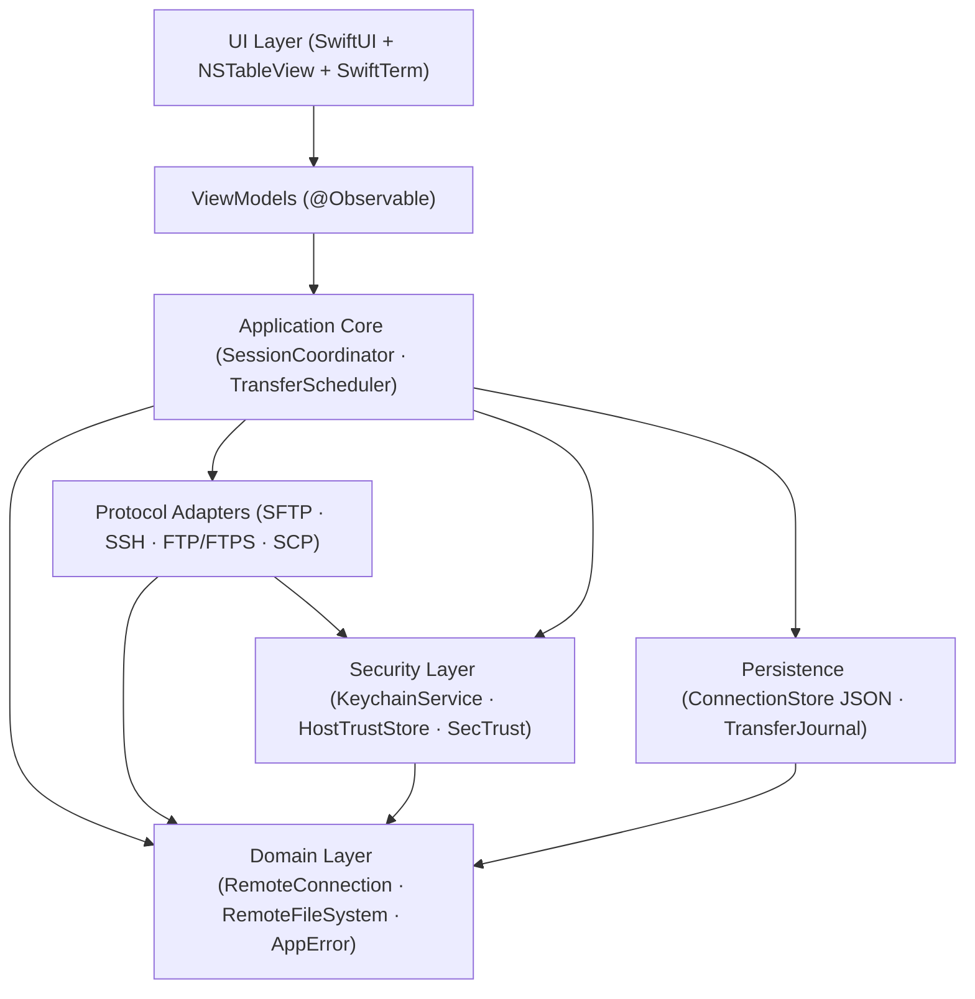

<h1 align="center">✨ SparkleSFTP</h1>

<p align="center">
  <b>Native macOS Dual-Pane SFTP, FTP/FTPS, SCP &amp; SSH Commander — Built with Swift 6 &amp; SwiftUI</b><br>
  <i>High-performance file management, Keychain + Touch ID security, integrated SwiftTerm PTY terminal, and crash-resilient atomic transfers without Electron bloat</i>
</p>

<p align="center">
  <b>English</b> &nbsp;|&nbsp; <a href="README-id.md"><b>Bahasa Indonesia</b></a>
</p>

<p align="center">
  <a href="docs/ROADMAP.md"></a>
  <a href="https://apple.com/macos"></a>
  <a href="https://developer.apple.com/swift/"></a>
  <a href="https://developer.apple.com/xcode/swiftui/"></a>
  <a href="LICENSE"></a>
  <a href="https://github.com/alsyundawy/SparkleSFTP/actions"></a>
</p>

> Lead Developer & Maintainer:<br>
> **[`HARRY DERTIN SUTISNA ALSYUNDAWY (@alsyundawy)`](https://github.com/alsyundawy)** — [`ALSYUNDAWY IT SOLUTION`](https://alsyundawy.com)<br>
>
> 📋 **[`Implementation Plan`](docs/IMPLEMENTATION_PLAN.md)** &nbsp;|&nbsp;
> 🔍 **[`14-Pillar Code Review`](docs/CODE_REVIEW_14_PILLARS.md)** &nbsp;|&nbsp;
> 📐 **[`Architecture`](docs/ARCHITECTURE.md)** &nbsp;|&nbsp;
> 🗺️ **[`Roadmap & Release Gate`](docs/ROADMAP.md)** &nbsp;|&nbsp;
> 🔐 **[`Security Policy`](SECURITY.md)** &nbsp;|&nbsp;
> 📜 **[`Changelog`](CHANGELOG.md)** &nbsp;|&nbsp;
> 🤝 **[`Contributing`](CONTRIBUTING.md)** &nbsp;|&nbsp;
> 💖 **[`Support via PayPal`](https://www.paypal.me/alsyundawy)**

---

> [!IMPORTANT]
>
> ### Repository Status: Phase 0 Bootstrap (Pre-Implementation Foundation)
>
> This repository is currently initialized with **architecture specifications, ADRs, security policies, linter/CI guardrails, and the 14-pillar critical review baseline**. Application source modules (`App/`, `Packages/`, `Features/`, `Tests/`, `Tools/`) will be scaffolded and implemented incrementally starting in Phase 01–02 as defined in [`docs/IMPLEMENTATION_PLAN.md`](docs/IMPLEMENTATION_PLAN.md).
>
> **Project Lineage:** Originally drafted under the working title `MacSFTP` and standardized as **SparkleSFTP** with all 55 findings from [`docs/CODE_REVIEW_14_PILLARS.md`](docs/CODE_REVIEW_14_PILLARS.md) integrated prior to coding.

---

## Navigation

- [Overview & Vision](#overview--vision)
- [Planned Technology Stack](#planned-technology-stack)
- [System Architecture](#system-architecture)
- [Security & Hardening Baseline](#security--hardening-baseline)
- [Repository Layout](#repository-layout)
- [Roadmap Summary](#roadmap-summary)
- [Documentation & ADRs](#documentation--adrs)
- [Contributing & Quality Gates](#contributing--quality-gates)
- [License](#license)

---

## Overview & Vision

**SparkleSFTP** is a native macOS file transfer and SSH Commander application designed for engineers, sysadmins, and DevOps workflows who want WinSCP-style dual-pane productivity with first-class macOS ergonomics:

- **Dual-Pane Commander Experience**: Local ↔ Remote and Remote ↔ Remote panes backed by AppKit `NSTableView` for smooth 100K+ file browsing, keyboard shortcuts (`Tab`, `F5`–`F8`), Quick Look (`QLPreviewPanel`), and Finder drag-and-drop.
- **Complete Protocol Coverage**: SFTP, SSH Terminal (PTY), Explicit/Implicit FTPS, Plain FTP (with explicit security warnings), and isolated SCP fallback (`SCPCompatibilityAdapter`).
- **Actor-Isolated Transfer Engine**: Bounded global and per-host concurrency, checkpointed pause/resume with remote metadata revalidation, durable `TransferJournal` crash recovery, and atomic temporary-write + SHA-256 verification.
- **Security from Day One**: Device-locked Apple Keychain (`kSecAttrAccessibleWhenUnlockedThisDeviceOnly`), optional Touch ID unlock, strict TOFU host key state machine, `SecTrust` TLS validation, and zero-secret `OSLog` privacy redaction.

---

## Planned Technology Stack

| Layer | Planned Technology | Purpose & Security Baseline |
| :--- | :--- | :--- |
| **Language** | Swift 6 | Strict concurrency, actor isolation, `Sendable` safety |
| **UI Framework** | SwiftUI + AppKit (`NSTableView`) | Native macOS HIG with cell-reused high-volume tables |
| **SSH & SFTP** | `Citadel` (`swift-nio-ssh >= 0.14.1`) | Async/await SFTP, PTY, Jump Host; mitigates CVE-2026-43798 |
| **FTP & FTPS** | `libcurl` (`libssh2` backend) | Explicit/implicit TLS FTP; avoids `libssh` (CVE-2025-15224) |
| **SSH Terminal** | `SwiftTerm` | VT100/xterm emulation via `NSViewRepresentable` + explicit PTY cleanup |
| **Secrets & Trust** | Apple `Security.framework` | Native Keychain ACLs, Touch ID (`LAContext`), `SecTrustEvaluateWithError` |
| **Persistence** | JSON (`Codable`) + SwiftData | Lightweight profile JSON (`ConnectionStore`) + durable `TransferJournal` |
| **Testing** | Swift Testing + Docker Compose | Deterministic OpenSSH, vsftpd, and ProFTPD test fixtures |
| **Distribution** | Universal 2 DMG + Sparkle | `arm64` + `x86_64`, Developer ID notarized, Ed25519 signed updates |

---

## System Architecture



### Non-Negotiable Layering Invariants

1. `App -> ApplicationCore -> Domain`, `ProtocolAdapters -> Domain`, `Security -> Domain`, `Persistence -> Domain`.
2. Views and ViewModels must **never** invoke `Citadel`, `libcurl`, or Keychain directly.
3. `Packages/` modules must **never** import from `Features/`.
4. Transfer lifecycles live inside the actor-isolated `TransferQueue` — completely independent of window/tab lifecycles.

---

## Security & Hardening Baseline

Every design decision in SparkleSFTP enforces the remediation outcomes documented in [`docs/CODE_REVIEW_14_PILLARS.md`](docs/CODE_REVIEW_14_PILLARS.md):

| Control | Standard / Reference | Enforcement |
| :--- | :--- | :--- |
| **SSH Pre-Auth Safety** | CVE-2026-43798 | Pin `swift-nio-ssh >= 0.14.1` in `Package.swift` |
| **libcurl SSH Auth Safety** | CVE-2025-15224 | Build with `libssh2` backend only (never `libssh`) |
| **Keychain Device Lock** | CWE-312 / CWE-522 | `kSecAttrAccessibleWhenUnlockedThisDeviceOnly` + SwiftLint rule |
| **TLS Verification** | CWE-295 | `SecTrustEvaluateWithError` + OCSP + zero silent FTPS downgrade |
| **Host Key Trust** | TOFU State Machine | 6-state lifecycle; changed keys hard-block connection |
| **Path & Symlink Safety** | CWE-22 / CWE-59 | Canonical path containment + inode/target validation |
| **Log Redaction** | CWE-532 | `OSLog` privacy labels + SwiftLint `no_password_in_logs` |

---

## Repository Layout

### Current Files (Phase 0 Repository Foundation)

```text
SparkleSFTP/
├── .github/
│   ├── ISSUE_TEMPLATE/        # Bug report & feature request forms
│   ├── workflows/ci.yml       # Markdown/YAML/Shell lint + conditional Swift CI
│   ├── FUNDING.yml
│   ├── dependabot.yml
│   └── pull_request_template.md
├── docs/
│   ├── ADR/                   # Architecture Decision Records (0001–0003)
│   ├── ARCHITECTURE.md        # Layering & concurrency boundaries
│   ├── CODE_REVIEW_14_PILLARS.md
│   ├── IMPLEMENTATION_PLAN.md
│   └── ROADMAP.md
├── .editorconfig
├── .gitattributes
├── .gitignore
├── .markdownlint.json
├── .swiftformat
├── .swiftlint.yml
├── .yamllint.yml
├── CHANGELOG.md
├── CODE_OF_CONDUCT.md
├── CONTRIBUTING.md
├── LICENSE                    # MIT License
├── README.md                  # English documentation
├── README-id.md               # Indonesian documentation
└── SECURITY.md                # Security policy & vulnerability disclosure
```

### Planned Application Structure (Phase 01–08)

Detailed module breakdown (`App/`, `Packages/Core`, `Packages/Networking`, `Packages/TransferEngine`, `Packages/FileManager`, `Packages/Security`, `Packages/Terminal`, `Packages/Synchronization`, `Packages/Persistence`, `Packages/DesignSystem`, `Features/`, `Tests/`, `Tools/`) is specified in [`docs/ARCHITECTURE.md`](docs/ARCHITECTURE.md) and [`docs/IMPLEMENTATION_PLAN.md`](docs/IMPLEMENTATION_PLAN.md).

---

## Roadmap Summary

| Phase | Milestone | Focus |
| :--- | :--- | :--- |
| **Phase 00** | Repository Bootstrap | Governance, specs, 14-pillar fixes, ADRs, CI & lint guardrails *(Done)* |
| **Phase 01–02** | Research & Foundation | Citadel/libcurl PoCs, Swift 6 Xcode project, pinned SPM, DesignSystem |
| **Phase 03** | Connection & Security | Profile store, native `KeychainService`, TOFU state machine, `SecTrust` |
| **Phase 04** | Protocol Engines | `SFTPService`, `SSHService`, `FTPService` (FTPS), Docker fixtures |
| **Phase 05** | Commander UI | Dual-pane `NSTableView`, F5–F8 shortcuts, Quick Look, Finder drag-drop |
| **Phase 06** | Transfer Engine | Actor `TransferQueue`, per-host throttling, `TransferJournal`, atomic upload |
| **Phase 07** | Terminal & Sync | `SwiftTerm` multi-tab/split PTY, port forwarding, dry-run sync, EN/ID |
| **Phase 08** | QA & Release | 10GB tests, PTY leak check, Developer ID notarization, Sparkle DMG |

---

## Documentation & ADRs

- **[Implementation Plan (`docs/IMPLEMENTATION_PLAN.md`)](docs/IMPLEMENTATION_PLAN.md)** — Full blueprint, interfaces, workgrounds, 125 tasks, and Docker test matrix.
- **[14-Pillar Code Review (`docs/CODE_REVIEW_14_PILLARS.md`)](docs/CODE_REVIEW_14_PILLARS.md)** — 55 critical/medium/low findings across bugs, concurrency, memory, security CVEs, scalability, and linting.
- **[System Architecture (`docs/ARCHITECTURE.md`)](docs/ARCHITECTURE.md)** — Module boundaries and concurrency invariants.
- **[Roadmap & Release Gate (`docs/ROADMAP.md`)](docs/ROADMAP.md)** — Delivery milestones and MVP gate criteria.
- **[ADR-001: Tech Stack & Protocols](docs/ADR/0001-tech-stack-and-protocols.md)**
- **[ADR-002: Keychain Isolation & Host Trust](docs/ADR/0002-security-keychain-and-host-trust.md)**
- **[ADR-003: Metadata Persistence (JSON vs SwiftData)](docs/ADR/0003-metadata-persistence-swiftdata-vs-json.md)**

---

## Contributing & Quality Gates

Contributions are welcome once implementation milestones open! Please review [`CONTRIBUTING.md`](CONTRIBUTING.md) and [`CODE_OF_CONDUCT.md`](CODE_OF_CONDUCT.md) before opening a pull request.

Repository checks can be run locally:

```bash
markdownlint-cli2 "**/*.md" "#.build" "#DerivedData"
actionlint
```

---

## License

Distributed under the **MIT License**. See [`LICENSE`](LICENSE) for the full text.

---

<p align="center">
  Made for macOS engineers by <a href="https://github.com/alsyundawy"><b>@alsyundawy</b></a>
</p>
