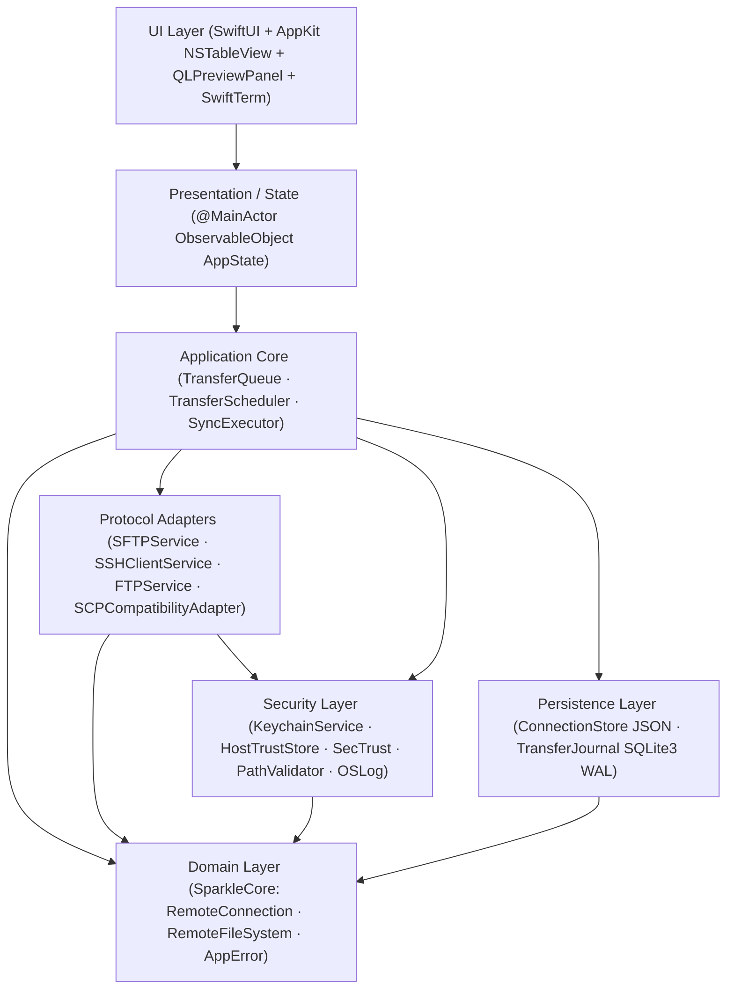

# SparkleSFTP System Architecture

This document defines the modular boundaries, dependency directions, concurrency guarantees, and security isolation rules for **SparkleSFTP** — a native macOS dual-pane SFTP, FTP/FTPS, SCP, and SSH Commander written in **Swift 6** and **SwiftUI / AppKit** targeting **macOS 13+**.

> [!NOTE]
> For the verified dependency audit, `Package.swift` contract, and Full MVP design, see [`TECHNICAL_SPECIFICATION.md`](TECHNICAL_SPECIFICATION.md), [`SECURITY_MODEL.md`](SECURITY_MODEL.md), [`ADR/0004`](ADR/0004-direct-swift-nio-ssh-and-sftp-codec.md), and [`ADR/0005`](ADR/0005-macos13-sqlite3-journal-and-observable-object.md).

## Architectural Topology



## Non-Negotiable Dependency Rules

1. **Strict Acyclic Layering (`CIRC-001`, `CIRC-002`)**:
   - `src/App -> SparkleFeatures -> src/Packages/*`
   - `SparkleNetworking -> SparkleSecurity, SparkleCore, Clibcurl, NIOSSH`
   - `SparkleTransferEngine -> SparkleSecurity, SparkleCore, Crypto` (communicates with remote protocols via `RemoteFileSystem` closures and persists checkpoints via `TransferJournalProtocol` injected by `AppEnvironment` — never imports `SparkleNetworking` or `SparklePersistence`)
   - `SparkleSecurity -> SparkleCore, NIOSSH, Crypto`
   - `SparklePersistence -> SparkleCore, SQLite3`
   - No `src/Packages/*` target may ever import `SparkleFeatures` (enforced by `Package.swift`).
2. **UI Isolation**:
   - SwiftUI Views and `@MainActor ObservableObject` ViewModels **must never** import or invoke `NIOSSH`, `Clibcurl`, `SQLite3`, or `Security.framework` Keychain C APIs directly.
   - Views never hold plaintext secrets outside transient edit form fields flushed immediately to `KeychainService`.
3. **Independent Multi-Window & Paired Multi-Tab State**:
   - `AppEnvironment` shares only persistent stores (`ConnectionStore`, `KeychainService`, `HostTrustStore`, `TransferJournal`, `CommandSnippetStore`, `PortForwardingManager`) across windows while minting an isolated per-window `AppState` (`makeWindowState()` + `FocusedValues`) so `New Window (⌘N)` never clones active remote sessions.
   - `WorkspaceTab` & `WorkspaceTabBar` pair per-tab local directory history with independent `ActiveSessionModel` instances, supporting duplicate same-host tabs, inline FileZilla-style Quick Connect, and instant non-blocking tab switching/closing.
4. **Transfer Lifecycle Independence**:
   - Active transfers live inside the actor-isolated `TransferQueue` and `TransferJournal` — completely independent of window, tab, or view lifecycles.
5. **Protocol Composition (`DUP-001`)**:
   - Connection lifecycle & capabilities live in `RemoteConnection`.
   - Stateless file operations live in `RemoteFileSystem` using `@escaping @Sendable (TransferProgress) -> Void` closures (`BUG-001`).

## Repository Module Layout

```text
SparkleSFTP/
├── Package.swift                 # Swift 6.0 manifest (.macOS(.v13), pinned deps)
├── sonar-project.properties      # SonarQube configuration (`src` sources + `swiftlint --reporter sonarqube`)
├── src/
│   ├── App/                      # Executable entry (`SparkleSFTPApp` + `WindowGroup`), `AppDelegate`, `AppEnvironment`, `SparkleUpdaterService`
│   ├── Features/                 # SparkleFeatures: SwiftUI + AppKit (`WorkspaceTabBar`, `QuickConnectBar`, Commander + WinSCP context menus/sheets, Connections hover/select/delete, Notepad2 Editor, Terminal, ConflictResolutionSheet, 7-Tab About, Preferences) & per-window `AppState`
│   └── Packages/
│       ├── Clibcurl/             # Non-variadic C11 bridge over macOS SDK libcurl (-lcurl), zlib (-lz) & dynamic libssh2 probe
│       ├── Core/                 # SparkleCore: RemotePath, AppError, TransferModels, ToolchainModels, Protocols, FeatureFlags
│       ├── Networking/           # SparkleNetworking: SFTPPacketCodec, SFTPPipelinedTransfer (64KB), TransferSpeedMeter, SSHClientService, SCP, FTPService (GCD 256KB), ToolchainInspector
│       ├── TransferEngine/       # SparkleTransferEngine: TransferQueue, TransferScheduler (4/3), FileZilla ConflictResolver, ResumeValidator, SHA256Verifier
│       ├── FileManager/          # SparkleFileManager: LocalFileService, FileSortDescriptor, POSIXPermissions, DualPaneState
│       ├── Security/             # SparkleSecurity: KeychainService, HostTrustStore, TLSCertificateValidator, PathValidator (`CWE-22/59/78`), PrivateKeyParser, UpdateConfigurationValidator
│       ├── Terminal/             # SparkleTerminal: SwiftTerm TerminalViewRepresentable, ExternalTerminalLauncher, PortForwardingManager
│       ├── Synchronization/      # SparkleSynchronization: DirectoryScanner, SyncPlanner (One-Way & Bidirectional), SyncExecutor
│       ├── Persistence/          # SparklePersistence: ConnectionStore (JSON), TransferJournal (SQLite3 WAL), SSH/FileZilla/WinSCP BOM & Nested-Group Importers
│       └── DesignSystem/         # SparkleDesignSystem: 76 SparkNotePad/NotepadNext theme palettes (26 families), SparkleWindowConfigurator, sparkleWorkspaceSurface, JSON i18n Locales (en.json / id.json, 361 keys)
├── Tests/                        # CoreTests, SecurityTests, PersistenceTests, NetworkingTests, TransferEngineTests, FileManagerTests, SynchronizationTests, IntegrationTests
├── Tools/                        # Docker Compose test servers (OpenSSH, vsftpd, ProFTPD) & Universal 2 DMG / notarization scripts
└── docs/                         # Technical Specification, Security Model, Workground, Task List, 14-Pillar Review, Long-Term Review, ADRs 0001–0008
```

## Concurrency & Memory Guarantees

- **Swift 6 Strict Concurrency**: `swiftLanguageModes: [.v6]` across every target; explicit `Sendable` conformance across `AppError`, `TransferProgress`, `RemotePath`, `TransferTaskMetadata`, and `HostTrustState`.
- **Actor Reentrancy Guards (`RUN-003`)**: `TransferQueue` re-verifies cancellation and task membership after every `await` suspension point.
- **No `Task.detached` Retain Cycles (`MEM-001`)**: Workers capture `[weak self]` and store `Task` handles cancelled in `deinit`.
- **Bounded Backpressure (`MEM-003`, `PERF-004`)**: `ProgressThrottler` (100 ms / 10 Hz) + `AsyncStream.makeStream(bufferingPolicy: .bufferingNewest(10))`.
- **Zero Main-Thread Blocking (`PERF-001`, `PERF-002`, `PERF-003`)**: Paginated directory windows (`NSTableView` cell dequeue reuse + cached symbol `NSImage`s), single-`lstat` local enumeration, cached `AppStrings`/`SparkleThemePalette`, `TransferMonitor` 10Hz progress isolation, 2-second throttled SQLite progress checkpoints, off-`MainActor` sorting, and background streaming `SHA256Verifier`.
- **Non-Deadlocking Application Exit**: `AppDelegate.applicationShouldTerminate` synchronously invokes `prepareFastShutdown()` and returns `.terminateNow` when idle (`<= 350ms` bounded `.terminateLater` parallel session/tunnel teardown otherwise), preserving child-to-bastion `ProxyJump` teardown order.
- **PTY Resource Hygiene (`MEM-002`)**: Explicit `PTYResourceBox` teardown closes `SSHPTYChannel`, cancels reader tasks, and clears `TerminalView.terminalDelegate`.
