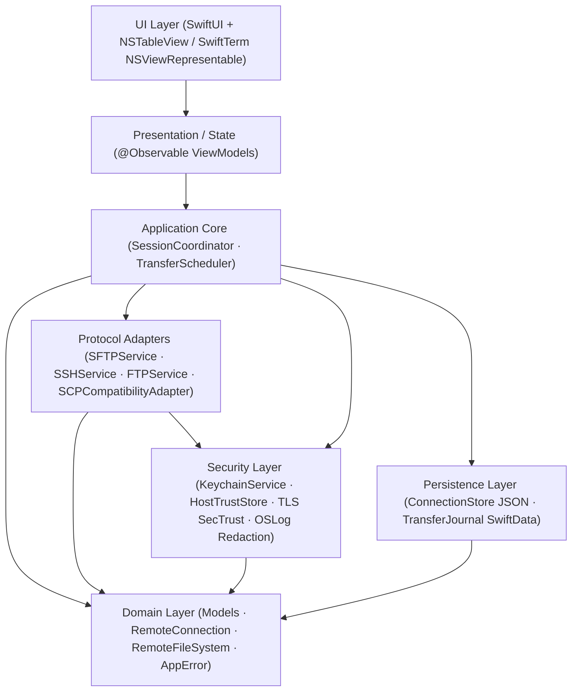

# SparkleSFTP System Architecture

This document defines the modular boundaries, dependency directions, concurrency guarantees, and security isolation rules for **SparkleSFTP** — a native macOS dual-pane SFTP, FTP/FTPS, SCP, and SSH Commander written in **Swift 6** and **SwiftUI / AppKit**.

> [!NOTE]
> For the full task breakdown and protocol signatures, see [`IMPLEMENTATION_PLAN.md`](IMPLEMENTATION_PLAN.md) and [`CODE_REVIEW_14_PILLARS.md`](CODE_REVIEW_14_PILLARS.md).

## Architectural Topology



## Non-Negotiable Dependency Rules

1. **Strict Acyclic Layering (`CIRC-001`, `CIRC-002`)**:
   - `App -> ApplicationCore -> Domain`
   - `ProtocolAdapters -> Domain` (plus `Security` contracts where needed for host trust / TLS)
   - `Security -> Domain`
   - `Persistence -> Domain`
   - `Packages/` modules **must never import** anything from `Features/`.
2. **UI Isolation**:
   - SwiftUI Views and `@Observable` ViewModels **must never** import or invoke `Citadel`, `libcurl`, or `Security.framework` Keychain APIs directly.
   - Views must never hold plaintext secrets in `@State` beyond immediate form input submission into `KeychainService`.
3. **Transfer Lifecycle Independence**:
   - Active transfers live inside the actor-isolated `TransferQueue` and `TransferJournal` — never coupled to the lifetime of a window, tab, or view.
4. **Protocol Composition (`DUP-001`)**:
   - Connection lifecycle & capabilities live in `RemoteConnection`.
   - Stateless file operations live in `RemoteFileSystem` using closure callbacks (`@escaping @Sendable (TransferProgress) -> Void`) to prevent circular references with `TransferEngine`.

## Planned Repository Module Layout

```text
SparkleSFTP/
├── App/                      # Entry point, AppDelegate, DI container, AppLifecycle
├── Packages/
│   ├── Core/                 # Domain models, RemoteConnection, RemoteFileSystem, AppError
│   ├── Networking/           # Citadel SSH/SFTP, libcurl FTP/FTPS, SCPCompatibilityAdapter, ProxyJump
│   ├── TransferEngine/       # TransferQueue actor, TransferScheduler, Resume/Recovery, SHA-256 verify
│   ├── FileManager/          # LocalFileService, Dual-Pane state, DirCompare, POSIX permissions
│   ├── Security/             # KeychainService, HostTrustStore (TOFU), SecTrust, OSLog redaction
│   ├── Terminal/             # SwiftTerm NSViewRepresentable, PTY lifecycle, snippets, forwarding
│   ├── Synchronization/      # Snapshot scanner, comparator, pure SyncPlanner, dry-run executor
│   ├── Persistence/          # JSON Codable ConnectionStore, SwiftData TransferJournal
│   └── DesignSystem/         # Semantic colors, typography, reusable components, themes
├── Features/                 # Feature-level SwiftUI Views & ViewModels
├── Tests/                    # UnitTests, IntegrationTests, ProtocolTests, SecurityTests, UITests
├── Tools/                    # Docker Compose test servers (OpenSSH, vsftpd, ProFTPD) & release scripts
└── docs/                     # Implementation plan, 14-pillar code review, ADRs, roadmap
```

## Concurrency & Memory Guarantees

- **Swift 6 Strict Concurrency**: Explicit `Sendable` conformance across all domain errors (`AppError`), progress payloads (`TransferProgress`), path types (`RemotePath`), and transfer metadata (`TransferTaskMetadata`).
- **Actor Reentrancy Guards (`RUN-003`)**: `TransferQueue` must re-verify task membership and state after every `await` suspension point.
- **No `Task.detached` Retain Cycles (`MEM-001`)**: Long-lived workers capture `[weak self]` and cancel stored `Task` handles in `deinit`.
- **Bounded Backpressure (`MEM-003`, `PERF-004`)**: Progress streams use `.bufferingNewest(10)` and `ProgressThrottler` (100 ms / max 10 Hz UI emit rate).
- **Zero Main-Thread Blocking (`PERF-001`, `PERF-002`, `PERF-003`)**: Directory sorting, paginated loading (`NSTableView` cell reuse), and SHA-256 verification for multi-GB transfers execute off `MainActor`.
- **PTY Resource Hygiene (`MEM-002`)**: Explicit `deinit` and session teardown close SSH channels, cancel PTY reader tasks, and nil `TerminalViewDelegate` weak references.
