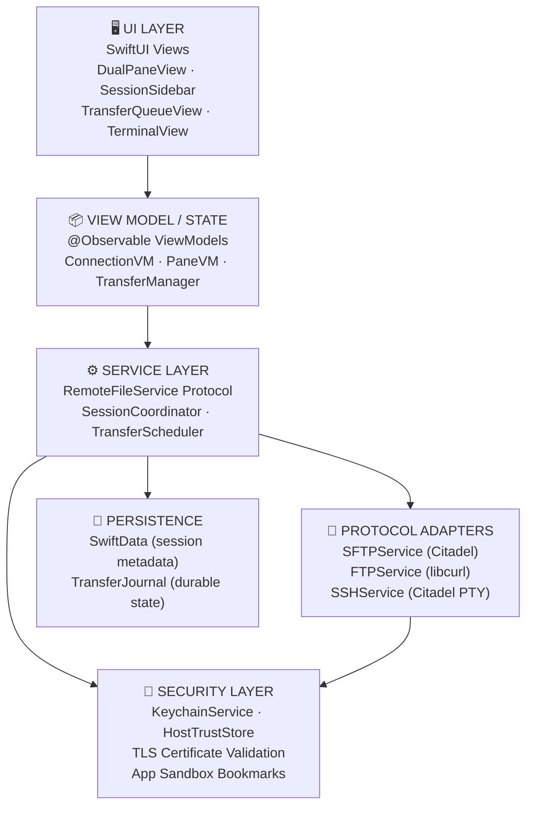
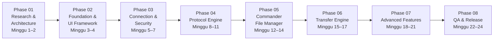
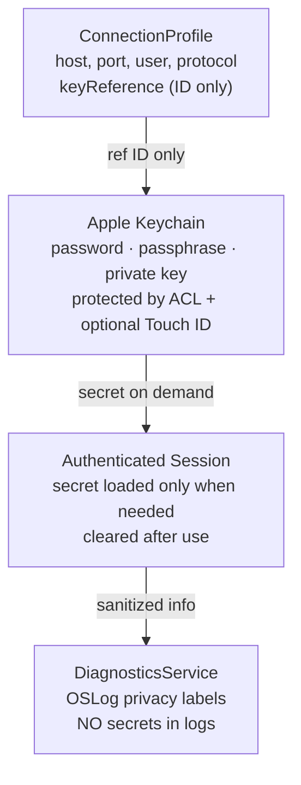

# 🖥️ SparkleSFTP — Implementation Plan, Workground & Task List

## Native macOS SFTP/FTP/SCP/SSH Commander — Swift 6 + SwiftUI

> [!IMPORTANT]
> Dokumen ini adalah sintesis mendalam dari analisis file spesifikasi awal (`aplikasi MacSFTP.txt`, yang kini distandardisasi menjadi **SparkleSFTP**) + riset web terhadap sumber resmi GitHub (Citadel, SwiftTerm, SwiftNIO SSH), Apple Developer Documentation, dan praktik komunitas Swift terkini (2024–2026).

---

## 🎯 Visi Produk

**SparkleSFTP** adalah aplikasi native macOS yang menggabungkan:

- **Dual-pane Commander** (WinSCP-style) dengan UI modern & elegan
- **Protokol lengkap**: SFTP, FTP, FTPS (Explicit/Implicit), SCP, SSH Terminal
- **Keamanan sejak hari pertama**: Keychain + Touch ID, tanpa Electron, tanpa overhead runtime asing

---

## 🏗️ Tech Stack Final (Evidence-Based)

| Lapisan | Teknologi | Alasan |
| :-------- | :---------- | :------- |
| **Bahasa** | Swift 6 | Strict concurrency, actor isolation, Sendable enforcement |
| **UI** | SwiftUI + AppKit Bridge | Native macOS HIG; `NSTableView` via `NSViewRepresentable` untuk performa file list |
| **SSH/SFTP** | Citadel (`orlandos-nl/Citadel`) | High-level async/await API di atas SwiftNIO SSH; dukungan SFTP, PTY, Jump Host |
| **FTP/FTPS** | libcurl (C Bridge + module map) | Satu-satunya jalur lengkap FTP+TLS di Swift; terbukti di produksi (syncSCP) |
| **Terminal** | SwiftTerm (`migueldeicaza/SwiftTerm`) | VT100/xterm engine matang; integrasi SwiftUI via `NSViewRepresentable` |
| **Keychain** | Apple Security.framework + GlasSecretStore | Keychain + Secure Enclave, SSH key SecureBytes |
| **Persistence** | SwiftData (metadata) + Keychain (secrets) | Pemisahan tegas metadata ↔ rahasia |
| **Concurrency** | Swift Actors + async/await + AsyncStream | Thread-safe tanpa GCD; `TransferQueue` sebagai actor terisolasi |
| **Testing** | Swift Testing + Docker SSH/FTP fixtures | Integration test deterministik terhadap server disposable |
| **CI/CD** | GitHub Actions | Build + unit test otomatis |
| **Distribusi** | Developer ID + Notarization + Sparkle | DMG direct distribution; opsional Mac App Store |

> [!NOTE]
> **Mengapa Citadel vs libssh2?** Citadel memiliki API async/await yang bersih, dukungan PTY, jump host, dan dokumentasi aktif. libssh2 adalah kandidat fallback untuk SCP legacy. Apple DTS sendiri merekomendasikan SwiftNIO SSH sebagai dasar.

---

## 📐 Arsitektur Sistem



### Aturan Dependensi (Non-Negotiable)

```text
App → ApplicationCore → Domain
ProtocolAdapters → Domain
Security → Domain
Persistence → Domain
```

> [!CAUTION]
> **UI tidak boleh pernah** memanggil Citadel, libcurl, atau Keychain secara langsung. View tidak menyimpan password. Transfer tidak bergantung pada lifecycle sebuah window.

---

## 🗂️ Struktur Repository

```text
SparkleSFTP/
├── App/
│   ├── SparkleSFTPApp.swift
│   ├── AppDelegate.swift
│   ├── AppEnvironment.swift           # Dependency injection root
│   └── AppLifecycle.swift
│
├── Packages/
│   ├── Core/                          # Domain models, interfaces, errors
│   │   ├── Domain/
│   │   ├── Interfaces/                # RemoteFileSystem, TransferEngine, CredentialStore
│   │   ├── Models/                    # Session, RemoteFile, TransferTask, CredentialRef
│   │   └── Errors/                    # AppError enum, user-friendly messages
│   │
│   ├── Networking/                    # Protocol adapters (tidak import SwiftUI)
│   │   ├── SSH/                       # SSHService.swift (Citadel)
│   │   ├── SFTP/                      # SFTPService.swift + SCPCompatibilityAdapter.swift
│   │   ├── FTP/                       # FTPService.swift (libcurl C bridge)
│   │   ├── FTPS/                      # Explicit + Implicit TLS
│   │   └── Proxy/                     # ProxyJump / bastion support
│   │
│   ├── TransferEngine/
│   │   ├── Queue/                     # TransferQueue actor
│   │   ├── Scheduler/                 # Admission, concurrency, priority
│   │   ├── Workers/                   # TransferWorker (satu job per worker)
│   │   ├── Resume/                    # Checkpoint & partial file handling
│   │   ├── Recovery/                  # TransferJournal, crash recovery
│   │   └── Verification/             # SHA-256, atomic rename, finalization
│   │
│   ├── FileManager/
│   │   ├── Local/                     # LocalFileService (FileManager + FSEvents)
│   │   ├── Remote/                    # RemoteFileService implementations
│   │   ├── Commander/                 # DualPane state, focus management
│   │   ├── Comparison/               # DirCompare, SyncPlanner, SyncExecutor
│   │   └── Operations/               # Copy, move, delete, rename
│   │
│   ├── Security/
│   │   ├── Keychain/                  # KeychainService, SecretReference
│   │   ├── HostKeys/                  # HostTrustStore, TOFU fingerprint
│   │   ├── Certificates/             # TLS validation, SecTrust
│   │   ├── Identity/                  # Private key import (PEM/OpenSSH)
│   │   └── Audit/                    # Credential redaction logging
│   │
│   ├── Terminal/
│   │   ├── Sessions/                  # TerminalSession, PTY lifecycle
│   │   ├── Emulator/                  # SwiftTerm NSViewRepresentable wrapper
│   │   ├── Snippets/                  # Command templates
│   │   └── Forwarding/               # Port forwarding manager
│   │
│   ├── Synchronization/
│   │   ├── Scanner/                   # Snapshot enumerator
│   │   ├── Comparator/               # Size/time/hash comparison
│   │   ├── Planner/                   # Pure sync plan (no mutations)
│   │   └── Executor/                  # Plan execution via TransferEngine
│   │
│   ├── Persistence/
│   │   ├── SwiftData/                 # Session metadata models
│   │   ├── Repositories/             # SessionStore, TransferJournal
│   │   └── Migrations/               # Schema versioning
│   │
│   └── DesignSystem/
│       ├── Components/               # Reusable SwiftUI components
│       ├── Colors/                    # Semantic color tokens
│       ├── Typography/               # Font scale
│       └── Themes/                    # Light/Dark/Custom accent
│
├── Features/                          # Feature-level SwiftUI Views + ViewModels
│   ├── Dashboard/
│   ├── Connections/                   # ConnectionManagerView, ConnectionEditorView
│   ├── Commander/                     # DualPaneView, FilePaneView, PathBar
│   ├── Transfers/                     # TransferQueueView, TransferRowView
│   ├── Terminal/                      # TerminalTabView, TerminalSplitView
│   ├── Synchronization/              # SyncProfileView, SyncPreviewView
│   ├── Settings/                      # Preferences, keyboard shortcuts
│   └── Diagnostics/                  # Connection health, security dashboard
│
├── Tests/
│   ├── UnitTests/
│   ├── IntegrationTests/             # Docker SSH/FTP server fixtures
│   ├── ProtocolTests/                # SFTP/FTP/SCP compatibility matrix
│   ├── SecurityTests/                # Host key, TLS, secret leakage
│   └── UITests/                      # Connect → Browse → Transfer → Disconnect
│
├── Tools/
│   ├── TestServers/                   # Docker Compose: OpenSSH, vsftpd, ProFTPD
│   └── Release/                       # Notarization, Sparkle scripts
│
└── docs/
    ├── ARCHITECTURE.md
    ├── CODE_REVIEW_14_PILLARS.md
    ├── IMPLEMENTATION_PLAN.md
    ├── ADR/                           # Architecture Decision Records
    └── ROADMAP.md
```

---

## 🔑 Domain Interfaces Utama

> [!CAUTION]
> **CRITICAL FIXES dari Code Review** — Interface di bawah sudah diperbaiki berdasarkan 14-pillar review. Lihat [CODE_REVIEW_14_PILLARS.md](CODE_REVIEW_14_PILLARS.md) untuk detail lengkap setiap finding.

```swift
// MARK: - Rich Progress Type (FIX: BUG-001, SYN-002)
// Gunakan typed struct, bukan AsyncStream<Double> sebagai parameter
struct TransferProgress: Sendable {
    let bytesTransferred: Int64
    let totalBytes: Int64
    let bytesPerSecond: Int64
    var percentage: Double { guard totalBytes > 0 else { return 0 }; return Double(bytesTransferred) / Double(totalBytes) }
    var estimatedTimeRemaining: Duration? {
        guard bytesPerSecond > 0 else { return nil }
        return .seconds((totalBytes - bytesTransferred) / bytesPerSecond)
    }
}

// MARK: - Strongly-Typed Remote Path (FIX: READ-002)
struct RemotePath: Sendable, Hashable, ExpressibleByStringLiteral {
    let rawValue: String
    init(rawValue: String) { self.rawValue = rawValue.hasPrefix("/") ? rawValue : "/" + rawValue }
    init(stringLiteral value: String) { self.init(rawValue: value) }
    var filename: String { URL(fileURLWithPath: rawValue).lastPathComponent }
    var parent: RemotePath { RemotePath(rawValue: URL(fileURLWithPath: rawValue).deletingLastPathComponent().path) }
}

// MARK: - Core Protocol Contract (FIX: BUG-001 — closure, bukan AsyncStream sebagai param)
protocol RemoteFileSystem: Sendable {
    func connect() async throws
    func listDirectory(at path: RemotePath) async throws -> [RemoteFile]
    // FIX: Gunakan callback closure, bukan AsyncStream sebagai input parameter
    func download(
        from: RemotePath,
        to: URL,
        onProgress: @escaping @Sendable (TransferProgress) -> Void
    ) async throws
    func upload(
        from: URL,
        to: RemotePath,
        onProgress: @escaping @Sendable (TransferProgress) -> Void
    ) async throws
    func delete(at path: RemotePath) async throws
    func rename(from source: RemotePath, to destination: RemotePath) async throws
    func createDirectory(at path: RemotePath) async throws
    func metadata(at path: RemotePath) async throws -> RemoteFileMetadata
    func disconnect(policy: DisconnectPolicy) async throws  // FIX: LOG-006 + SYN-001
}

enum DisconnectPolicy: Sendable {
    case cancelAllTransfers
    case waitForCompletion
    case pauseAndDisconnect
}

// MARK: - AppError (FIX: BUG-002 — explicit Sendable conformance)
enum AppError: Error, Sendable, LocalizedError {
    case connectionTimeout(host: String)
    case hostUnreachable(host: String)
    case hostKeyMismatch(expected: String, got: String)
    case authenticationFailed(method: String)
    case credentialNotFound(service: String)
    case transferFailed(reason: String)
    case diskFull(requiredBytes: Int64, availableBytes: Int64)
    case permissionDenied(path: String)
    case checksumMismatch(expected: String, actual: String)
    case pathTraversal(attempted: String)      // SEC-003 CWE-22
    case symlinkTraversal(destination: String) // SEC-004 CWE-59
    case planExpired                           // LOG-003
    case syncConflict(path: String)
    var errorDescription: String? { /* localized */ return String(describing: self) }
}

// MARK: - Transfer Task (FIX: BUG-003 — pisahkan metadata statis dari state dinamis)
struct TransferTaskMetadata: Identifiable, Sendable {  // Jarang berubah
    let id: UUID
    let source: TransferEndpoint
    let destination: TransferEndpoint
    let totalBytes: Int64
    let priority: TransferPriority
    let createdAt: Date
}

// MARK: - Transfer Status (Sendable, explicit associated values)
enum TransferStatus: Sendable {
    case queued, preparing, connecting
    case transferring(bytesPerSecond: Int64)
    case verifying, finalizing, completed
    case paused, interrupted, cancelled
    case failed(AppError), needsReview
}

// MARK: - Host Trust State Machine (FIX: LOG-001 — complete state machine)
enum HostTrustState: Sendable {
    case unknown
    case pendingUserDecision(fingerprint: String)
    case trusted(fingerprint: String, since: Date)
    case rejected
    case mismatch(expected: String, got: String)
    case corrupted
}

// MARK: - Sync Plan with Expiry (FIX: LOG-003)
struct SyncPlan: Sendable {
    let createdAt: Date
    let expiresAt: Date   // Default: createdAt + 60 seconds
    let actions: [SyncAction]
    var isStale: Bool { Date() > expiresAt }
}
```

---

## 🗺️ Workground (Area Kerja)

| # | Workground | Deskripsi | Dependensi |
| :-- | :----------- | :---------- | :----------- |
| **WG-1** | Fondasi Proyek & Domain Layer | Xcode setup, modul, model domain, protocol kontrak, error handling, CI | — |
| **WG-2** | Core SSH & SFTP Engine | Citadel integration, auth (password/key/2FA), SFTP client, host key TOFU | WG-1 |
| **WG-3** | FTP/FTPS Engine | libcurl C bridge, async/await wrapper, explicit/implicit TLS | WG-1 |
| **WG-4** | UI Shell & Dual-Pane | SwiftUI window, NavigationSplitView, HSplitView, sidebar, toolbar, FilePaneView | WG-1 |
| **WG-5** | Terminal SSH Terintegrasi | SwiftTerm NSViewRepresentable, PTY channel via Citadel, multi-tab | WG-2, WG-4 |
| **WG-6** | Transfer Queue & Drag-and-Drop | TransferQueue actor, progress via AsyncStream, drag-drop, conflict dialog | WG-2, WG-3, WG-4 |
| **WG-7** | Persistensi & Keamanan | GlasSecretStore/Keychain, SessionStore JSON, Touch ID, SSH config parser | WG-1 |
| **WG-8** | Fitur Lanjutan | Remote editor, port forwarding, command snippets, dir compare, S3 opsional | WG-2, WG-5, WG-6 |
| **WG-9** | Testing, Polish & Distribusi | Unit/integration/UI tests, notarization, Sparkle, dokumentasi | Semua WG |

---

## 📋 Phased Roadmap (8 Fase)



### Phase 01 — Research & Architecture (Minggu 1–2)

- Audit library dan lisensi (Citadel MIT, SwiftTerm MIT, libcurl MIT/curl)
- Proof-of-concept: SSH connect → auth → SFTP listing → upload/download → cancel
- Proof-of-concept: libcurl FTP/FTPS → TLS valid & invalid certificate test
- Threat modeling: trust boundary, attack surface, credential lifecycle
- Finalisasi minimum macOS (target: **macOS 13 Ventura**, ideal: **macOS 14 Sonoma**)
- Pilihan ADR: backend SSH, database metadata, distribusi, file table, transfer recovery

### Phase 02 — Foundation & UI Framework (Minggu 3–4)

- Xcode project (Swift 6, Universal Binary arm64+x86_64)
- SPM dependencies: Citadel, SwiftTerm, GlasSecretStore
- SwiftUI + AppKit integration skeleton
- Design system: color tokens, typography, SF Symbols 6, dark/light
- SwiftData schema v1 + Keychain wrapper
- CI/CD (GitHub Actions: build + test)

### Phase 03 — Connection & Security (Minggu 5–7)

- ConnectionProfile CRUD (SwiftData)
- KeychainService: save/load/delete password, passphrase, private key
- Host key TOFU: fingerprint SHA-256, known_hosts style, changed-key blocking
- SSH auth: password, ed25519/RSA key, keyboard-interactive (2FA)
- TLS certificate validation: chain + hostname + expiry verification
- SSH config parser (`~/.ssh/config`)

### Phase 04 — Protocol Engine (Minggu 8–11)

- SFTPService: listDirectory, download, upload, rename, delete, mkdir, stat
- SCPCompatibilityAdapter.swift: SCP fallback via `execCommand`
- SSHService: PTY channel, session lifecycle, reconnect, keepalive
- FTPService via libcurl: listing, upload, download, explicit/implicit FTPS
- Protocol capability detection (resume, rename, permissions)
- Integration tests terhadap Docker server fixtures

### Phase 05 — Commander File Manager (Minggu 12–14)

- MainWindow: `NavigationSplitView` sidebar + `HSplitView` dual pane
- `FilePaneView` (reusable local/remote): `NSTableView` via `NSViewRepresentable`
- PathBar + breadcrumb + Back/Forward/Up navigation
- Multi-select, range select, keyboard shortcuts (Tab switch pane)
- Commander keys: F5 Copy, F6 Move, F7 New Folder, F8 Delete
- Context menu, Quick Look (`QLPreviewPanel`), Inspector view
- Drag-and-drop: local ↔ remote, Finder interop

### Phase 06 — Transfer Engine (Minggu 15–17)

- `TransferQueue` actor: bounded concurrency (max 3 simultaneous), priority
- `TransferJournal`: durable state, crash recovery, interrupted job reconciliation
- Progress via `AsyncStream<Double>`, throttled UI updates (tidak flood MainActor)
- Conflict resolution: Ask/Skip/Rename/Overwrite
- Pause/resume: checkpoint-based, hanya jika backend mendukung
- Atomic upload: download ke temp file → verify → rename atomik
- `TransferQueueView`: progress bar, speed, ETA, retry, cancel

### Phase 07 — Advanced Features (Minggu 18–21)

- SwiftTerm integration: `TerminalViewRepresentable`, PTY dari SSHService
- Multi-tab terminal, horizontal/vertical split
- Port forwarding: local/remote tunnel, preset layanan
- Directory comparison: snapshot enumerator + pure SyncPlanner
- Sync dry-run preview UI (create/update/delete terpisah, destructive confirmation)
- Remote file editor: temp workspace + FSEvents + auto-upload on save
- Import FileZilla sitemanager.xml, WinSCP .ini
- Localization (EN + ID)

### Phase 08 — QA & Release (Minggu 22–24)

- Full protocol regression terhadap semua Docker fixtures
- Security audit: credential leakage, log redaction, path traversal
- Performance profiling: 10K+ file listing, 10GB transfer, memory bounds
- Accessibility: VoiceOver, keyboard-only navigation
- Code signing + notarization (`xcrun notarytool`)
- Sparkle framework auto-update
- DMG packaging + Universal Binary verification
- Beta distribution + feedback triage

---

## ✅ Master TODO & Task List (122+ Tasks)

### EPIC-01 — Project Foundation

- [ ] **TASK-001** Create Xcode project (macOS App, SwiftUI lifecycle, Swift 6)
- [ ] **TASK-002** Configure deployment target (macOS 13+, Universal Binary)
- [ ] **TASK-003** Configure Swift Package Manager with **PINNED VERSIONS** (critical for CVE patching)
  - Citadel: `https://github.com/orlandos-nl/Citadel` — verify depends on swift-nio-ssh ≥ 0.14.1
  - `swift-nio-ssh`: **minimum 0.14.1** — patches **CVE-2026-43798** (OOB stack write, pre-auth)
  - SwiftTerm: `https://github.com/migueldeicaza/SwiftTerm` — latest stable
  - **GlasSecretStore**: `https://github.com/msitarzewski/GlasSecretStore` — **audit activity sebelum pin**; buat `KeychainService` native sebagai fallback jika abandonware
  - libcurl: use **libssh2 backend** (NOT libssh) — mitigates **CVE-2025-15224** (SSH agent auth bypass)
- [ ] **TASK-004** Configure SwiftLint + SwiftFormat
- [ ] **TASK-005** Configure unit testing (Swift Testing framework)
- [ ] **TASK-006** Configure CI/CD (GitHub Actions: build + test matrix)
- [ ] **TASK-007** Configure code signing (Developer ID)
- [ ] **TASK-008** Create architecture documentation (README + ADR/)
- [ ] **TASK-009** Create App Sandbox entitlements:

  ```xml
  <key>com.apple.security.network.client</key><true/>
  <key>com.apple.security.files.user-selected.read-write</key><true/>
  ```

- [ ] **TASK-010** Define domain contracts: `RemoteFileSystem`, `TransferEngine`, `CredentialStore`

### EPIC-02 — Design System

- [ ] **TASK-011** Design color system (semantic tokens, light/dark, custom accent)
- [ ] **TASK-012** Design typography scale (SF Pro, SF Mono)
- [ ] **TASK-013** Design icon system (SF Symbols 6)
- [ ] **TASK-014** Create reusable components: Button, Badge, ProgressRow
- [ ] **TASK-015** Create navigation sidebar (`NavigationSplitView` sidebar)
- [ ] **TASK-016** Create toolbar (Connect, Refresh, Upload, Download, Sync)
- [ ] **TASK-017** Create tab system (multi-session tabs)
- [ ] **TASK-018** Create status bar (protocol, host, speed, connection state)
- [ ] **TASK-019** Create `HSplitView` dual-pane container
- [ ] **TASK-020** Implement dark/light appearance + `.ultraThinMaterial` background
- [ ] **TASK-021** Implement keyboard shortcuts (`.keyboardShortcut` + `NSEvent` monitor)
- [ ] **TASK-022** Implement accessibility labels + VoiceOver annotations

### EPIC-03 — Connection Manager

- [ ] **TASK-023** Create `ConnectionProfile` model (SwiftData)
- [ ] **TASK-024** Create `ConnectionRepository` (CRUD + SwiftData)
- [ ] **TASK-025** Create `ConnectionManagerView` (sidebar list dengan groups)
- [ ] **TASK-026** Create `ConnectionEditorView` (form: host, port, user, auth, path)
- [ ] **TASK-027** Implement protocol selector (SFTP/FTP/FTPS/SCP)
- [ ] **TASK-028** Implement authentication selector (password/key/agent/keyboard-interactive)
- [ ] **TASK-029** Implement server groups + favorites
- [ ] **TASK-030** Implement connection search
- [ ] **TASK-031** Implement recent connections
- [ ] **TASK-032** Implement SSH config parser (`~/.ssh/config` → Host, HostName, Port, User, IdentityFile, ProxyJump)
- [ ] **TASK-033** Implement FileZilla XML importer (`sitemanager.xml`)
- [ ] **TASK-034** Implement WinSCP .ini importer

### EPIC-04 — Security Engine

- [ ] **TASK-035** Implement `KeychainService` (save/load/delete password, passphrase)
  - **WAJIB**: `kSecAttrAccessibleWhenUnlockedThisDeviceOnly` pada semua items (CWE-522 fix)
  - **WAJIB**: `SecAccessControlCreateWithFlags` untuk restrict to this app only
  - **DILARANG**: `kSecAttrAccessibleAfterFirstUnlock` (syncs to iCloud = data leak)
- [ ] **TASK-036** Implement `SecretReference` (CredentialReference model, tidak menyimpan secret di DB)
- [ ] **TASK-037** Implement private key loader (PEM/OpenSSH format, `NSOpenPanel` + security-scoped bookmark)
- [ ] **TASK-038** Implement `HostTrustStore` (fingerprint SHA-256, TOFU flow)
- [ ] **TASK-039** Implement host key verification UI (Unknown → konfirmasi eksplisit; Changed → blokir)
- [ ] **TASK-040** Implement TLS certificate validation (chain + hostname + expiry)
- [ ] **TASK-041** Implement secure logging (credential redaction via `OSLog` privacy)
- [ ] **TASK-042** Implement secure temporary file handling (isolated temp dir, cleanup policy)
- [ ] **TASK-043** Implement security-scoped bookmarks (persistent folder access)
- [ ] **TASK-044** Implement Touch ID gate opsional (`LAContext` + biometric prompt)
- [ ] **TASK-045** Implement security diagnostics view (fingerprint, TLS cert, auth method)

### EPIC-05 — Protocol Engine

- [ ] **TASK-046** Define `RemoteProtocol` interface + capability matrix
- [ ] **TASK-047** Define `RemoteSession` interface (lifecycle, reconnect)
- [ ] **TASK-048** Define `RemoteFileSystem` interface (semua file operations)
- [ ] **TASK-049** Implement `SFTPService` (Citadel): listDir, download, upload, stat, rename, delete, mkdir
- [ ] **TASK-050** Implement `SSHService` (Citadel): connect, auth (password/key/2FA), keepalive, reconnect
- [ ] **TASK-051** Implement `SCPCompatibilityAdapter.swift`: SCP fallback via `execCommand`
- [ ] **TASK-052** Implement jump host support (`jumpHostClient.jump(to:)` Citadel)
- [ ] **TASK-053** Implement libcurl C bridge (module map, `libcurl.tbd`)
- [ ] **TASK-054** Implement `FTPService` via libcurl: listing, upload, download
- [ ] **TASK-055** Implement explicit FTPS (`CURLOPT_USE_SSL` = `CURLUSESSL_ALL`, port 21)
- [ ] **TASK-056** Implement implicit FTPS (port 990)
- [ ] **TASK-057** Implement connection timeout + keepalive
- [ ] **TASK-058** Implement proxy support (SOCKS5, HTTP)
- [ ] **TASK-059** Implement server capability detection (resume, rename, permissions)

### EPIC-06 — File Manager

- [ ] **TASK-060** Implement `LocalFileService` (FileManager + FSEvents watcher)
- [ ] **TASK-061** Implement `LocalFileService` stub (fake remote untuk dev UI awal)
- [ ] **TASK-062** Implement `FilePaneView`:
  - `NSTableView` via `NSViewRepresentable` (performa ribuan file)
  - Kolom: Nama, Ukuran, Tanggal Modifikasi, Izin POSIX
  - Alternating row colors, multi-select, keyboard navigation
- [ ] **TASK-063** Implement `PathBarView` (breadcrumb + editable path input)
- [ ] **TASK-064** Implement dual-pane navigation (focus tracking, Tab switch panel)
- [ ] **TASK-065** Implement file sorting (sortable columns, stable sort)
- [ ] **TASK-066** Implement multi-selection (click, Shift+click, Cmd+A)
- [ ] **TASK-067** Implement drag-and-drop:
  - Local → Remote: `.onDrop(of: [.fileURL])` → upload via RemoteFileService
  - Remote → Local: `NSItemProvider` → temp URL → Finder export
  - Option key = copy, tanpa modifier = move
- [ ] **TASK-068** Implement file operations (copy, move, delete, rename, chmod)
- [ ] **TASK-069** Implement permissions editor (Unix octal + symbolic, chmod via SFTP)
- [ ] **TASK-070** Implement Quick Look (`QLPreviewPanel`)
- [ ] **TASK-071** Implement remote file editor (VS Code integration via `code --wait` + FSEvents)
- [ ] **TASK-072** Implement directory comparison engine

### EPIC-07 — Transfer Engine

- [ ] **TASK-073** Create `TransferTask` model (Identifiable, Sendable, full state machine)
- [ ] **TASK-074** Create `TransferQueue` actor (bounded concurrency, priority queue)
  - **WAJIB**: Re-verify actor state setelah setiap `await` (reentrancy guard) — lihat RUN-003
  - **WAJIB**: Store `Task` reference dan cancel di `deinit` — hindari retain cycle (MEM-001)
  - **WAJIB**: Per-host concurrency limit (default: max 2 per host) — SCALE-001
- [ ] **TASK-075** Create `TransferScheduler` (admission control, per-host limit)
- [ ] **TASK-076** Implement upload flow (temp write → verify size/hash → atomic rename)
  - SHA-256 verification HARUS di background thread (tidak MainActor) — PERF-002
  - Atomic rename HANYA setelah verifikasi selesai — TASK-084

- [ ] **TASK-077** Implement download flow (temp write → verify → move to destination)
  - Revalidate remote file metadata sebelum resume (mtime + size check) — LOG-002
  - Path canonicalization untuk cegah CWE-22 path traversal — SEC-003
  - Symlink validation sebelum write ke local — SEC-004 CWE-59
- [ ] **TASK-078** Implement batch transfers (folder recursive, symlink guard)
- [ ] **TASK-079** Implement concurrent transfers (max 3 simultaneous, configurable)
- [ ] **TASK-080** Implement pause/resume (checkpoint-based, only if backend supports)
- [ ] **TASK-081** Implement retry (exponential backoff, max attempts, skip auth/trust errors)
- [ ] **TASK-082** Implement cancellation (clean socket teardown, no hanging sessions)
- [ ] **TASK-083** Implement conflict resolver (Ask/Skip/Rename/Overwrite dialog)
- [ ] **TASK-084** Implement atomic upload (tidak replace target sebelum verifikasi selesai)
- [ ] **TASK-085** Implement `TransferJournal` actor (durable state, SQLite/JSON)
- [ ] **TASK-086** Implement crash recovery (muat journal → tandai interrupted → rekonsiliasi)
- [ ] **TASK-087** Implement transfer statistics (speed, ETA, throttled UI update)
- [ ] **TASK-088** Create `TransferQueueView` (progress bar, speed, ETA, pause/resume/cancel/retry)
- [ ] **TASK-089** Implement system notifications (`UNUserNotificationCenter` on transfer complete/fail)

### EPIC-08 — SSH Terminal Workspace

- [ ] **TASK-090** Create `TerminalViewRepresentable` (`NSViewRepresentable` wrapping SwiftTerm `TerminalView`)
  - **WAJIB**: explicit `deinit` dengan PTY FD cleanup (prevent MEM-002 leak)
  - **WAJIB**: delegate `weak` reference (prevent retain cycle)
  - Test: open/close 100 tabs → no leaked FD (Instruments Leaks check)
- [ ] **TASK-091** Implement PTY channel via Citadel (`SSHClient.withPTY(...)`)
  - Feed `ttyOutput` (AsyncSequence) → `terminalView.feed(byteArray:)`
  - Kirim input dari `TerminalViewDelegate.send(source:data:)` → `ttyStdinWriter`
- [ ] **TASK-092** Implement `TerminalViewDelegate`:
  - `sizeChanged` → resize PTY via `WindowChangeRequest`
  - `clipboardCopy` → `NSPasteboard`
- [ ] **TASK-093** Implement terminal tabs (multi-tab per server)
- [ ] **TASK-094** Implement split terminal (horizontal/vertical)
- [ ] **TASK-095** Implement SSH agent integration
- [ ] **TASK-096** Implement keyboard-interactive (2FA challenge-response)
- [ ] **TASK-097** Implement ProxyJump / bastion support
- [ ] **TASK-098** Implement local port forwarding
- [ ] **TASK-099** Implement remote port forwarding
- [ ] **TASK-100** Implement command snippets + history

### EPIC-09 — Synchronization

- [ ] **TASK-101** Create `SyncProfile` model (source, destination, exclusion rules)
- [ ] **TASK-102** Implement directory scanner (async, cancel-safe, symlink guard)
- [ ] **TASK-103** Implement file comparison engine (size, mtime, SHA-256 hash)
- [ ] **TASK-104** Implement pure `SyncPlanner` (buat rencana TANPA mutasi apapun)
- [ ] **TASK-105** Implement sync preview UI (create/update/delete ditampilkan terpisah)
- [ ] **TASK-106** Implement dry-run mode
- [ ] **TASK-107** Implement one-way synchronization (via TransferEngine)
- [ ] **TASK-108** Implement bidirectional sync (v1.5+)
- [ ] **TASK-109** Implement exclusion patterns (glob, regex)
- [ ] **TASK-110** Implement deletion protection + explicit confirmation untuk operasi destruktif

### EPIC-10 — Quality Assurance & Release

- [ ] **TASK-111** Unit tests: state machine, path parser, conflict rules, SSH config parser
- [ ] **TASK-112** Integration tests (Docker Compose):
  - `linuxserver/openssh-server` atau `atmoz/sftp`
  - `fauria/vsftpd` dengan TLS
  - ProFTPD untuk FTP/FTPS
- [ ] **TASK-113** SFTP interoperability tests (listing, upload, download, resume)
- [ ] **TASK-114** FTPS interoperability tests (explicit, implicit, invalid cert rejection)
- [ ] **TASK-115** SSH authentication tests (password, key, 2FA, changed key blocking)
- [ ] **TASK-116** Host-key mismatch tests (unknown → prompt, changed → block)
- [ ] **TASK-117** TLS certificate validation tests (expired, self-signed, hostname mismatch)
- [ ] **TASK-118** Large-file transfer tests (100MB, 1GB, 10GB)
- [ ] **TASK-119** Interrupted-transfer recovery tests (crash during write, network disconnect)
- [ ] **TASK-120** Memory and performance tests (10K+ file listing, queue besar)
- [ ] **TASK-121** Security audit (credential leakage, log redaction, path traversal)
- [ ] **TASK-122** Code signing + notarization (`xcrun notarytool submit`)
- [ ] **TASK-123** Sparkle framework integration (signed update verification)
- [ ] **TASK-124** DMG packaging + Universal Binary verification (`lipo -archs`)
- [ ] **TASK-125** Beta distribution + feedback triage

---

## 🔐 Security Architecture (Non-Negotiable)



### SSH Security Rules

| Aturan | Implementasi |
| :------- | :------------- |
| TOFU (Trust On First Use) | Fingerprint SHA-256 ditampilkan saat koneksi pertama; pengguna harus mengkonfirmasi secara eksplisit |
| Known-hosts database | Simpan fingerprint di Keychain (bukan UserDefaults) |
| Changed host key | Blokir koneksi; tampilkan peringatan berbeda dari "unknown" |
| Modern algorithms only | Disable algoritma usang (MD5, SHA-1) secara default |
| **DILARANG** | `acceptAnyHostKey = true` / `.acceptAnything()` di kode produksi |

### FTPS Security Rules

- TLS 1.2 minimum, TLS 1.3 preferred
- Certificate chain + hostname + expiry validation WAJIB
- **Tidak ada auto-downgrade** dari FTPS ke FTP plaintext
- Plain FTP → tampilkan warning merah eksplisit di UI

---

## ⚡ Testing Environment (Docker Compose)

```yaml
# docker-compose.test.yml
services:
  sftp-server:
    image: atmoz/sftp
    ports: ["2222:22"]
    # Test: password auth, key auth, SFTP-only account

  openssh-server:
    image: linuxserver/openssh-server
    ports: ["2223:2222"]
    # Test: SSH terminal, SCP, SFTP, ProxyJump

  ftp-server:
    image: fauria/vsftpd
    ports: ["21:21", "21100-21110:21100-21110"]
    environment:
      - FTP_USER=testuser
      - PASV_ADDRESS=127.0.0.1
    # Test: plain FTP, explicit FTPS with valid & invalid cert

  proftpd:
    image: instantlinux/proftpd
    ports: ["2121:21"]
    # Test: implicit FTPS port 990
```

**Wajib diuji per server:**

- File kecil 1KB · 100MB · 1GB · 10GB
- Filename Unicode · spasi · hidden files · symlink
- Permission denied · disk full · network disconnect · server restart
- TLS cert expired · host key changed · wrong password · interrupted transfer

---

## 📊 Fitur Priority Matrix

| Fitur | Priority | Phase |
| :------ | :--------- | :------ |
| **SFTP connection + Keychain** | P0 — MVP | Phase 03–04 |
| **Dual-pane file browser** | P0 — MVP | Phase 05 |
| **Upload/Download queue** | P0 — MVP | Phase 06 |
| **SSH host key verification** | P0 — MVP | Phase 03 |
| **SSH terminal (SwiftTerm)** | P0 — MVP | Phase 07 |
| FTP + explicit FTPS | P1 — v1.0 | Phase 04 |
| Transfer resume + recovery | P1 — v1.0 | Phase 06 |
| Directory comparison + sync | P1 — v1.0 | Phase 07 |
| FileZilla/SSH config import | P1 — v1.0 | Phase 03 |
| Implicit FTPS (port 990) | P1 — v1.0 | Phase 04 |
| Multi-tab sessions | P1 — v1.0 | Phase 07 |
| Touch ID vault unlock | P2 — v1.1 | Phase 08 |
| Port forwarding | P2 — v1.1 | Phase 07 |
| S3-compatible storage | P2 — v2.0 | Post-release |
| Remote-to-remote server transfer | P2 — v2.0 | Post-release |

---

## ⚠️ Risk Matrix

| Risiko | Level | Mitigasi |
| :------- | :------ | :--------- |
| SwiftUI `Table` performa (ribuan file) | 🔴 Tinggi | AppKit `NSTableView` via `NSViewRepresentable` |
| SSH algorithm compatibility | 🔴 Tinggi | Protocol compatibility test suite + Docker fixtures |
| FTPS passive connection (NAT/firewall) | 🔴 Tinggi | PASV mode testing, EPSV fallback |
| Large-file transfer (memory bounds) | 🔴 Tinggi | Streaming chunks, bounded buffer, backpressure |
| Transfer recovery (data integrity) | 🔴 Tinggi | TransferJournal actor + durable state + reconciliation |
| SFTP server differences (capability) | 🔴 Tinggi | Capability detection; tidak assume universal support |
| App Sandbox restrictions | 🔴 Tinggi | Security-scoped bookmarks; entitlements tepat |
| Library dependency updates | 🔴 Tinggi | Pinned SPM versions + security review per update |
| Keychain permission prompts | 🟡 Sedang | Credential lifecycle design; batch access per session |
| SSH terminal rendering edge cases | 🟡 Sedang | SwiftTerm + PTY tests + scrollback stress test |

---

## 🚦 MVP Acceptance Criteria (Release Gate)

**Aplikasi TIDAK boleh dirilis jika masih ada:**

- [ ] Host key berubah tetapi koneksi tetap dilanjutkan otomatis
- [ ] FTPS menerima sertifikat tidak valid secara default
- [ ] Password/private key muncul dalam log
- [ ] Transfer gagal ditandai `completed`
- [ ] Crash recovery menyebabkan overwrite tidak terkonfirmasi
- [ ] Sync menghapus target yang berbeda dari preview tanpa revalidasi
- [ ] Cancel menyebabkan session atau worker tidak pernah selesai
- [ ] Dependency atau lisensi distribusi belum jelas

**Semua harus hijau sebelum rilis:**

- [ ] Connect SFTP, FTP, explicit FTPS, implicit FTPS, SSH terminal
- [ ] Host key verification berjalan benar (unknown prompt, changed block)
- [ ] TLS certificate validation (chain + hostname + expiry)
- [ ] Dual-pane lokal/remote berfungsi + keyboard Commander shortcuts
- [ ] Upload/download + batch + pause/resume + cancel + retry
- [ ] Conflict resolution + atomic upload
- [ ] Credentials tersimpan di Keychain, TIDAK di database
- [ ] Interrupted transfer dapat direkonsiliasi setelah restart
- [ ] Tidak ada secret dalam log
- [ ] Tidak ada crash pada transfer 10GB+
- [ ] Build Universal arm64/x86_64, signed, notarized
- [ ] `swift-nio-ssh` ≥ 0.14.1 (patch **CVE-2026-43798**)
- [ ] libcurl uses `libssh2` backend (patch **CVE-2025-15224**)
- [ ] Semua Keychain items pakai `kSecAttrAccessibleWhenUnlockedThisDeviceOnly`
- [ ] Path traversal test: download dengan `../` → rejected (CWE-22)
- [ ] Symlink attack test: recursive download malicious symlink → rejected (CWE-59)
- [ ] Actor reentrancy test: cancel mid-transfer → no double-process
- [ ] PTY leak test: open/close 100 terminal tabs → no memory leak
- [ ] SHA-256 verification: tidak blocking main thread untuk file > 100MB
- [ ] Sparkle unsigned update → ditolak
- [ ] OSLog: tidak ada secret dalam Console.app

---

## 📅 Timeline Estimasi

| Fase | Workground | Durasi |
| :----- | :----------- | :------- |
| Phase 01–02 | WG-1 (fondasi) | 2–4 minggu |
| Phase 03 | WG-7 (security + connection) | 3 minggu |
| Phase 04 | WG-2 + WG-3 (protocol engines) | 4 minggu |
| Phase 05 | WG-4 (UI dual-pane) | 3 minggu |
| Phase 06 | WG-6 (transfer engine) | 3 minggu |
| Phase 07 | WG-5 + WG-8 (terminal + advanced) | 4 minggu |
| Phase 08 | WG-9 (QA + release) | 3–4 minggu |
| **Total MVP** | **Semua kecuali WG-8 advanced** | **~18–22 minggu** |

> [!TIP]
> **Solo developer:** Fokus MVP dulu (Phase 01–06 = ~15 minggu). Gunakan `LocalFileService` stub agar UI dapat dikembangkan paralel dengan backend protocol engine. Jangan bangun semua protokol sekaligus.

---

## 📚 Referensi Resmi

| Sumber | URL |
| :------- | :---- |
| Citadel (SSH/SFTP) | <https://github.com/orlandos-nl/Citadel> |
| SwiftNIO SSH | <https://github.com/apple/swift-nio-ssh> |
| SwiftTerm | <https://github.com/migueldeicaza/SwiftTerm> |
| Apple Keychain Services | <https://developer.apple.com/documentation/security/keychain_services> |
| App Sandbox Entitlements | <https://developer.apple.com/documentation/security/app_sandbox> |
| RFC 959 (FTP) | <https://datatracker.ietf.org/doc/html/rfc959> |
| RFC 4217 (FTPS) | <https://datatracker.ietf.org/doc/html/rfc4217> |
| RFC 4251 (SSH Architecture) | <https://datatracker.ietf.org/doc/html/rfc4251> |
| libcurl Documentation | <https://curl.se/libcurl/c/> |
| Swift 6 Concurrency | <https://docs.swift.org/swift-book/documentation/the-swift-programming-language/concurrency/> |

---

*Generated: 2026-11-11 | SparkleSFTP Implementation Plan v1.1 (originally drafted as MacSFTP, standardized to SparkleSFTP)*
*Skills applied: spec-driven-development · architecture-patterns · backend-architect · security-auditor · frontend-ui-engineering · source-driven-development · planning-and-task-breakdown · systematic-debugging · verification-before-completion · token-efficiency-zero-hallucination*
