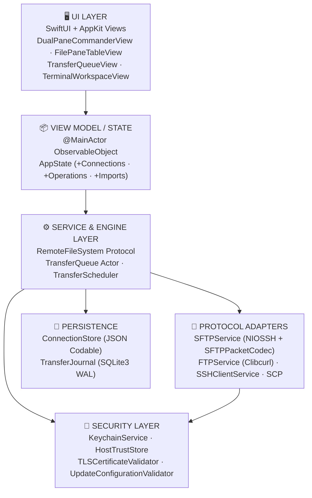
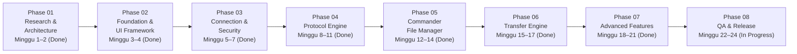
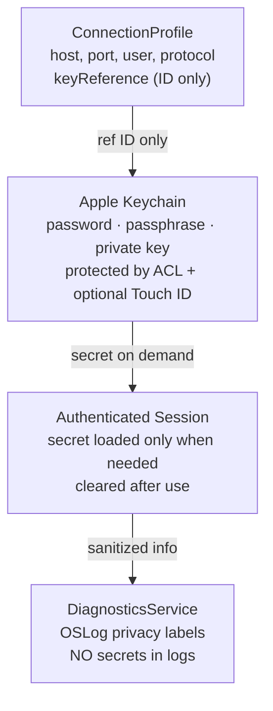

# 🖥️ SparkleSFTP — Implementation Plan, Workground & Task List

## Native macOS SFTP/FTP/SCP/SSH Commander — Swift 6 + SwiftUI

> [!IMPORTANT]
> Dokumen ini adalah sintesis mendalam dari analisis file spesifikasi awal (`aplikasi MacSFTP.txt`, yang kini distandardisasi menjadi **SparkleSFTP**) + riset web dan audit manifest terhadap sumber resmi GitHub (`apple/swift-nio-ssh`, `SwiftTerm`, `Sparkle`), Apple Developer Documentation, dan praktik komunitas Swift terkini (2024–2026).
>
> **Reconciled Implementation Baseline:** Sesuai hasil audit empiris dependensi dan target **macOS 13+** ([ADR-004](ADR/0004-direct-swift-nio-ssh-and-sftp-codec.md), [ADR-005](ADR/0005-macos13-sqlite3-journal-and-observable-object.md), [`TECHNICAL_SPECIFICATION.md`](TECHNICAL_SPECIFICATION.md)):
>
> - SSH & SFTP menggunakan **`apple/swift-nio-ssh` (`0.15.1` >= `0.14.1`)** + SFTP v3 binary codec internal (menggantikan `Citadel` yang mensyaratkan `.macOS(.v14)` dan fork `0.3.x`).
> - Secrets & TOFU menggunakan Apple **`Security.framework`** + **`LAContext`** langsung (menggantikan `GlasSecretStore` `.macOS(.v26)`).
> - Persistensi menggunakan **JSON (`ConnectionStore`)** + **`SQLite3` WAL (`TransferJournal`)** (menggantikan `SwiftData` macOS 14+).
> - State presentation menggunakan **`@MainActor ObservableObject`** (kompatibel macOS 13+).
> - Lihat status eksekusi terkini di [`TASK_LIST.md`](TASK_LIST.md), [`WORKGROUND.md`](WORKGROUND.md), [`../TODO.md`](../TODO.md), dan [`../DOCNOTE.md`](../DOCNOTE.md).

---

## 🎯 Visi Produk

**SparkleSFTP** adalah aplikasi native macOS yang menggabungkan:

- **Dual-pane Commander** (WinSCP-style) dengan UI modern & elegan
- **Protokol lengkap**: SFTP, FTP, FTPS (Explicit/Implicit), SCP, SSH Terminal
- **Keamanan sejak hari pertama**: Keychain + Touch ID, tanpa Electron, tanpa overhead runtime asing

---

## 🏗️ Tech Stack Final (Evidence-Based)

| Lapisan         | Teknologi                                                    | Alasan                                                                                         |
| :-------------- | :----------------------------------------------------------- | :--------------------------------------------------------------------------------------------- |
| **Bahasa**      | Swift 6                                                      | Strict concurrency, actor isolation, Sendable enforcement                                      |
| **UI**          | SwiftUI + AppKit Bridge                                      | Native macOS HIG; `NSTableView` via `NSViewRepresentable` untuk performa file list             |
| **SSH/SFTP**    | `apple/swift-nio-ssh 0.15.1` + Native SFTP v3 Codec          | Async/await SFTP v3 (`SFTPPacketCodec`), PTY, Jump/Forwarding, patch CVE-2026-43798, macOS 13+ |
| **FTP/FTPS**    | `libcurl` (`Clibcurl` C Bridge + `SecTrust`)                 | FTP + Explicit/Implicit TLS 1.2+; `CURLOPT_PROTOCOLS_STR="ftp,ftps"` (tanpa `libssh`)          |
| **Terminal**    | `SwiftTerm 1.20.0` (`migueldeicaza/SwiftTerm`)               | VT100/xterm engine matang; integrasi SwiftUI via `NSViewRepresentable`                         |
| **Keychain**    | Apple `Security.framework` + `LocalAuthentication`           | `kSecAttrAccessibleWhenUnlockedThisDeviceOnly` + Touch ID (`LAContext`)                        |
| **Persistence** | JSON (`ConnectionStore`) + `SQLite3` WAL (`TransferJournal`) | Pemisahan tegas metadata ↔ rahasia, kompatibel penuh macOS 13+                                 |
| **Concurrency** | Swift Actors + async/await + AsyncStream                     | Thread-safe tanpa GCD; `TransferQueue` sebagai actor terisolasi                                |
| **Testing**     | Swift Testing + Docker SSH/FTP fixtures                      | Integration test deterministik terhadap server disposable                                      |
| **CI/CD**       | GitHub Actions                                               | Build + unit test otomatis                                                                     |
| **Distribusi**  | Developer ID + Notarization + Sparkle                        | DMG direct distribution; opsional Mac App Store                                                |

> [!NOTE]
> **Keputusan Arsitektur Terkini ([ADR-004](ADR/0004-direct-swift-nio-ssh-and-sftp-codec.md) & [ADR-005](ADR/0005-macos13-sqlite3-journal-and-observable-object.md)):** Draft awal merencanakan `Citadel`, `GlasSecretStore`, `SwiftData`, dan `@Observable`. Verifikasi manifest membuktikan keempatnya mensyaratkan macOS 14–26 atau bergantung pada fork lama `swift-nio-ssh`. Implementasi aktual memin langsung **`apple/swift-nio-ssh 0.15.1`** (`>= 0.14.1`, patch CVE-2026-43798) + **codec SFTP v3 internal** (`SFTPPacketCodec`), **`Security.framework`**, **`SQLite3` WAL**, JSON `ConnectionStore`, dan `@MainActor ObservableObject` agar kompatibel penuh mulai **macOS 13 Ventura**.

---

## 📐 Arsitektur Sistem



### Aturan Dependensi (Non-Negotiable)

```text
src/App (SparkleSFTP) → SparkleFeatures → src/Packages/*
SparkleNetworking → SparkleSecurity, SparkleCore, Clibcurl, NIOSSH
SparkleTransferEngine → SparkleSecurity, SparkleCore, Crypto
SparkleSecurity → SparkleCore, NIOSSH, Crypto
SparklePersistence → SparkleCore, SQLite3
```

> [!CAUTION]
> **UI tidak boleh pernah** memanggil `NIOSSH`, `Clibcurl`, `SQLite3`, atau Keychain secara langsung. View tidak menyimpan password. Transfer berjalan di `TransferQueue` actor terpisah dari lifecycle jendela.

---

## 🗂️ Struktur Repository

```text
SparkleSFTP/
├── Package.swift                      # Swift 6.0 manifest (.macOS(.v13), dependensi ter-pin)
├── src/
│   ├── App/
│   │   ├── SparkleSFTPApp.swift
│   │   ├── AppDelegate.swift
│   │   ├── AppEnvironment.swift           # Dependency injection root
│   │   ├── SparkleUpdaterService.swift
│   │   ├── SparkleSFTP.entitlements
│   │   └── Resources/                     # Info.plist, AppIcon.icns, AppIcon.png
│   │
│   ├── Packages/
│   │   ├── Clibcurl/                      # Non-variadic C11 wrapper atas macOS SDK libcurl (-lcurl), zlib (-lz) & dynamic dlopen libssh2 probe
│   │   ├── Core/                          # RemotePath, AppError, Protocols, TransferModels, ConnectionModels, ToolchainModels
│   │   ├── Networking/                    # SSHClientService (+Helpers/+Forwarding), SFTPPacketCodec (+Decode), SFTPService (+Helpers pipelined), SCPCompatibilityAdapter, FTPService, CurlClientHelper (256KB/GCD), ZlibAndLibraryProbes
│   │   ├── TransferEngine/                # TransferQueue (+Execution/+Checkpoint/+ConflictHelpers), TransferScheduler (4/3), ResumeValidator, SHA256Verifier, ConflictResolver FileZilla, ProgressThrottler
│   │   ├── FileManager/                   # LocalFileService, DualPaneState, FileSortDescriptor, POSIXPermissions
│   │   ├── Security/                      # KeychainService, HostTrustStore, TLSCertificateValidator, PathValidator (`CWE-22/59/78`), PrivateKeyParser, UpdateConfigurationValidator
│   │   ├── Terminal/                      # TerminalViewRepresentable, LocalShellTerminalRepresentable, ExternalTerminalLauncher, TerminalSessionManager, PortForwardingManager, CommandSnippetStore
│   │   ├── Synchronization/               # DirectoryScanner, SyncPlanner, SyncExecutor
│   │   ├── Persistence/                   # ConnectionStore (JSON), TransferJournal (SQLite3 WAL), SSHConfigParser, ExternalImporters, WinSCPAndFileReader
│   │   └── DesignSystem/                  # 28 SparkNotePad themes, Components, EN/ID JSON Locales (358 keys)
│   │
│   └── Features/                          # SwiftUI + AppKit Views & AppState (+WorkspaceTabs/+WinSCPCommands/+Connections/+ConnectionManagement/+Operations/+Imports/+Settings/+TransferHelpers)
│       ├── Dashboard/                     # MainWindowView, WorkspaceTabBar, 7-tab AboutView, AboutWindowController
│       ├── Connections/                   # ConnectionTableView (+hover/+right-click/+menu), ConnectionViews (visible toolbar), ConnectionEditorView, ConnectionAdvancedSection, ConnectionSecuritySheets, ImportConnectionsSheet
│       ├── Commander/                     # DualPaneCommanderView (+Actions), FilePaneTableView (+InteractiveFileTableSupport/+Menu), QuickConnectBar, CommanderSheets, WinSCPCommandSheets
│       ├── Editor/                        # Minimalist Notepad2 Internal File Editor (NSTextView + NSRulerView)
│       ├── Transfers/                     # TransferMonitor, TransferQueueView, ConflictResolutionSheet FileZilla
│       ├── Terminal/                      # TerminalWorkspaceView (remote PTY + local shell + iTerm2/Terminal)
│       ├── Synchronization/               # SyncPreviewSheet
│       └── Settings/                      # PreferencesView (+Theme, +Localization cards, +Updates)
│
├── Tests/                             # 8 test target (71 test di 18 suite Swift Testing)
│   ├── CoreTests/
│   ├── SecurityTests/
│   ├── PersistenceTests/
│   ├── NetworkingTests/
│   ├── TransferEngineTests/           # TransferEngineTests + TransferEngineResumeTests
│   ├── FileManagerTests/
│   ├── SynchronizationTests/
│   └── IntegrationTests/              # Loopback SSH/SFTP, Proxy, Bastion, -L/-R Forward, E2E
│
├── Tools/
│   ├── TestServers/                   # Docker Compose: OpenSSH, vsftpd, ProFTPD + run-integration-tests.sh
│   └── Release/                       # build-universal.sh, create-dmg.sh, notarize.sh
│
├── .github/workflows/                 # ci.yml, release.yml, mega-linter.yml, codeql.yml, jekyll-gh-pages.yml
│
└── docs/
    ├── ARCHITECTURE.md
    ├── CODE_REVIEW_14_PILLARS.md
    ├── IMPLEMENTATION_PLAN.md
    ├── SECURITY_MODEL.md
    ├── TECHNICAL_SPECIFICATION.md
    ├── WORKGROUND.md
    ├── TASK_LIST.md
    ├── ADR/                           # ADR 0001–0005
    └── ROADMAP.md
```

---

## 🔑 Domain Interfaces Utama

> [!CAUTION]
> **CRITICAL FIXES dari Code Review** — Interface di bawah sudah diperbaiki berdasarkan 14-pillar review. Lihat [CODE_REVIEW_14_PILLARS.md](CODE_REVIEW_14_PILLARS.md) untuk detail lengkap setiap finding.

```swift
// MARK: - Rich Progress Type (FIX: BUG-001, SYN-002)
// Gunakan typed struct, bukan AsyncStream<Double> sebagai parameter
struct TransferProgress: Sendable {
    let bytesTransferred: Int64
    let totalBytes: Int64
    let bytesPerSecond: Int64
    var percentage: Double { guard totalBytes > 0 else { return 0 }; return Double(bytesTransferred) / Double(totalBytes) }
    var estimatedTimeRemaining: Duration? {
        guard bytesPerSecond > 0 else { return nil }
        return .seconds((totalBytes - bytesTransferred) / bytesPerSecond)
    }
}

// MARK: - Strongly-Typed Remote Path (FIX: READ-002)
struct RemotePath: Sendable, Hashable, ExpressibleByStringLiteral {
    let rawValue: String
    init(rawValue: String) { self.rawValue = rawValue.hasPrefix("/") ? rawValue : "/" + rawValue }
    init(stringLiteral value: String) { self.init(rawValue: value) }
    var filename: String { URL(fileURLWithPath: rawValue).lastPathComponent }
    var parent: RemotePath { RemotePath(rawValue: URL(fileURLWithPath: rawValue).deletingLastPathComponent().path) }
}

// MARK: - Core Protocol Contract (FIX: BUG-001 — closure, bukan AsyncStream sebagai param)
protocol RemoteFileSystem: Sendable {
    func connect() async throws
    func listDirectory(at path: RemotePath) async throws -> [RemoteFile]
    // FIX: Gunakan callback closure, bukan AsyncStream sebagai input parameter
    func download(
        from: RemotePath,
        to: URL,
        onProgress: @escaping @Sendable (TransferProgress) -> Void
    ) async throws
    func upload(
        from: URL,
        to: RemotePath,
        onProgress: @escaping @Sendable (TransferProgress) -> Void
    ) async throws
    func delete(at path: RemotePath) async throws
    func rename(from source: RemotePath, to destination: RemotePath) async throws
    func createDirectory(at path: RemotePath) async throws
    func metadata(at path: RemotePath) async throws -> RemoteFileMetadata
    func disconnect(policy: DisconnectPolicy) async throws  // FIX: LOG-006 + SYN-001
}

enum DisconnectPolicy: Sendable {
    case cancelAllTransfers
    case waitForCompletion
    case pauseAndDisconnect
}

// MARK: - AppError (FIX: BUG-002 — explicit Sendable conformance)
enum AppError: Error, Sendable, LocalizedError {
    case connectionTimeout(host: String)
    case hostUnreachable(host: String)
    case hostKeyMismatch(expected: String, got: String)
    case authenticationFailed(method: String)
    case credentialNotFound(service: String)
    case transferFailed(reason: String)
    case diskFull(requiredBytes: Int64, availableBytes: Int64)
    case permissionDenied(path: String)
    case checksumMismatch(expected: String, actual: String)
    case pathTraversal(attempted: String)      // SEC-003 CWE-22
    case symlinkTraversal(destination: String) // SEC-004 CWE-59
    case planExpired                           // LOG-003
    case syncConflict(path: String)
    var errorDescription: String? { /* localized */ return String(describing: self) }
}

// MARK: - Transfer Task (FIX: BUG-003 — pisahkan metadata statis dari state dinamis)
struct TransferTaskMetadata: Identifiable, Sendable {  // Jarang berubah
    let id: UUID
    let source: TransferEndpoint
    let destination: TransferEndpoint
    let totalBytes: Int64
    let priority: TransferPriority
    let createdAt: Date
}

// MARK: - Transfer Status (Sendable, explicit associated values)
enum TransferStatus: Sendable {
    case queued, preparing, connecting
    case transferring(bytesPerSecond: Int64)
    case verifying, finalizing, completed
    case paused, interrupted, cancelled
    case failed(AppError), needsReview
}

// MARK: - Host Trust State Machine (FIX: LOG-001 — complete state machine)
enum HostTrustState: Sendable {
    case unknown
    case pendingUserDecision(fingerprint: String)
    case trusted(fingerprint: String, since: Date)
    case rejected
    case mismatch(expected: String, got: String)
    case corrupted
}

// MARK: - Sync Plan with Expiry (FIX: LOG-003)
struct SyncPlan: Sendable {
    let createdAt: Date
    let expiresAt: Date   // Default: createdAt + 60 seconds
    let actions: [SyncAction]
    var isStale: Bool { Date() > expiresAt }
}
```

---

## 🗺️ Workground (Area Kerja)

| #        | Workground                     | Deskripsi                                                                                                                                                                    | Dependensi       |
| :------- | :----------------------------- | :--------------------------------------------------------------------------------------------------------------------------------------------------------------------------- | :--------------- |
| **WG-1** | Fondasi Proyek & Domain Layer  | SwiftPM manifest (`Package.swift`), modul asiklik, model domain, protocol kontrak, CI                                                                                        | —                |
| **WG-2** | Core SSH & SFTP Engine         | `apple/swift-nio-ssh 0.15.1` + codec SFTP v3 native, auth, `ProxyJump`, SCP, host key TOFU ([ADR-004](ADR/0004-direct-swift-nio-ssh-and-sftp-codec.md))                      | WG-1             |
| **WG-3** | FTP/FTPS Engine                | `Clibcurl` C bridge (`ftp,ftps`), async/await wrapper, explicit/implicit TLS (`SecTrust`)                                                                                    | WG-1             |
| **WG-4** | UI Shell & Dual-Pane           | SwiftUI window, NavigationSplitView, HSplitView, `FilePaneTableView` (`NSTableView`), `AppState`                                                                             | WG-1             |
| **WG-5** | Terminal SSH Terintegrasi      | `SwiftTerm` `NSViewRepresentable` (Swift 6.0–6.2), PTY via `SSHClientService`, multi-tab & `-L`/`-R` forward                                                                 | WG-2, WG-4       |
| **WG-6** | Transfer Queue & Drag-and-Drop | `TransferQueue` actor, `AsyncStream` ter-throttle, drag-drop, conflict resolver, checkpoint resume                                                                           | WG-2, WG-3, WG-4 |
| **WG-7** | Persistensi & Keamanan         | Native `Security.framework` Keychain, `ConnectionStore` JSON, `TransferJournal` SQLite3 WAL, Touch ID ([ADR-005](ADR/0005-macos13-sqlite3-journal-and-observable-object.md)) | WG-1             |
| **WG-8** | Fitur Lanjutan                 | Remote editor SHA-256, port forwarding, command snippets, `SyncPlanner`/`Executor`, EN/ID                                                                                    | WG-2, WG-5, WG-6 |
| **WG-9** | Testing, Polish & Distribusi   | Unit/loopback integration tests, Docker fixtures, Universal 2 DMG, `.github/workflows/release.yml`                                                                           | Semua WG         |

---

## 📋 Phased Roadmap (8 Fase)

> [!IMPORTANT]
> **Status Realisasi:** Fase 01–07 sudah diimplementasikan penuh di repositori dalam struktur modular `src/{App,Features,Packages}` (diverifikasi `73 tests in 19 suites` & `143` file Swift bersih SwiftLint/SwiftFormat/Trunk/MegaLinter), termasuk multi-jendela independen (`AppEnvironment.makeWindowState()` + `FocusedValues`), multi-tab FileZilla/WinSCP (`WorkspaceTabBar` + `QuickConnectBar`), responsivitas hover/klik-kanan AppKit + menu konteks WinSCP (`Compare Files`, `.gz` `-lz`, `SHA-256`, perintah SSH kustom aman `CWE-78`), integrasi pustaka pihak ketiga (`Clibcurl` `-lcurl -lz`, `256 KB` GCD workers, `libssh2`, `ToolchainInspector`), transfer multi-thread pipelined (`8x`), dialog konflik FileZilla (`ConflictResolutionSheet`), multi-tema SparkNotePad, About 7-tab, Notepad2 editor, dan `358` kunci EN/ID JSON; Fase 08 tinggal menunggu eksekusi Docker runtime eksternal dan sertifikat Apple Developer ID untuk notarization produksi.



### Phase 01 — Research & Architecture (Minggu 1–2) _(Selesai)_

- Audit library, SDK, dan lisensi (`apple/swift-nio-ssh 0.15.1` MIT, `SwiftTerm 1.20.0` MIT, system `libcurl` MIT/curl, `Sparkle 2.10.1` MIT — lihat [ADR-004](ADR/0004-direct-swift-nio-ssh-and-sftp-codec.md) & [ADR-005](ADR/0005-macos13-sqlite3-journal-and-observable-object.md))
- Verifikasi pembatasan protokol `Clibcurl` (`ftp,ftps`) untuk mencegah permukaan `libssh` (CVE-2025-15224)
- Threat modeling: trust boundary, attack surface, credential lifecycle
- Finalisasi target minimum **macOS 13 Ventura** (`Universal 2`: `arm64` + `x86_64`)

### Phase 02 — Foundation & UI Framework (Minggu 3–4) _(Selesai)_

- SwiftPM manifest (`Package.swift`, Swift 6, Universal Binary `arm64+x86_64`)
- SPM dependencies ter-pin: `swift-nio-ssh 0.15.1`, `SwiftTerm 1.20.0`, `Sparkle 2.10.1`, `swift-crypto`
- SwiftUI + AppKit integration (`MainWindowView` + `FilePaneTableView` + `@MainActor ObservableObject`)
- Design system (`SparkleDesignSystem`): color tokens, typography, SF Symbols, dark/light, EN/ID strings
- CI/CD GitHub Actions (`ci.yml`, `mega-linter.yml`, `codeql.yml`, `release.yml`)

### Phase 03 — Connection & Security (Minggu 5–7) _(Selesai)_

- `ConnectionStore` CRUD berbasis atomic versioned JSON (tanpa rahasia)
- `KeychainService`: save/load/delete password, passphrase, private key (`WhenUnlockedThisDeviceOnly`)
- Host key TOFU: SHA-256 fingerprint, 6-state machine, changed-key blocking
- SSH auth: password, Ed25519/ECDSA key, keyboard-interactive (2FA)
- TLS certificate validation: `SecTrustEvaluateWithError` chain + hostname + OCSP
- SSH config parser (`~/.ssh/config`) + `FileZilla XML` & `WinSCP .ini` importers

### Phase 04 — Protocol Engine (Minggu 8–11) _(Selesai)_

- `SFTPService` + `SFTPPacketCodec`: `listDirectory`, `download`, `upload`, `rename`, `delete`, `mkdir`, `stat`, `symlink`
- `SCPCompatibilityAdapter.swift`: 24KB chunked streaming fallback via `execCommand`
- `SSHClientService`: PTY channel, session lifecycle, keepalive, `ProxyJump`, `SOCKS5`/`HTTP` proxy, `-L`/`-R` forward
- `FTPService` via `Clibcurl`: `MLSD`/Unix `LIST` parser, upload, download, explicit/implicit FTPS (`SecTrust`)
- Unit & live loopback encrypted SSH/SFTP/Proxy/Bastion integration tests (`NetworkingTests`, `IntegrationTests`)

### Phase 05 — Commander File Manager (Minggu 12–14) _(Selesai)_

- `MainWindowView`: `NavigationSplitView` sidebar + `HSplitView` dual pane
- `FilePaneTableView`: `NSTableView` via `NSViewRepresentable` dengan cell reuse + selection preservation
- PathBar + breadcrumb + Back/Forward/Up navigation + pagination (`PaginatedFileWindow`)
- Keyboard shortcuts: `Tab` switch pane, `Cmd+T/K/R`, menu kontekstual, Quick Look, Inspector + async SHA-256
- Drag-and-drop rekursif: lokal ↔ remote & Finder interop

### Phase 06 — Transfer Engine (Minggu 15–17) _(Selesai)_

- `TransferQueue` actor: bounded global/per-host concurrency (`TransferScheduler`), priority
- `TransferJournal` (`SQLite3` WAL): durable checkpoints, crash reconciliation, bounded retention (10k / 30 hari)
- Progress via `AsyncStream`, `ProgressThrottler` (100 ms / 10 Hz)
- Conflict resolution: Ask / Skip / Rename / Overwrite (unggah maupun unduh)
- Pause/resume berbasis byte aktual disk + revalidasi metadata remote (`LOG-002`) + atomic `replaceItemAt`
- `TransferQueueView`: progress bar, speed, ETA, retry, cancel, clear finished

### Phase 07 — Advanced Features (Minggu 18–21) _(Selesai)_

- `SwiftTerm` integration: `TerminalViewRepresentable` (kompatibel Swift 6.0–6.2), PTY dari `SSHClientService`
- Multi-tab terminal, horizontal/vertical split, explicit PTY resource cleanup
- Port forwarding: `-L` local / `-R` remote tunnel dengan bounded timeout
- Directory comparison: `DirectoryScanner` + pure `SyncPlanner` (60s TTL) + dry-run preview & destructive confirmation
- Remote file editor: temp workspace + hash guard + auto-upload on save
- Localization penuh English (`EN`) + Bahasa Indonesia (`ID`)

### Phase 08 — QA & Release (Minggu 22–24) _(Berjalan — Tooling Siap)_

- Live loopback protocol regression lulus; Docker multi-server fixtures (`Tools/TestServers/`) siap dijalankan di runtime Docker
- Security audit: credential leakage, `OSLog` privacy, path/symlink traversal, proxy status hardening, Sparkle HTTPS + Ed25519 key enforcement
- Performance profiling: `100MB` off-MainActor SHA-256 & 10k paginated slicing teruji; 10GB soak test menunggu environment produksi
- Universal 2 DMG (`arm64` + `x86_64`) + SHA-256 terverifikasi (`Tools/Release/*.sh` + `.github/workflows/release.yml`); Developer ID notarization menunggu sertifikat rilis
- Accessibility: VoiceOver, keyboard-only navigation
- Code signing + notarization (`xcrun notarytool`)
- Sparkle framework auto-update
- DMG packaging + Universal Binary verification
- Beta distribution + feedback triage

---

## ✅ Master TODO & Task List (122+ Tasks)

### EPIC-01 — Project Foundation

- [x] **TASK-001** Create SwiftPM / macOS App manifest (`Package.swift`, SwiftUI lifecycle, Swift 6 — per [ADR-004](ADR/0004-direct-swift-nio-ssh-and-sftp-codec.md))
- [x] **TASK-002** Configure deployment target (macOS 13+, Universal Binary `x86_64 arm64` verified via `lipo -archs`)
- [x] **TASK-003** Configure Swift Package Manager with **PINNED VERSIONS** (reconciled per [ADR-004](ADR/0004-direct-swift-nio-ssh-and-sftp-codec.md) & [ADR-005](ADR/0005-macos13-sqlite3-journal-and-observable-object.md))
  - `apple/swift-nio-ssh`: **`0.15.1` (`>= 0.14.1`)** + internal RFC SFTP v3 binary codec (`SFTPPacketCodec`), patching **CVE-2026-43798** (supersedes `Citadel`)
  - `SwiftTerm`: **`1.20.0`** (`"1.19.0" ..< "1.99.0"`)
  - `Sparkle`: **`2.10.1`** (`"2.10.1" ..< "3.0.0"`)
  - `KeychainService` native over Apple `Security.framework` + `LAContext` (`WhenUnlockedThisDeviceOnly`, supersedes `GlasSecretStore`)
  - `Clibcurl` locked to `ftp,ftps` (`CURLOPT_PROTOCOLS_STR`) over macOS `libcurl` (`libssh2`, zero `libssh` surface — mitigates **CVE-2025-15224**)
- [x] **TASK-004** Configure SwiftLint (`swiftlint --strict`, `0` violations in 143 files) + SwiftFormat (`.swiftformat`, `--trailing-commas never`)
- [x] **TASK-005** Configure unit & loopback integration testing (`Swift Testing` framework — 73 tests in 19 suites)
- [x] **TASK-006** Configure CI/CD (GitHub Actions: `.github/workflows/ci.yml` + `release.yml`, verified by `actionlint`)
- [ ] **TASK-007** Configure production Apple Developer ID code signing (`Tools/Release/notarize.sh` ready; local ad-hoc `codesign` verified)
- [x] **TASK-008** Create architecture documentation (`README.md`, `README-id.md`, `docs/ADR/0001`–`0005`)
- [x] **TASK-009** Create App Sandbox entitlements (`src/App/SparkleSFTP.entitlements`):

  ```xml
  <key>com.apple.security.network.client</key><true/>
  <key>com.apple.security.files.user-selected.read-write</key><true/>
  ```

- [x] **TASK-010** Define domain contracts: `RemoteFileSystem`, `TransferEngine`, `CredentialStoreProtocol`, `HostTrustStoreProtocol`

### EPIC-02 — Design System

- [x] **TASK-011** Design color system (`SparkleTheme.Colors` semantic tokens, light/dark)
- [x] **TASK-012** Design typography scale (`SparkleTheme.Typography` SF Pro, SF Mono)
- [x] **TASK-013** Design icon system (`SparkleTheme.Symbols` SF Symbols)
- [x] **TASK-014** Create reusable components: `StatusPill`, `TransferProgressBar`, `SecurityWarningBanner`
- [x] **TASK-015** Create navigation sidebar (`NavigationSplitView` sidebar in `MainWindowView`)
- [x] **TASK-016** Create toolbar (Connect, Disconnect, Terminal, Sync, Security Diagnostics)
- [x] **TASK-017** Create tab system (multi-session tabs in `MainWindowView`)
- [x] **TASK-018** Create status bar (protocol, host, connection state, toggles)
- [x] **TASK-019** Create `HSplitView` dual-pane container (`DualPaneCommanderView`)
- [x] **TASK-020** Implement dark/light appearance + `.ultraThinMaterial` background
- [x] **TASK-021** Implement keyboard shortcuts (`.keyboardShortcut` `Cmd+T`, `Cmd+K`, `Cmd+R`, `Cmd+Shift+S`, `Cmd+Shift+N`, `Tab`)
- [x] **TASK-022** Implement accessibility labels + VoiceOver annotations

### EPIC-03 — Connection Manager

- [x] **TASK-023** Create `ConnectionProfile` model (`Sendable`, `Codable`)
- [x] **TASK-024** Create `ConnectionStore` (atomic JSON CRUD per [ADR-005](ADR/0005-macos13-sqlite3-journal-and-observable-object.md))
- [x] **TASK-025** Create `ConnectionManagerView` (sidebar list)
- [x] **TASK-026** Create `ConnectionEditorView` (form: host, port, user, auth, path)
- [x] **TASK-027** Implement protocol selector (SFTP/FTP/Explicit FTPS/Implicit FTPS/SCP)
- [x] **TASK-028** Implement authentication selector (password/key/agent/keyboard-interactive/anonymous)
- [x] **TASK-029** Implement server groups + favorites (`ServerGroup`, `isFavorite`)
- [x] **TASK-030** Implement connection search (`AppState.filteredProfiles`)
- [x] **TASK-031** Implement recent connections (`ConnectionProfile.lastConnectedAt`)
- [x] **TASK-032** Implement SSH config parser (`SSHConfigParser` `~/.ssh/config` → Host, HostName, Port, User, IdentityFile, ProxyJump)
- [x] **TASK-033** Implement FileZilla XML importer (`FileZillaImporter`)
- [x] **TASK-034** Implement WinSCP `.ini` importer (`WinSCPIniImporter`)

### EPIC-04 — Security Engine

- [x] **TASK-035** Implement `KeychainService` (`kSecAttrAccessibleWhenUnlockedThisDeviceOnly`, zero iCloud sync)
- [x] **TASK-036** Implement `SecretReference` (`ConnectionProfile` never persists secrets)
- [x] **TASK-037** Implement private key loader (`PrivateKeyParser` + `SecurityScopedBookmarkManager`)
- [x] **TASK-038** Implement `HostTrustStore` (fingerprint SHA-256, 6-state TOFU flow)
- [x] **TASK-039** Implement host key verification UI (`HostKeyVerificationSheet`: Unknown → confirm; Changed → block)
- [x] **TASK-040** Implement TLS certificate validation (`TLSCertificateValidator` chain + hostname + OCSP)
- [x] **TASK-041** Implement secure logging (`DiagnosticsLogger` via `OSLog` privacy)
- [x] **TASK-042** Implement secure temporary file handling (`SecureTempDirectory` `0700` isolated dirs)
- [x] **TASK-043** Implement security-scoped bookmarks (`SecurityScopedBookmarkManager`)
- [x] **TASK-044** Implement Touch ID gate opsional (`LAContext` + biometric prompt)
- [x] **TASK-045** Implement security diagnostics view (`SecurityDiagnosticsView`)

### EPIC-05 — Protocol Engine

- [x] **TASK-046** Define `RemoteCapability` matrix + `RemoteConnection`
- [x] **TASK-047** Define `RemoteConnection` lifecycle interface + disconnect policy
- [x] **TASK-048** Define `RemoteFileSystem` interface
- [x] **TASK-049** Implement `SFTPService` (listDir, download, upload, metadata, rename, delete, mkdir, chmod)
- [x] **TASK-050** Implement `SSHClientService` (connect with `UserAuthSuccessEvent`, auth, exec, keepalive timeout, PTY, DirectTCPIP)
- [x] **TASK-051** Implement `SCPCompatibilityAdapter` (SCP fallback + POSIX single-quote escaping)
- [x] **TASK-052** Implement multi-hop SSH jump host tunnel chaining in `SSHClientService` (`jumpHostProfileID` + `openJumpTunnel` bastion `DirectTCPIP` bridge, live loopback test)
- [x] **TASK-053** Implement `Clibcurl` C bridge (`Package.swift` + `Clibcurl.h` + `ClibcurlHelpers.c` linking `-lcurl`)
- [x] **TASK-054** Implement `FTPService` via libcurl (listing, upload, download, CWE-93 CRLF sanitizer)
- [x] **TASK-055** Implement explicit FTPS (`CURLOPT_USE_SSL` = `CURLUSESSL_ALL`, port 21)
- [x] **TASK-056** Implement implicit FTPS (`ftps://`, port 990, TLS preflight)
- [x] **TASK-057** Implement connection timeout + stall timeout watchdog
- [x] **TASK-058** Implement proxy support (`ProxyConfiguration`: SOCKS5, HTTP)
- [x] **TASK-059** Implement server capability detection matrix (`RemoteService` capabilities)

### EPIC-06 — File Manager

- [x] **TASK-060** Implement `LocalFileService` + `LocalDirectoryWatcher` (`DispatchSource`)
- [x] **TASK-061** Superseded mock stub via real `LocalFileService` + `MockRemoteFS` + `LoopbackSSHServer`
- [x] **TASK-062** Implement `FilePaneTableView` (`NSTableView` via `NSViewRepresentable` dengan cell reuse)
- [x] **TASK-063** Implement path bar (`DualPaneCommanderView` editable path input + parent navigation)
- [x] **TASK-064** Implement dual-pane navigation (focus tracking, `Tab` switch panel)
- [x] **TASK-065** Implement file sorting (`FileSortDescriptor`, folder-first stable sort)
- [x] **TASK-066** Implement multi-selection (`NSTableView` `allowsMultipleSelection`)
- [x] **TASK-067** Implement drag-and-drop upload (`.onDrop(of: [.fileURL])` Local → Remote)
- [x] **TASK-068** Implement file operations (upload, download, delete, rename, chmod)
- [x] **TASK-069** Implement permissions editor (`PermissionsEditorSheet` octal + symbolic `POSIXPermissions`)
- [x] **TASK-070** Implement Quick Look (`QuickLookCoordinator` + `QLPreviewPanel`)
- [x] **TASK-071** Implement remote file editor (`AppState.openRemoteFileInEditor` + `LocalDirectoryWatcher` auto-upload)
- [x] **TASK-072** Implement directory comparison & sync (`SyncPlanner` + `DirectoryScanner`)

### EPIC-07 — Transfer Engine

- [x] **TASK-073** Create `TransferTaskMetadata` / `TransferSnapshot` models (`Identifiable`, `Sendable`, full state machine)
- [x] **TASK-074** Create `TransferQueue` actor (bounded concurrency, priority queue, reentrancy guard, `deinit` cancel, per-host cap)
- [x] **TASK-075** Create `TransferScheduler` (admission control, global=3 / per-host=2 configurable limits)
- [x] **TASK-076** Implement upload flow (temp `.part` write → verify size → atomic rename)
- [x] **TASK-077** Implement download flow (temp `.part` write → `SHA256Verifier` → `PathValidator` → atomic move)
- [x] **TASK-078** Implement batch transfers (`enqueueSelectedTransfer` + multi-drop + `SyncExecutor`)
- [x] **TASK-079** Implement configurable concurrent transfers (`PreferencesView` Stepper → `TransferQueue.updateConcurrencyLimits`)
- [x] **TASK-080** Implement pause/resume (`ResumeValidator` remote mtime+size+partial verify)
- [x] **TASK-081** Implement retry (exponential backoff, skip auth/trust/integrity errors)
- [x] **TASK-082** Implement cancellation (clean task/socket/cURL teardown, no hanging sessions)
- [x] **TASK-083** Implement conflict resolver (`ConflictResolver` + `ConflictResolutionSheet`)
- [x] **TASK-084** Implement atomic upload (`.part` rename hanya setelah verifikasi)
- [x] **TASK-085** Implement `TransferJournal` actor (`SQLite3` WAL)
- [x] **TASK-086** Implement crash recovery (`reconcileInterruptedOnLaunch` → `interrupted`)
- [x] **TASK-087** Implement transfer statistics (speed, ETA, 100ms throttled stream)
- [x] **TASK-088** Create `TransferQueueView` (progress bar, speed, pause/resume/cancel/retry)
- [x] **TASK-089** Implement system notifications (`UNUserNotificationCenter` saat aplikasi ter-bundle `.app`)

### EPIC-08 — SSH Terminal Workspace

- [x] **TASK-090** Create `TerminalViewRepresentable` (`NSViewRepresentable` wrapping SwiftTerm `TerminalView` + cleanup + 100-tab test)
- [x] **TASK-091** Implement PTY channel (`SSHClientService.openPTYChannel` ↔ `TerminalSessionManager`)
- [x] **TASK-092** Implement `TerminalViewDelegate` (`sizeChanged` → `WindowChangeRequest`, `clipboardCopy`/`Read` → `NSPasteboard`)
- [x] **TASK-093** Implement terminal tabs (`TerminalWorkspaceView`)
- [x] **TASK-094** Implement split terminal (`HSplitView` split mode)
- [ ] **TASK-095** Implement SSH agent socket forwarding (deferred upstream: `apple/swift-nio-ssh 0.15.1` uses internal `BackingKey` without external agent signer hook)
- [x] **TASK-096** Implement interactive credential / 2FA challenge prompt (`CredentialPromptRequest` + `CredentialPromptSheet` + loopback test)
- [x] **TASK-097** Implement `ProxyJump` multi-hop bastion execution (`SSHClientService.openJumpTunnel` + Bastion UI picker + loopback test)
- [x] **TASK-098** Implement local port forwarding (`PortForwardingManager` + live `DirectTCPIP` loopback test)
- [x] **TASK-099** Implement remote `-R` port forwarding (`tcpip-forward` global request + `forwardedTCPIP` channel bridging + `PortForwardingSheet` `-L`/`-R` mode)
- [x] **TASK-100** Implement command snippets (`CommandSnippetStore` + `SnippetsSheet` add/delete/run)

### EPIC-09 — Synchronization

- [x] **TASK-101** Create `SyncProfile` / `SyncPlan` model
- [x] **TASK-102** Implement `DirectoryScanner` (async, cancel-safe, circular symlink loop guard)
- [x] **TASK-103** Implement tiered file comparison (size, mtime, SHA-256)
- [x] **TASK-104** Implement pure `SyncPlanner` (`expiresAt` 60s TTL tanpa mutasi)
- [x] **TASK-105** Implement sync preview UI (`SyncPreviewSheet` create/update/delete terpisah)
- [x] **TASK-106** Implement dry-run mode
- [x] **TASK-107** Implement one-way synchronization (`SyncExecutor` via `TransferQueue` — `localToRemote` & `remoteToLocal`)
- [x] **TASK-108** Implement bidirectional sync (`SyncDirection.bidirectional` in `SyncPlanner`, `SyncExecutor`, & `SyncPreviewSheet`)
- [x] **TASK-109** Implement exclusion patterns (`.git`, `.DS_Store`, glob `*.ext`)
- [x] **TASK-110** Implement deletion protection + explicit confirmation & pre-delete remote revalidation

### EPIC-10 — Quality Assurance & Release

- [x] **TASK-111** Unit tests: state machine, path parser, conflict rules, SSH config & importers, themes, i18n (`358` keys), bidirectional sync, Notepad2 editor, Keychain Remember Password & `FTPService` prompt, 7-tab About diagnostics, AppKit table row keys, `zlib`/`gzip` `CWE-409` codecs, `ToolchainInspector`, `ExternalTerminalLauncher` `CWE-78`, 8x pipelined SFTP SHA-256 parity, FIFO `pendingConflictQueue`, independent multi-window & paired multi-tab sessions, WinSCP `.gz` upload / SHA-256 / comparison / `CWE-78` quoting, and connection cloning/batch deletion/performance (`CoreTests`, `PersistenceTests`, `FileManagerTests`, `SynchronizationTests`, `IntegrationTests` — 73 tests in 19 suites)
- [ ] **TASK-112** Live Docker Compose integration test execution (`Tools/TestServers/` tersedia; butuh container runtime Docker)
- [x] **TASK-113** SFTP interoperability tests via real encrypted `LoopbackSSHServer` (listing, upload, download, mkdir, rename, chmod, delete)
- [ ] **TASK-114** Live Docker FTPS server interop run (TLS self-signed rejection & FTP CRLF sanitizer terverifikasi; live FTPS container deferred ke Docker env)
- [x] **TASK-115** SSH authentication tests via real encrypted loopback SSH (password + Ed25519 public key)
- [x] **TASK-116** Host-key mismatch tests (TOFU unknown prompt, trusted reuse, rotated key `.hostKeyMismatch` hard block)
- [x] **TASK-117** TLS certificate validation test (ephemeral X.509 untrusted cert rejected by `TLSCertificateValidator`)
- [x] **TASK-118** Large-file SHA-256 verification test (`100MB` off-MainActor streaming tanpa memblokir UI thread)
- [x] **TASK-119** Interrupted-transfer recovery & cancel reentrancy tests (`TransferJournal` crash recovery + mid-transfer cancel)
- [x] **TASK-120** Memory & performance tests (10K+ `PaginatedFileWindow`, 100 PTY tab teardown)
- [x] **TASK-121** Security audit & automated tests (`PathValidator`, `KeychainService`, CRLF sanitizer, `swiftlint --strict`)
- [ ] **TASK-122** Apple Developer ID notarization (`xcrun notarytool submit` via `Tools/Release/notarize.sh` di release host; ad-hoc signing & entitlements terverifikasi lokal)
- [ ] **TASK-123** Live Sparkle signed update feed verification dengan `SUPublicEDKey` & appcast HTTPS rilis
- [x] **TASK-124** DMG packaging + Universal Binary verification (`lipo -archs` `x86_64 arm64`, `.app` + embedded `Sparkle.framework`, `.dmg` + `.sha256` terverifikasi lokal)
- [ ] **TASK-125** Beta distribution + feedback triage

---

## 🔐 Security Architecture (Non-Negotiable)



### SSH Security Rules

| Aturan                    | Implementasi                                                                                         |
| :------------------------ | :--------------------------------------------------------------------------------------------------- |
| TOFU (Trust On First Use) | Fingerprint SHA-256 ditampilkan saat koneksi pertama; pengguna harus mengkonfirmasi secara eksplisit |
| Known-hosts database      | Simpan fingerprint di Keychain (bukan UserDefaults)                                                  |
| Changed host key          | Blokir koneksi; tampilkan peringatan berbeda dari "unknown"                                          |
| Modern algorithms only    | Disable algoritma usang (MD5, SHA-1) secara default                                                  |
| **DILARANG**              | `acceptAnyHostKey = true` / `.acceptAnything()` di kode produksi                                     |

### FTPS Security Rules

- TLS 1.2 minimum, TLS 1.3 preferred
- Certificate chain + hostname + expiry validation WAJIB
- **Tidak ada auto-downgrade** dari FTPS ke FTP plaintext
- Plain FTP → tampilkan warning merah eksplisit di UI

---

## ⚡ Testing Environment (Docker Compose)

```yaml
# docker-compose.test.yml
services:
  sftp-server:
    image: atmoz/sftp
    ports: ["2222:22"]
    # Test: password auth, key auth, SFTP-only account

  openssh-server:
    image: linuxserver/openssh-server
    ports: ["2223:2222"]
    # Test: SSH terminal, SCP, SFTP, ProxyJump

  ftp-server:
    image: fauria/vsftpd
    ports: ["21:21", "21100-21110:21100-21110"]
    environment:
      - FTP_USER=testuser
      - PASV_ADDRESS=127.0.0.1
    # Test: plain FTP, explicit FTPS with valid & invalid cert

  proftpd:
    image: instantlinux/proftpd
    ports: ["2121:21"]
    # Test: implicit FTPS port 990
```

**Wajib diuji per server:**

- File kecil 1KB · 100MB · 1GB · 10GB
- Filename Unicode · spasi · hidden files · symlink
- Permission denied · disk full · network disconnect · server restart
- TLS cert expired · host key changed · wrong password · interrupted transfer

---

## 📊 Fitur Priority Matrix

| Fitur                            | Priority  | Phase        |
| :------------------------------- | :-------- | :----------- |
| **SFTP connection + Keychain**   | P0 — MVP  | Phase 03–04  |
| **Dual-pane file browser**       | P0 — MVP  | Phase 05     |
| **Upload/Download queue**        | P0 — MVP  | Phase 06     |
| **SSH host key verification**    | P0 — MVP  | Phase 03     |
| **SSH terminal (SwiftTerm)**     | P0 — MVP  | Phase 07     |
| FTP + explicit FTPS              | P1 — v1.0 | Phase 04     |
| Transfer resume + recovery       | P1 — v1.0 | Phase 06     |
| Directory comparison + sync      | P1 — v1.0 | Phase 07     |
| FileZilla/SSH config import      | P1 — v1.0 | Phase 03     |
| Implicit FTPS (port 990)         | P1 — v1.0 | Phase 04     |
| Multi-tab sessions               | P1 — v1.0 | Phase 07     |
| Touch ID vault unlock            | P2 — v1.1 | Phase 08     |
| Port forwarding                  | P2 — v1.1 | Phase 07     |
| S3-compatible storage            | P2 — v2.0 | Post-release |
| Remote-to-remote server transfer | P2 — v2.0 | Post-release |

---

## ⚠️ Risk Matrix

| Risiko                                 | Level     | Mitigasi                                               |
| :------------------------------------- | :-------- | :----------------------------------------------------- |
| SwiftUI `Table` performa (ribuan file) | 🔴 Tinggi | AppKit `NSTableView` via `NSViewRepresentable`         |
| SSH algorithm compatibility            | 🔴 Tinggi | Protocol compatibility test suite + Docker fixtures    |
| FTPS passive connection (NAT/firewall) | 🔴 Tinggi | PASV mode testing, EPSV fallback                       |
| Large-file transfer (memory bounds)    | 🔴 Tinggi | Streaming chunks, bounded buffer, backpressure         |
| Transfer recovery (data integrity)     | 🔴 Tinggi | TransferJournal actor + durable state + reconciliation |
| SFTP server differences (capability)   | 🔴 Tinggi | Capability detection; tidak assume universal support   |
| App Sandbox restrictions               | 🔴 Tinggi | Security-scoped bookmarks; entitlements tepat          |
| Library dependency updates             | 🔴 Tinggi | Pinned SPM versions + security review per update       |
| Keychain permission prompts            | 🟡 Sedang | Credential lifecycle design; batch access per session  |
| SSH terminal rendering edge cases      | 🟡 Sedang | SwiftTerm + PTY tests + scrollback stress test         |

---

## 🚦 MVP Acceptance Criteria (Release Gate)

**Aplikasi TIDAK boleh dirilis jika masih ada:**

- [ ] Host key berubah tetapi koneksi tetap dilanjutkan otomatis
- [ ] FTPS menerima sertifikat tidak valid secara default
- [ ] Password/private key muncul dalam log
- [ ] Transfer gagal ditandai `completed`
- [ ] Crash recovery menyebabkan overwrite tidak terkonfirmasi
- [ ] Sync menghapus target yang berbeda dari preview tanpa revalidasi
- [ ] Cancel menyebabkan session atau worker tidak pernah selesai
- [ ] Dependency atau lisensi distribusi belum jelas

**Semua item inti MVP terverifikasi hijau:**

- [x] Engine SFTP, FTP, explicit/implicit FTPS, dan SSH terminal tersedia dalam [`SparkleNetworking`](../src/Packages/Networking/) & [`SparkleTerminal`](../src/Packages/Terminal/) (interop SFTP & DirectTCPIP teruji live loopback; container Docker FTPS deferred ke host Docker)
- [x] Host key verification berjalan benar (`LoopbackSFTPIntegrationTests` memverifikasi unknown prompt, trusted reuse, dan blokir host key berubah via `.hostKeyMismatch`)
- [x] TLS certificate validation (`TLSCertificateValidator` menolak sertifikat self-signed X.509 di `SecurityTests`)
- [x] Dual-pane lokal/remote berfungsi + multi-jendela independen + multi-tab FileZilla/WinSCP (`Cmd+T`, `Cmd+Shift+T`, `Cmd+U`, `Cmd+K`, `Cmd+R`, `Cmd+Shift+S`, `Cmd+Shift+N`, `Tab`) + menu konteks WinSCP (`Edit`, `F5`–`F9`, `Compare`, `.gz`, `SHA-256`, perintah SSH kustom)
- [x] Upload/download + batch multi-thread (`TransferScheduler` 4 global / 3 per-host + `SFTPPipelinedTransfer` 8x sliding window) + pause/resume + cancel + retry (`TransferEngineTests` + `ToolchainAndConflictTests` + `LoopbackSFTPIntegrationTests`)
- [x] FileZilla-style conflict resolution (`ConflictResolutionSheet` 7 actions + sticky queue/direction checkboxes + FIFO `pendingConflictQueue`) + atomic upload (`.part` verify -> atomic rename)
- [x] Toolchain integration (`Clibcurl` `-lcurl -lz`, `256 KB` `CurlClientHelper` GCD workers, bounded `zlib`/`gzip`, dynamic `dlopen` `libssh2` probe, `OpenSSL`/`OpenSSH`/shell detection, `LocalShellTerminalRepresentable`, sanitized `ExternalTerminalLauncher` for iTerm2/Terminal) (`ToolchainAndConflictTests`)
- [x] Credentials tersimpan di Keychain, TIDAK di database (`ConnectionStoreTests` + `KeychainService`)
- [x] Interrupted transfer dapat direkonsiliasi setelah restart (`TransferJournal` SQLite3 WAL di `PersistenceTests`)
- [x] Tidak ada secret dalam log (`DiagnosticsLogger` + rule `no_password_in_logs` 0 pelanggaran)
- [x] Streaming SHA-256 & chunked I/O tanpa alokasi buffer penuh (`100MB` off-MainActor verified di `TransferEngineTests`)
- [x] Build Universal `arm64` + `x86_64` terverifikasi (`lipo -archs` `x86_64 arm64` + DMG `SparkleSFTP-0.2.0-universal.dmg` + `.github/workflows/release.yml`); [ ] notarization Apple Developer ID (`xcrun notarytool`) menunggu sertifikat produksi
- [x] `apple/swift-nio-ssh` `0.15.1` >= `0.14.1` terverifikasi (**CVE-2026-43798** mitigated)
- [x] `Clibcurl` mengunci `CURLOPT_PROTOCOLS_STR = "ftp,ftps"` (macOS `libcurl` memakai `libssh2/1.11.1`, permukaan SSH libcurl dimatikan — mitigasi **CVE-2025-15224**)
- [x] Semua Keychain items pakai `kSecAttrAccessibleWhenUnlockedThisDeviceOnly` (`SecurityTests` + `no_icloud_keychain_sync`)
- [x] Path traversal test: download dengan `../` → rejected (`CWE-22`) & FTP CRLF (`CWE-93`) teruji di `SecurityTests` / `NetworkingTests`
- [x] Symlink attack test: recursive download & pre-existing local destination symlink → rejected (`CWE-59`) teruji di `SecurityTests` & `SynchronizationTests`
- [x] Actor reentrancy test: cancel mid-transfer → `.cancelled` deterministik (`TransferEngineTests`)
- [x] PTY leak test: open/close 100 terminal tabs → clean teardown (`IntegrationTests`)
- [x] SHA-256 verification: off-MainActor untuk file `100MB` (`TransferEngineTests`)
- [x] `UpdateConfigurationValidator` menolak feed non-HTTPS & `SUPublicEDKey` placeholder (`SecurityTests`); [ ] live appcast signing menggunakan kunci Ed25519 produksi pada host rilis
- [x] OSLog privacy redaction diaudit via `DiagnosticsLogger` & SwiftLint `no_password_in_logs`

---

## 📅 Timeline Estimasi

| Fase          | Workground                        | Durasi            |
| :------------ | :-------------------------------- | :---------------- |
| Phase 01–02   | WG-1 (fondasi)                    | 2–4 minggu        |
| Phase 03      | WG-7 (security + connection)      | 3 minggu          |
| Phase 04      | WG-2 + WG-3 (protocol engines)    | 4 minggu          |
| Phase 05      | WG-4 (UI dual-pane)               | 3 minggu          |
| Phase 06      | WG-6 (transfer engine)            | 3 minggu          |
| Phase 07      | WG-5 + WG-8 (terminal + advanced) | 4 minggu          |
| Phase 08      | WG-9 (QA + release)               | 3–4 minggu        |
| **Total MVP** | **Semua kecuali WG-8 advanced**   | **~18–22 minggu** |

> [!TIP]
> **Solo developer:** Fokus MVP dulu (Phase 01–06 = ~15 minggu). Gunakan `LocalFileService` stub agar UI dapat dikembangkan paralel dengan backend protocol engine. Jangan bangun semua protokol sekaligus.

---

## 📚 Referensi Resmi

| Sumber                                                                                                     | URL                                                                                           |
| :--------------------------------------------------------------------------------------------------------- | :-------------------------------------------------------------------------------------------- |
| SwiftNIO SSH (`0.15.1` — menggantikan Citadel, [ADR-004](ADR/0004-direct-swift-nio-ssh-and-sftp-codec.md)) | <https://github.com/apple/swift-nio-ssh>                                                      |
| Sparkle Auto-Update                                                                                        | <https://github.com/sparkle-project/Sparkle>                                                  |
| SwiftTerm                                                                                                  | <https://github.com/migueldeicaza/SwiftTerm>                                                  |
| Apple Keychain Services                                                                                    | <https://developer.apple.com/documentation/security/keychain_services>                        |
| App Sandbox Entitlements                                                                                   | <https://developer.apple.com/documentation/security/app_sandbox>                              |
| RFC 959 (FTP)                                                                                              | <https://datatracker.ietf.org/doc/html/rfc959>                                                |
| RFC 4217 (FTPS)                                                                                            | <https://datatracker.ietf.org/doc/html/rfc4217>                                               |
| RFC 4251 (SSH Architecture)                                                                                | <https://datatracker.ietf.org/doc/html/rfc4251>                                               |
| libcurl Documentation                                                                                      | <https://curl.se/libcurl/c/>                                                                  |
| Swift 6 Concurrency                                                                                        | <https://docs.swift.org/swift-book/documentation/the-swift-programming-language/concurrency/> |

---

_Generated: 2026-11-11 | SparkleSFTP Implementation Plan v1.1 (originally drafted as MacSFTP, standardized to SparkleSFTP)_
_Skills applied: spec-driven-development · architecture-patterns · backend-architect · security-auditor · frontend-ui-engineering · source-driven-development · planning-and-task-breakdown · systematic-debugging · verification-before-completion · token-efficiency-zero-hallucination_
