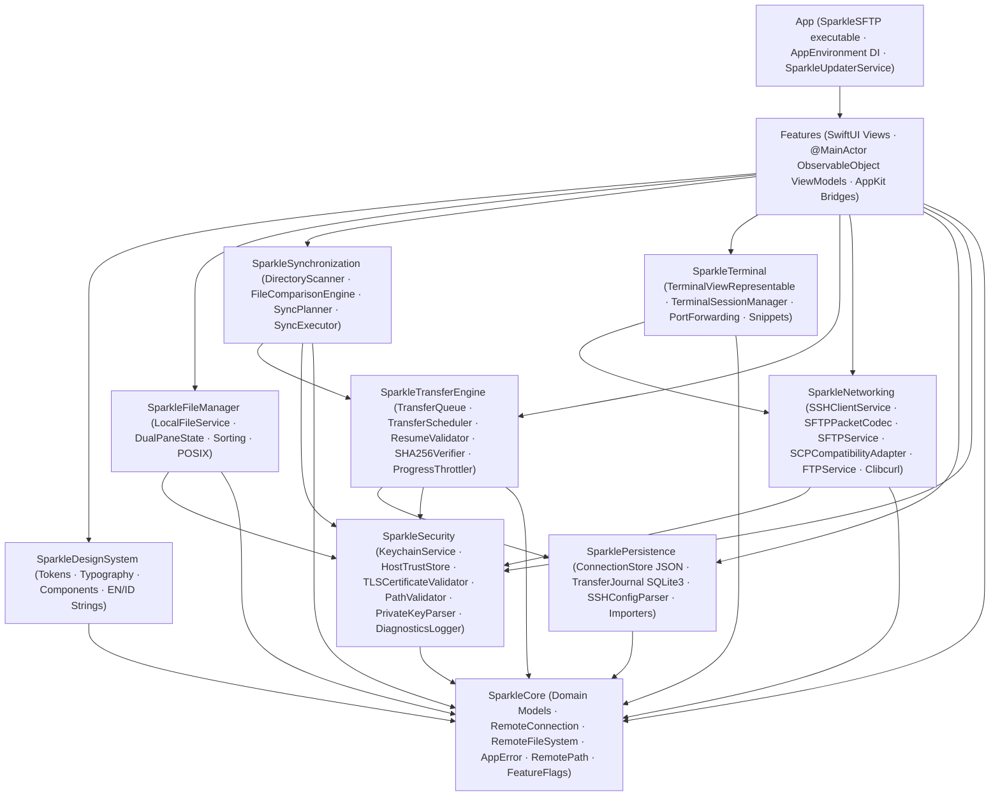

# SparkleSFTP — Technical Specification (Full MVP)

- **Project Name:** SparkleSFTP *(evolved from early design title `MacSFTP`)*
- **Target Platform:** macOS 13.0 Ventura and newer (`Universal 2`: `arm64` + `x86_64`)
- **Language & Build System:** Swift 6 (`swift-tools-version: 6.0`) via Swift Package Manager (`Package.swift`)
- **UI Framework:** SwiftUI (application shell, navigation, sheets, settings) + AppKit (`NSTableView` cell-reused file browser, `QLPreviewPanel` Quick Look, `SwiftTerm.TerminalView` via `NSViewRepresentable`)
- **Scope:** Full MVP (Connection Manager, Security & TOFU/SecTrust, SFTP v3, SSH PTY Terminal + Port Forwarding, SCP Fallback, FTP + Explicit/Implicit FTPS, Dual-Pane Commander, Actor Transfer Engine + Durable SQLite Journal, Directory Sync with Dry-Run Expiry, Remote File Editor, EN/ID Localization, Release Tooling)
- **Distribution:** Open-source (**MIT License**), Developer ID signed + notarized Universal 2 DMG + Sparkle Ed25519 auto-updates

---

## 1. Final Architecture & Layering Boundaries



### Enforced Acyclic Invariants

1. `SparkleCore` depends only on `Foundation` (plus Swift standard library concurrency).
2. No `Packages/*` target may depend on `Features/` (`CIRC-002`, enforced at compile time by `Package.swift`).
3. `SparkleTransferEngine` never imports `SparkleNetworking` — all protocol transfers execute through `RemoteFileSystem` closure callbacks (`CIRC-001`, `BUG-001`).
4. SwiftUI Views and ViewModels never call `NIOSSH`, `Clibcurl`, `SQLite3`, or raw `Security.framework` C APIs directly.
5. ViewModels use `@MainActor` + `ObservableObject` + `@Published` for single-path compatibility across **macOS 13+** ([ADR-005](ADR/0005-macos13-sqlite3-journal-and-observable-object.md)).

---

## 2. Verified Dependency Audit

Every third-party package and system framework below was inspected against upstream `Package.swift` manifests, release tags, macOS SDK headers, and CVE advisories prior to implementation.

| Component | Package / Framework | Verified Version / Floor | License | macOS Floor | Audit Verdict & Rationale |
| :--- | :--- | :--- | :--- | :--- | :--- |
| **SSH Transport** | `apple/swift-nio-ssh` | `"0.15.1" ..< "0.16.0"` (`>= 0.14.1`) | Apache 2.0 | macOS 10.15+ | **APPROVED.** Official Apple SwiftNIO SSH; `>= 0.14.1` patches **CVE-2026-43798** (pre-auth oversized ECDSA signature OOB stack write). Supports Swift 6, session/PTY channels, `DirectTCPIP` forwarding. |
| **Networking Core** | `apple/swift-nio` | `from: "2.81.0"` | Apache 2.0 | macOS 10.15+ | **APPROVED.** EventLoopGroup, `ClientBootstrap`, `ServerBootstrap`, `ByteBuffer`. |
| **Cryptography** | `apple/swift-crypto` | `from: "3.12.3"` | Apache 2.0 | macOS 10.15+ | **APPROVED.** Hardware-accelerated SHA-256 streaming verification, Curve25519 / P-256 / P-384 / P-521 key support. |
| **Terminal Emulator** | `migueldeicaza/SwiftTerm` | `"1.19.0" ..< "1.99.0"` (resolved `1.20.0`) | MIT | macOS 11+ | **APPROVED.** Stable Swift 6.0-manifest release (`v1.19.0`–`v1.20.0`) with AppKit `TerminalView` + `TerminalViewDelegate` (`v1.99.3` raises tools-version to 6.2 and adds `swift-png`). |
| **Auto-Update** | `sparkle-project/Sparkle` | `"2.10.1" ..< "3.0.0"` | MIT | macOS 12+ | **APPROVED.** Binary `.xcframework` with HTTPS Appcast + Ed25519 (`SUPublicEDKey`) verification. Embedded into `.app/Contents/Frameworks` by release scripts. |
| **FTP / FTPS Bridge** | System `libcurl` (`Clibcurl`) | macOS SDK (`8.7.1+`) | curl / MIT-like | macOS 13+ | **APPROVED.** Wrapped via non-variadic C helpers (`Packages/Clibcurl`) with `CURLOPT_PROTOCOLS_STR = "ftp,ftps"`, `CURLUSESSL_ALL`, TLS 1.2+. Does not use `libssh` (avoids **CVE-2025-15224**). |
| **Keychain & Touch ID** | Apple `Security` + `LocalAuthentication` | macOS SDK | Apple System | macOS 13+ | **APPROVED.** Direct `SecItem*` + `LAContext` implementation enforcing `kSecAttrAccessibleWhenUnlockedThisDeviceOnly`. |
| **Durable Journal** | macOS System `SQLite3` | macOS SDK (`libsqlite3.tbd`) | Public Domain | macOS 13+ | **APPROVED.** WAL-mode ACID checkpoints + bounded retention (`10,000` entries / `30` days). |
| **TLS Validation** | Apple `Security` + `Network` (`SecTrust`) | macOS SDK | Apple System | macOS 13+ | **APPROVED.** `SecPolicyCreateSSL` + `SecPolicyCreateRevocation(kSecRevocationOCSPMethod)` + `SecTrustEvaluateWithError`. |

### Explicitly Rejected Dependencies

| Candidate | Reason Rejected (Verified Evidence) |
| :--- | :--- |
| `orlandos-nl/Citadel` (`0.12.1`) | Requires `.macOS(.v14)` (breaks macOS 13+) AND pulls `Wellz26/swift-nio-ssh` `0.3.x` fork instead of `apple/swift-nio-ssh >= 0.14.1` ([ADR-004](ADR/0004-direct-swift-nio-ssh-and-sftp-codec.md)). |
| `orlandos-nl/Citadel` (`0.11.1`) | Pulls `Joannis/swift-nio-ssh` `0.3.2` instead of `apple/swift-nio-ssh >= 0.14.1` (fails CVE-2026-43798 mitigation). |
| `msitarzewski/GlasSecretStore` | Requires `.macOS(.v26)` and `swift-tools-version: 6.2` ([ADR-005](ADR/0005-macos13-sqlite3-journal-and-observable-object.md)). |
| `SwiftData` / `@Observable` | Requires macOS 14.0+ ([ADR-005](ADR/0005-macos13-sqlite3-journal-and-observable-object.md)). |

---

## 3. `Package.swift` Contract

`Package.swift` uses `swift-tools-version: 6.0` and `platforms: [.macOS(.v13)]` with Swift 6 strict concurrency enabled across all targets:

- **Library / System Targets (`Packages/*`):**
  - `Clibcurl` (C target wrapping `<curl/curl.h>` + `-lcurl`)
  - `SparkleCore`
  - `SparkleSecurity`
  - `SparklePersistence`
  - `SparkleNetworking`
  - `SparkleTransferEngine`
  - `SparkleFileManager`
  - `SparkleTerminal`
  - `SparkleSynchronization`
  - `SparkleDesignSystem`
- **Feature Target (`Features/`):** `SparkleFeatures`
- **Executable App Target (`App/`):** `SparkleSFTP` (links `SparkleFeatures`, all packages, and `Sparkle`)
- **Test Targets (`Tests/*`):** `CoreTests`, `SecurityTests`, `PersistenceTests`, `NetworkingTests`, `TransferEngineTests`, `FileManagerTests`, `SynchronizationTests`, `IntegrationTests`

---

## 4. Repository Structure

```text
SparkleSFTP/
├── Package.swift
├── DOCNOTE.md
├── TODO.md
├── CHANGELOG.md
├── README.md / README-id.md / SECURITY.md / CONTRIBUTING.md / LICENSE
├── tasks/
│   ├── plan.md
│   └── todo.md
├── App/
│   ├── SparkleSFTPApp.swift
│   ├── AppDelegate.swift
│   ├── AppEnvironment.swift
│   ├── SparkleUpdaterService.swift
│   ├── SparkleSFTP.entitlements
│   └── Resources/
│       ├── Info.plist
│       ├── AppIcon.icns
│       └── AppIcon.png
├── Packages/
│   ├── Clibcurl/
│   ├── Core/
│   ├── Security/
│   ├── Persistence/
│   ├── Networking/
│   ├── TransferEngine/        # TransferQueue (+Execution, +Checkpoint), TransferScheduler, ResumeValidator, SHA256Verifier
│   ├── FileManager/
│   ├── Terminal/
│   ├── Synchronization/
│   └── DesignSystem/
├── Features/
│   ├── AppState*.swift        # Main coordinator + Connections/Operations/Imports/TransferHelpers extensions
│   ├── MainWindowView.swift
│   ├── Dashboard/
│   ├── Connections/
│   ├── Commander/
│   ├── Transfers/
│   ├── Terminal/
│   ├── Synchronization/
│   └── Settings/
├── Tests/
│   ├── CoreTests/
│   ├── SecurityTests/
│   ├── PersistenceTests/
│   ├── NetworkingTests/
│   ├── TransferEngineTests/
│   ├── FileManagerTests/
│   ├── SynchronizationTests/
│   └── IntegrationTests/
├── Tools/
│   ├── TestServers/
│   └── Release/
└── docs/
    ├── ADR/ (0001–0005)
    ├── ARCHITECTURE.md
    ├── CODE_REVIEW_14_PILLARS.md
    ├── IMPLEMENTATION_PLAN.md
    ├── ROADMAP.md
    ├── SECURITY_MODEL.md
    ├── TASK_LIST.md
    ├── TECHNICAL_SPECIFICATION.md
    └── WORKGROUND.md
```

---

## 5. Security Model Summary

Full details live in [`docs/SECURITY_MODEL.md`](SECURITY_MODEL.md):

- **Keychain Isolation (`CWE-312` / `CWE-522`)**: All passwords, passphrases, private keys, and host keys stored with `kSecAttrAccessibleWhenUnlockedThisDeviceOnly` and optional `.userPresence` Touch ID gating (`LAContext`).
- **6-State TOFU (`LOG-001`)**: `unknown`, `pendingUserDecision`, `trusted`, `rejected`, `mismatch`, `corrupted`. Changed host key hard-blocks connection.
- **TLS / FTPS (`CWE-295`)**: `SecTrustEvaluateWithError` + OCSP revocation + TLS 1.2+ + zero silent downgrade to plain FTP.
- **Path & Symlink Containment (`CWE-22` / `CWE-59`)**: Strict POSIX canonicalization and local destination boundary enforcement before writes.
- **Log Redaction (`CWE-532`)**: `OSLog` privacy annotations + static SwiftLint error rules.

---

## 6. Milestone Implementation Plan (Full MVP)

| Milestone | Scope | Key Modules | Empirical Verification |
| :--- | :--- | :--- | :--- |
| **M1 — Foundation & Manifest** | `Package.swift`, `SparkleCore`, `SparkleDesignSystem`, `Clibcurl` | `Packages/Core`, `Packages/DesignSystem`, `Packages/Clibcurl` | `swift package resolve`, `swift build`, `CoreTests` |
| **M2 — Security & Persistence** | Keychain, Touch ID, TOFU, SecTrust, PathValidator, KeyParser, JSON + SQLite3 Journal, Importers | `Packages/Security`, `Packages/Persistence` | `SecurityTests`, `PersistenceTests` |
| **M3 — Protocol Engines** | `NIOSSH` client, SFTP v3 binary codec & service, SCP adapter, `libcurl` FTP/FTPS service | `Packages/Networking` | `NetworkingTests` (wire codec, listing parser, escaping) |
| **M4 — Transfer, FileManager & Sync** | Actor `TransferQueue`, Scheduler, `ResumeValidator`, `SHA256Verifier`, `LocalFileService`, `SyncPlanner`/`Executor` | `Packages/TransferEngine`, `Packages/FileManager`, `Packages/Synchronization` | `TransferEngineTests`, `FileManagerTests`, `SynchronizationTests` |
| **M5 — Terminal, AppKit/SwiftUI UI & App** | `SwiftTerm` wrapper, PTY session manager, port forwarding, dual-pane `NSTableView`, Quick Look, views, `App/` | `Packages/Terminal`, `Features/`, `App/` | `IntegrationTests`, `swift build` executable |
| **M6 — Release Tooling, QA & CI Gates** | Docker test servers, Universal 2/notarize/DMG shell scripts, full linter & test verification | `Tools/`, `.github/`, docs | `swift test`, `swiftlint --strict`, `shellcheck`, `markdownlint-cli2`, `actionlint` |
