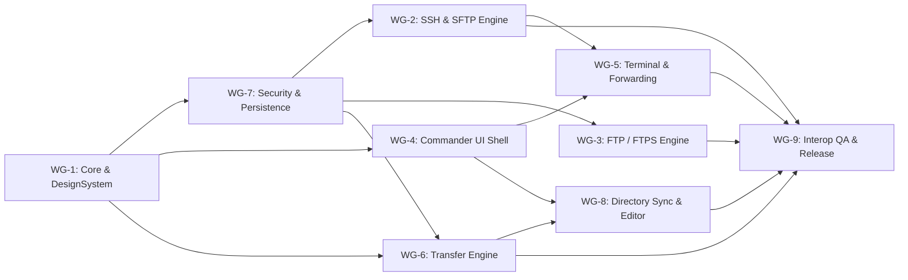

# SparkleSFTP Workground Breakdown (`WG-1` – `WG-9`)

This document maps every workground (domain work stream) to its SwiftPM module boundaries, concrete deliverables, dependencies, and verification gates.

## Workground Matrix

| ID       | Workground                                                                                                                        | SwiftPM Target(s)                                                                                                                                                                                                                  | Dependencies     | Verification Gate                                                                                                                                  | Status                    |
| :------- | :-------------------------------------------------------------------------------------------------------------------------------- | :--------------------------------------------------------------------------------------------------------------------------------------------------------------------------------------------------------------------------------- | :--------------- | :------------------------------------------------------------------------------------------------------------------------------------------------- | :------------------------ |
| **WG-1** | Project Foundation, SwiftPM Manifest, Multi-Themes (`76` SparkNotePad Palettes / `26` Families) & JSON i18n (`456` Keys)          | `Package.swift`, `SparkleCore`, `SparkleDesignSystem` (`Resources/Locales/`)                                                                                                                                                       | —                | `swift build`, `CoreTests` (`ThemeAndLocalizationTests`), `swiftlint --strict`                                                                     | ✅ Implemented & Enhanced |
| **WG-2** | Core SSH, Pipelined `64 KB` SFTP v3 Engine & SCP Compatibility Adapter                                                            | `SparkleNetworking` (`SSHClientService`, `SFTPPacketCodec`, `SFTPPipelinedTransfer`, `TransferSpeedMeter`, `SCPCompatibilityAdapter`, `ToolchainInspector`)                                                                        | WG-1, WG-7       | `NetworkingTests`, `ToolchainAndConflictTests` (`64 KB` SFTP pipelined 512 KB transfer, NIOSSH `0.15.1`)                                           | ✅ Implemented & Enhanced |
| **WG-3** | FTP & Explicit/Implicit FTPS Engine via `Clibcurl` (`-lcurl -lz`) + `SecTrust`                                                    | `Clibcurl` (`ClibcurlHelpers.c`, `ClibcurlSystemLibs.c`), `SparkleNetworking` (`FTPService`, `CurlClientHelper` 256KB/GCD, `ZlibCompressionCodec`)                                                                                 | WG-1, WG-7       | `NetworkingTests`, `ToolchainAndConflictTests` (`zlib`/`gzip` CWE-409 codec, `curl_version_info`)                                                  | ✅ Implemented & Enhanced |
| **WG-4** | SwiftUI + AppKit Dual-Pane Commander Shell, Multi-Window / Multi-Tab Workspace, Minimalist Notepad2 Editor & Commander Context UX | `SparkleFileManager`, `SparkleFeatures` (`WorkspaceTabBar`, `QuickConnectBar`, `FilePaneTableView`, `ActivityLogView`, `TransferQueueView`, `MainWindowView`, `Commander/`, `Connections/`, `Editor/`), `SparkleSFTP` (`src/App/`) | WG-1             | `FileManagerTests`, `EditorAndSyncTests`, `WindowTabsAndCommanderCommandsTests`, `WindowControlsAndShortcutsTests`, `swift build` macOS executable | ✅ Implemented & Enhanced |
| **WG-5** | Integrated SSH Terminal (`SwiftTerm`), Standalone iTerm2-Style Terminal & External Launcher                                       | `SparkleTerminal` (`TerminalViewRepresentable`, `StandaloneTerminalManager`, `ExternalTerminalLauncher`), `src/Features/Terminal`                                                                                                  | WG-2, WG-4       | `IntegrationTests` (100-session teardown), `TransferAndTerminalRegressionTests` (`CWE-78` SSH check, splits, find bar)                             | ✅ Implemented & Enhanced |
| **WG-6** | Actor Transfer Engine, EWMA Speedometer, POSIX Permissions & FileZilla Conflict Flow                                              | `SparkleTransferEngine` (`TransferQueue`, `TransferScheduler` 4/3), `src/Features/Transfers` (`ConflictResolutionSheet`, collapsible `TransferQueueView`)                                                                          | WG-1, WG-7       | `TransferEngineTests`, `FolderPermissionsTransferTests`, `ToolchainAndConflictTests` (FIFO `pendingConflictQueue`, upload resume)                  | ✅ Implemented & Enhanced |
| **WG-7** | Security Engine, Persistence & FileZilla XML & Commander INI Preview Importers                                                    | `SparkleSecurity` (`PathValidator` `CWE-22/59/78`), `SparklePersistence` (`ExternalSessionFileReader`), `src/Features/Connections`                                                                                                 | WG-1             | `SecurityTests`, `PersistenceTests`, `ExternalImportersTests`                                                                                      | ✅ Implemented & Enhanced |
| **WG-8** | Directory Synchronization (`TASK-108` Bidirectional), Remote Editor Auto-Upload & Custom JSON Locales                             | `SparkleSynchronization`, `src/Features/Synchronization`, `SparkleDesignSystem` (`456` EN/ID keys)                                                                                                                                 | WG-1, WG-6, WG-7 | `SynchronizationTests`, `BidirectionalSyncTests`, `EditorAndSyncTests`                                                                             | ✅ Implemented & Enhanced |
| **WG-9** | Docker Interop Fixtures, CI Hygiene, Trunk/SonarQube, Auto-Update & Sparkle/DMG Release Tooling                                   | `Tools/TestServers`, `Tools/Release`, `src/App/SparkleUpdaterService`, `sonar-project.properties`, `.github/workflows/`                                                                                                            | All              | `markdownlint-cli2`, `trunk check`, `actionlint`, `shellcheck`, `clang-format`, `cppcheck`, `swift test` (`121 tests in 33 suites`)                | ✅ Implemented & Enhanced |

---

## Dependency Graph

---

## Module Ownership & Non-Circular Layering Rules

1. **`SparkleCore`** owns pure `Sendable` domain models, `RemoteConnection`, `RemoteFileSystem`, `TransferEngineProtocol`, `AppError`, `RemotePath`, and `FeatureFlags`. It imports only `Foundation`.
2. **`SparkleSecurity`** depends only on `SparkleCore`, `Crypto`, `NIOSSH` (public key fingerprinting), and Apple system frameworks (`Security`, `LocalAuthentication`, `Network`, `OSLog`).
3. **`SparklePersistence`** depends only on `SparkleCore` and macOS system `SQLite3`.
4. **`SparkleNetworking`** depends on `SparkleCore`, `SparkleSecurity`, `Clibcurl`, `NIO`, `NIOSSH`, and `Crypto`. It never imports `SparkleTransferEngine` or `SparkleFeatures`.
5. **`SparkleTransferEngine`** depends only on `SparkleCore`, `SparkleSecurity`, and `Crypto`. It communicates with remote protocols via `RemoteFileSystem` closures (`onProgress: @escaping @Sendable (TransferProgress) -> Void`, preventing `CIRC-001`) and persists durable checkpoints via `TransferJournalProtocol` (`SparkleCore`) injected at composition time (`SparklePersistence` in `AppEnvironment`).
6. **`SparkleFileManager`** depends on `SparkleCore` and `SparkleSecurity`.
7. **`SparkleTerminal`** depends on `SparkleCore`, `SparkleNetworking`, `NIO`, `NIOPosix`, `NIOSSH`, and `SwiftTerm`.
8. **`SparkleSynchronization`** depends on `SparkleCore`, `SparkleSecurity`, and `SparkleTransferEngine`.
9. **`SparkleDesignSystem`** depends only on `SparkleCore`, `SwiftUI`, and `AppKit`.
10. **`SparkleFeatures`** (`src/Features/`) and **`SparkleSFTP`** (`src/App/`) compose packages at the top; no `src/Packages/*` target may import `SparkleFeatures` (`CIRC-002`).
