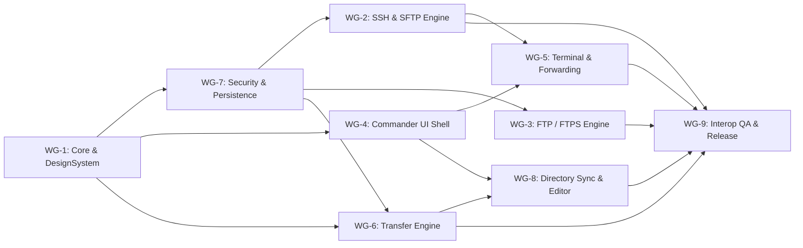

# SparkleSFTP Workground Breakdown (`WG-1` – `WG-9`)

This document maps every workground (domain work stream) to its SwiftPM module boundaries, concrete deliverables, dependencies, and verification gates.

## Workground Matrix

| ID | Workground | SwiftPM Target(s) | Dependencies | Verification Gate | Status |
| :--- | :--- | :--- | :--- | :--- | :--- |
| **WG-1** | Project Foundation, SwiftPM Manifest, Multi-Themes (`28` SparkNotePad Palettes) & JSON i18n (`263` Keys) | `Package.swift`, `SparkleCore`, `SparkleDesignSystem` (`Resources/Locales/`) | — | `swift build`, `CoreTests` (`ThemeAndLocalizationTests`), `swiftlint --strict` | ✅ Implemented & Enhanced |
| **WG-2** | Core SSH, SFTP v3 Binary Engine & SCP Compatibility Adapter | `SparkleNetworking` (`SSHClientService`, `SFTPPacketCodec`, `SFTPService`, `SCPCompatibilityAdapter`) | WG-1, WG-7 | `NetworkingTests` (SFTP wire round-trip, SCP escaping, NIOSSH `0.15.1` pin) | ✅ Implemented in MVP |
| **WG-3** | FTP & Explicit/Implicit FTPS Engine via `Clibcurl` + `SecTrust` | `Clibcurl`, `SparkleNetworking` (`FTPService`, `FTPListingParser`) | WG-1, WG-7 | `NetworkingTests` (FTP listing parser, FTPS TLS options, zero downgrade) | ✅ Implemented in MVP |
| **WG-4** | SwiftUI + AppKit Dual-Pane Commander Shell & Minimalist Notepad2 Internal Editor | `SparkleFileManager`, `SparkleFeatures` (`Commander/`, `Editor/`), `SparkleSFTP` (`App/`) | WG-1 | `FileManagerTests`, `EditorAndSyncTests`, `swift build` macOS executable | ✅ Implemented & Enhanced |
| **WG-5** | Integrated SSH Terminal (`SwiftTerm`) & Port Forwarding | `SparkleTerminal`, `SparkleFeatures/Terminal` | WG-2, WG-4 | `TerminalTests` / 100-session teardown cleanup test | ✅ Implemented in MVP |
| **WG-6** | Actor Transfer Engine & Durable SQLite Journal | `SparkleTransferEngine`, `SparkleFeatures/Transfers` | WG-1, WG-7 | `TransferEngineTests` (reentrancy, per-host cap, resume revalidation, SHA-256) | ✅ Implemented in MVP |
| **WG-7** | Security Engine, Persistence & FileZilla/WinSCP Preview Importers | `SparkleSecurity`, `SparklePersistence` (`WinSCPAndFileReader`), `SparkleFeatures/Connections` | WG-1 | `SecurityTests`, `PersistenceTests`, `ExternalImportersTests` | ✅ Implemented & Enhanced |
| **WG-8** | Directory Synchronization (`TASK-108` Bidirectional), Remote Editor Auto-Upload & Custom JSON Locales | `SparkleSynchronization`, `SparkleFeatures/Synchronization`, `SparkleDesignSystem` | WG-1, WG-6, WG-7 | `SynchronizationTests`, `BidirectionalSyncTests`, `EditorAndSyncTests` | ✅ Implemented & Enhanced |
| **WG-9** | Docker Interop Fixtures, CI Hygiene, Auto-Update Preferences & Sparkle/DMG Release Tooling | `Tools/TestServers`, `Tools/Release`, `App/SparkleUpdaterService`, `.github/workflows/` | All | `markdownlint-cli2`, `actionlint`, `shellcheck`, `swift test` (`57 tests in 15 suites`) | ✅ Implemented & Enhanced |

---

## Dependency Graph

---

## Module Ownership & Non-Circular Layering Rules

1. **`SparkleCore`** owns pure `Sendable` domain models, `RemoteConnection`, `RemoteFileSystem`, `TransferEngineProtocol`, `AppError`, `RemotePath`, and `FeatureFlags`. It imports only `Foundation`.
2. **`SparkleSecurity`** depends only on `SparkleCore`, `Crypto`, `NIOSSH` (public key fingerprinting), and Apple system frameworks (`Security`, `LocalAuthentication`, `Network`, `OSLog`).
3. **`SparklePersistence`** depends only on `SparkleCore` and macOS system `SQLite3`.
4. **`SparkleNetworking`** depends on `SparkleCore`, `SparkleSecurity`, `Clibcurl`, `NIO`, `NIOSSH`, and `Crypto`. It never imports `SparkleTransferEngine` or `SparkleFeatures`.
5. **`SparkleTransferEngine`** depends only on `SparkleCore`, `SparkleSecurity`, and `Crypto`. It communicates with remote protocols via `RemoteFileSystem` closures (`onProgress: @escaping @Sendable (TransferProgress) -> Void`, preventing `CIRC-001`) and persists durable checkpoints via `TransferJournalProtocol` (`SparkleCore`) injected at composition time (`SparklePersistence` in `AppEnvironment`).
6. **`SparkleFileManager`** depends on `SparkleCore` and `SparkleSecurity`.
7. **`SparkleTerminal`** depends on `SparkleCore`, `SparkleNetworking`, `NIO`, `NIOPosix`, `NIOSSH`, and `SwiftTerm`.
8. **`SparkleSynchronization`** depends on `SparkleCore`, `SparkleSecurity`, and `SparkleTransferEngine`.
9. **`SparkleDesignSystem`** depends only on `SparkleCore`, `SwiftUI`, and `AppKit`.
10. **`SparkleFeatures`** (`Features/`) and **`SparkleSFTP`** (`App/`) compose packages at the top; no `Packages/*` target may import `SparkleFeatures` (`CIRC-002`).
